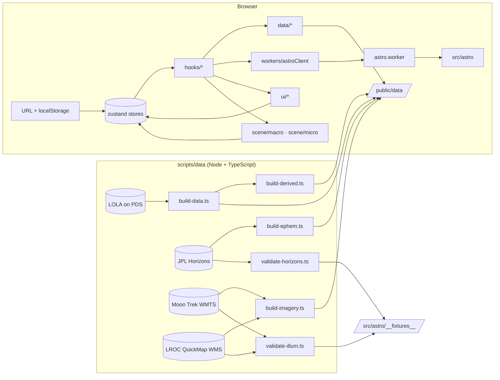

# Killa Landing architecture

This document explains how the application is organised, why the main decisions were taken, how the algorithms work and how to extend it. To install and run the project see [README.md](README.md); to use it, the [user guide](docs/GUIDE.md) (Spanish).

The repository, the site address, the npm package name (`lumen-3d`), the browser storage keys (`lumen3d.*`, `lumen-theme`) and the export file names (`lumen3d_*`) use the name LUMEN.

## 1. Overview

Killa Landing is a static single-page application with no backend. Every scenario is evaluated in the browser. The heavy inputs (LOLA topography, the ephemeris table, orbital imagery) are pre-processed once by Node scripts and published as static files under `public/data/`.



Stack: Vite 8, React 19, TypeScript (strict), zustand, three.js with `@react-three/fiber` and `@react-three/drei`, astronomy-engine; Vitest with jsdom and Testing Library for unit and component tests, Playwright for end-to-end tests.

## 2. Design principles

**A static site.** There is no server to keep running and no service the app depends on at run time. If a published product is missing the app degrades instead of failing: without the ephemeris table it uses the analytic model, without imagery it keeps plain materials, without a site's data it uses an ideal spherical horizon.

**A pure computation core.** `src/astro/` has no React, no DOM and no worker APIs. It is plain functions on plain data and typed arrays, so the same files run in the browser, in the web worker, in Vitest and in plain Node (the data scripts). Imports inside `src/astro/` carry explicit `.ts` extensions for that reason.

**TypeScript everywhere, including the data pipeline.** The LOLA products are raw Int16 rasters with a text label, so no GIS library is needed. The offline scripts import the same horizon, ephemeris and illumination code the app uses, which guarantees that a published horizon mask and one computed in the browser agree.

**Numbers come from analysis, not from the GPU.** Power and link figures are the ephemeris compared with the horizon mask. three.js shadows only visualise the result. Results are therefore deterministic, testable in jsdom (which has no WebGL) and independent of shadow-map resolution. The intensity of the Sun light in the surface view is the analytically computed visible fraction of the disc, so a ridge 100 km away dims the whole tile even though it is outside the 3D terrain.

**Heavy work in a web worker.** Horizon ray-marching, time series, sweeps, the ellipse analysis, routes, traverses and the planner run off the main thread through one message protocol. Where `Worker` does not exist (tests) the same handler runs in-thread, so both paths behave identically.

**three.js only.** The domain is a small region (the cap south of 80°S and local tiles), not a streaming globe. The selenographic frame and the two stereographic projections are a handful of pure functions ([src/astro/frames.ts](src/astro/frames.ts)). The orbit and surface views are two React Three Fiber scenes sharing the stores.

**Procedural detail, kept out of the numbers.** The 20 m terrain is too coarse to look like ground from 2 m. Grain, small craters, rocks, wheel tracks and dust are generated in the browser and are decoration only: lighting, shadows and every metric still come from the DEM and the horizon mask.

**The audience mode changes what is shown, never what is computed** ([src/ui/audience.ts](src/ui/audience.ts)).

## 3. Module map

### `src/astro/` — computation core

| File                                  | Responsibility                                                                                                                                     |
| ------------------------------------- | -------------------------------------------------------------------------------------------------------------------------------------------------- |
| `constants.ts`                        | Physical constants: Moon radius (1 737 400 m), observer height (2 m), synodic month, unit conversions                                              |
| `frames.ts`                           | Selenographic vectors, ENU basis, azimuth/elevation, great-circle destination and distance, south polar and oblique stereographic projections      |
| `ephemeris.ts`, `ephemTable.ts`       | Sun and Earth in the Moon body-fixed frame: DE441 table with cubic interpolation, IAU-model fallback, topocentric sky state, sampled series        |
| `dem.ts`                              | Raster georeferencing (`DemGrid`, `DemMeta`, `DemProjection`), bilinear sampling, DEM stacks, crop and downsample                                  |
| `horizon.ts`, `horizonFromDem.ts`     | Horizon masks, interpolation, visible fraction of a disc; ray-marching of the mask over a DEM stack                                                |
| `series.ts`                           | One site evaluated over an ephemeris series (typed arrays): Sun and Earth azimuth, elevation and visible fraction                                  |
| `windows.ts`                          | On/off windows with interpolated edges, gaps, state at an instant                                                                                  |
| `metrics.ts`                          | Mission-window metrics, the score, the landing-date sweep                                                                                          |
| `scenario.ts`                         | `computeScenario` and `computeDateSweep` (the worker entry points), the shared ephemeris cache, the sampling-step rule                             |
| `instant.ts`                          | Exact state at one instant (panels and scene)                                                                                                      |
| `seasons.ts`, `dateShift.ts`          | Monthly aggregation for the Seasons chart; scores at ±1, ±3, ±7 days                                                                               |
| `slope.ts`                            | Horn slope with the stereographic scale correction, statistics in a circle, safe/caution thresholds                                                |
| `dispersion.ts`                       | Landing ellipse: weighted sample points, mission and slope at each, expected values and probabilities                                              |
| `optimize.ts`                         | "Suggest a better point": safe ground in the ellipse, preselection by height, full mission at each candidate                                       |
| `energy.ts`                           | Array power by panel kind, the battery step shared by lander and rover, the battery simulation                                                     |
| `thermal.ts`                          | Radiative temperature estimate, shadow cooling, PSR floor; Earth refraction for the "If this were Earth" comparison                                |
| `dsn.ts`                              | Moon elevation from Goldstone, Madrid and Canberra, the per-series DSN mask, free-space path loss                                                  |
| `hardware.ts`                         | Hardware limits, the viable / marginal / ruled-out classification, URL encoding of the limits                                                      |
| `illumination.ts`                     | Yearly illumination map of a tile (one byte per cell), PSR lookup, the offline builder                                                             |
| `iceAccess.ts`                        | Dijkstra route to permanently shadowed ground, snapping of an ice target, science score, combined score                                            |
| `traverse.ts`                         | Rover round trip: route resampling, speed and traction, sky along the route, the battery simulation with sampling, return and deadline             |
| `planner.ts`, `plannerTypes.ts`       | Mission planner engine and its data contract (`PlanProblem`, `PlanCandidate`, `PlanPick`, `PlanDay`, `PlanResult`, `PlanViolation`)                |
| `plannerFixture.ts`                   | Synthetic terrain used by the planner tests                                                                                                        |
| `descent.ts`                          | Kinematic descent profile, waypoints that clear the terrain, camera attitude, reticle ray-marching                                                 |
| `descentPhysics.ts`, `descentPlan.ts` | Powered descent: point mass, rocket equation, ZEM/ZEV guidance, terminal law, hazard retargeting; choice of the start height and the divert advice |
| `terrainMesh.ts`                      | Terrain and horizon-ring geometry in the local scene frame; `sceneToLatLon` for click-to-relocate                                                  |
| `imagery.ts`                          | Types and UV helpers for the published image mosaics                                                                                               |
| `__fixtures__/`                       | Reference values from JPL Horizons, LROC QuickMap and Moon Trek used by the tests offline                                                          |

### `src/workers/`

| File              | Responsibility                                                                    |
| ----------------- | --------------------------------------------------------------------------------- |
| `protocol.ts`     | Request and response types, `DemRef` / `IllumRef`, planner job contract           |
| `handlers.ts`     | `handleRequest`: one `switch` over the job kinds; holds the plans in progress     |
| `astro.worker.ts` | The worker shell: receives an envelope, calls the handler, posts the reply        |
| `astroClient.ts`  | Promise API (`runScenario`, `runTraverse`, `runPlanPrepare`…); in-thread fallback |

### `src/data/`

| File             | Responsibility                                                                                                           |
| ---------------- | ------------------------------------------------------------------------------------------------------------------------ |
| `catalog.ts`     | Site index, site detail (mask, tile, illumination), custom sites, `polarTiles` / `tileFor`, `asset()` for base-path URLs |
| `loadDem.ts`     | Fetch and cache Int16 DEMs and Uint8 illumination maps                                                                   |
| `loadEphem.ts`   | Fetch the DE441 table and install it for the current thread                                                              |
| `loadImagery.ts` | Imagery manifest; assembles mosaic tiles into a canvas texture                                                           |

### `src/config/`

| File                | Responsibility                                                                       |
| ------------------- | ------------------------------------------------------------------------------------ |
| `sites.ts`          | The 22 curated site seeds (also imported by the Node scripts)                        |
| `presets.ts`        | Quick scenarios for Compare                                                          |
| `energyProfiles.ts` | Illustrative power profiles (lander, rover, CSA-inspired utility rover, fixed panel) |
| `landers.ts`        | Lander presets for the descent                                                       |
| `iceTargets.ts`     | Ice targets the planner suggests; which tile covers a point                          |
| `challenges.ts`     | The five challenges of Challenges mode: setup, goals, scoring                        |
| `externalLinks.ts`  | Deep links to LROC QuickMap and Moon Trek and the pre-filled JPL Horizons query      |

### `src/store/`, `src/hooks/`

| File                                                           | Responsibility                                                                                        |
| -------------------------------------------------------------- | ----------------------------------------------------------------------------------------------------- |
| `store/useMissionStore.ts`                                     | Scenarios, shared mission time, view, playback, layers, landing ellipse, approach azimuth             |
| `store/useUiStore.ts`                                          | Interface state: panels, tour, help, audience, flow stage, assistant, challenges                      |
| `store/useViewStore.ts`                                        | Surface camera direction and orbit framing                                                            |
| `store/useDescentStore.ts`                                     | Descent playback, model and lander                                                                    |
| `store/useRoverStore.ts`                                       | Rover playback, rover choice, samples and hours per sample                                            |
| `store/usePlannerStore.ts`                                     | Planner inputs, run status, progress, result, selection                                               |
| `hooks/useScenario.ts`                                         | Site detail + worker series for a scenario; battery, instant state, thermal                           |
| `hooks/useAsync.ts`                                            | Keyed async state that keeps the previous value while the next one loads                              |
| `hooks/useTerrain.ts`                                          | DEM stack, slope statistics, landing ellipse, dispersion                                              |
| `hooks/useScience.ts`, `useRover.ts`                           | Ice access, better-point search, illumination grid, rover traverse                                    |
| `hooks/useCatalogViability.ts`, `useTopSites.ts`               | The whole catalogue evaluated for the hardware filter, the Top 3 and the assistant                    |
| `hooks/usePlanner.ts`, `planActions.ts`                        | Builds the plan problem, runs it in batches, cancels; opens a pick in Orbit or sends picks to Compare |
| `hooks/useUrlSync.ts`                                          | State ↔ URL                                                                                           |
| `hooks/scenarioExport.ts`                                      | Evaluates a scenario outside React for export                                                         |
| `hooks/useChallengeState.ts`                                   | Snapshot the challenge goals are checked against                                                      |
| `hooks/usePlayback.ts`, `usePanelShortcuts.ts`, `useCanvas.ts` | Mission clock; keys 1/2/3; canvas sizing                                                              |

### `src/scene/`

| File                                                                                                            | Responsibility                                                                                       |
| --------------------------------------------------------------------------------------------------------------- | ---------------------------------------------------------------------------------------------------- |
| `Experience.tsx`                                                                                                | Root: orbital context, or the active site's surface (lander's eye or descent)                        |
| `SunGlare.tsx`, `Starfield.tsx`, `canvasTexture.ts`, `sceneColors.ts`                                           | Shared pieces: Sun disc and glare, stars, procedural canvas textures, colours of in-scene marks      |
| `macro/MacroScene.tsx`, `macroGeometry.ts`, `Earth.tsx`, `Sun.tsx`                                              | Orbit view: globe, relief cap, site markers, fly-to; the Earth shader (also used in the surface sky) |
| `micro/MicroScene.tsx`, `surface.ts`, `relocate.ts`                                                             | Surface view: terrain, layers, sky bodies, lighting, shadows, click-to-relocate                      |
| `micro/LookControls.tsx`, `SkyStars.tsx`, `SurfaceOverlays.tsx`                                                 | First-person camera, star field, landing ellipse and markers                                         |
| `micro/regolith.ts`, `slopeColors.ts`, `illumColors.ts`                                                         | Procedural regolith material; slope and illumination layers                                          |
| `micro/DescentControls.tsx`, `DescentReticle.tsx`, `DescentDust.tsx`, `dust.ts`, `descentTelemetry.ts`          | Descent camera, reticle, engine dust, per-frame telemetry                                            |
| `micro/Lander.tsx`, `LanderRamp.tsx`, `CraftParts.tsx`, `craftMaterials.ts`, `egress.ts`                        | Procedural lander, rover pallet and ramps, materials                                                 |
| `micro/Rover.tsx`, `RoverModel.tsx`, `roverGeometry.ts`, `roverRig.ts`, `roverPlayback.ts`, `roverTelemetry.ts` | Rover controller, model, merged geometry, suspension and steering, playback pose, telemetry          |
| `micro/RoverTracks.tsx`, `trackGeometry.ts`, `trackMaterial.ts`                                                 | Wheel tracks and wheel dust                                                                          |
| `micro/NearGround.tsx`, `nearGroundField.ts`                                                                    | Decorative fine-relief patch around the rover or lander                                              |

### `src/ui/`

| Files                                                                                                                                                                                         | Responsibility                                                                          |
| --------------------------------------------------------------------------------------------------------------------------------------------------------------------------------------------- | --------------------------------------------------------------------------------------- |
| `Splash.tsx`, `Welcome.tsx`, `TopBar.tsx`, `StepBar.tsx`, `MoreMenu.tsx`, `steps.ts`, `audience.ts`                                                                                           | Start screens, top bar, step bar, audience visibility table                             |
| `CollapsiblePanel.tsx`, `SitePicker.tsx`, `TopSites.tsx`, `MoonLocator.tsx`, `locator.ts`                                                                                                     | Panels and the site panel                                                               |
| `MetricsPanel.tsx`, `EnergyCard.tsx`, `ThermalCard.tsx`, `IceCard.tsx`, `LandingPanel.tsx`, `DateShift.tsx`                                                                                   | Site status and its cards                                                               |
| `BottomPanel.tsx`, `TimeControls.tsx`, `Timeline.tsx`, `HorizonChart.tsx`, `DateSweep.tsx`, `SeasonChart.tsx`, `PolarMap.tsx`                                                                 | Time controls and the five chart tabs (canvas)                                          |
| `CompareView.tsx`, `ScenarioEditor.tsx`, `PresetBar.tsx`, `HardwareFilter.tsx`, `ExportMenu.tsx`, `export.ts`                                                                                 | Decide step, hardware filter, export                                                    |
| `ViewHud.tsx`, `CompassTape.tsx`, `DescentHud.tsx`, `RoverHud.tsx`, `roverView.ts`                                                                                                            | HUDs of each view                                                                       |
| `Planner.tsx`, `PlannerForm.tsx`, `PlannerCalendar.tsx`, `PlannerTable.tsx`, `PlannerMap.tsx`, `PlannerTop.tsx`, `plannerView.ts`, `plannerInputs.ts`, `plannerFixes.ts`, `plannerFixture.ts` | Planner screen, its pure helpers (sorting, CSV, colours), fix suggestions, test fixture |
| `Challenges.tsx`, `ExplainPanel.tsx`, `Tour.tsx`, `tourSteps.ts`, `HelpButton.tsx`                                                                                                            | Challenges mode, "Why?" cards and glossary, guided tour, help popovers                  |
| `AssistantFab.tsx`, `Killa.tsx`, `Loader.tsx`                                                                                                                                                 | Floating assistant, the mascot, loading indicator                                       |
| `kit/` (`Notice`, `Empty`, `Busy`, `Stat`), `LevelTag.tsx`, `levels.ts`, `bands.ts`, `icons.tsx`, `format.ts`                                                                                 | Shared building blocks: notices, empty and busy states, levels, icons, formatters       |
| `theme.ts`, `chartTheme.ts`                                                                                                                                                                   | Light/dark theme store; palette for canvas charts read from the tokens                  |

### Other folders

| Path                 | Responsibility                                                                                                  |
| -------------------- | --------------------------------------------------------------------------------------------------------------- |
| `src/assistant/`     | `AssistantClient` contract, the local keyword-based client, an optional HTTP client (`VITE_ASSISTANT_URL`)      |
| `src/i18n/`          | `es.ts` (source), `en.ts`, `qu.ts` + `qu/core.ts`, `qu/scene.ts`, `qu/flow.ts` (partial Quechua), `sites.ts`    |
| `src/styles/`        | `tokens.css` and the stylesheets (`index.css`, `flow.css`, `planner.css`, `kit.css`, `killa.css`, `charts.css`) |
| `scripts/data/`      | Data pipeline and accuracy checks; `horizons.ts` (API client), `lola-global.ts`, `png.ts` (PNG reader)          |
| `scripts/vitest.mjs` | Starts Vitest from the canonical path (Windows drive-letter casing)                                             |
| `e2e/smoke.spec.ts`  | Playwright smoke tests                                                                                          |

## 4. Data flow

1. `App` shows the splash and loads `public/data/sites/index.json`, merging it with the seeds of [src/config/sites.ts](src/config/sites.ts). When the catalogue is ready, `useUrlSync` applies the URL; stores have already restored their persisted values from `localStorage` at creation.
2. `useScenarioData(scenario)` asks for the site detail (mask and tile metadata, cached per id) and then runs the `scenario` job in the worker, which returns the series of the mission window and its metrics.
3. `useInstant` computes the exact state at `start + offsetH`. Every scenario shares `offsetH` (T+), so Compare is always at the same mission time.
4. The scene reads the same instant state: Sun and Earth positions, light intensity, earthshine.
5. `usePlayback` advances `offsetH` while playing.
6. `useBattery` and `useThermal` integrate over the series on the main thread (cheap).
7. `useDispersion`, `useIceAccess`, `useOptimize` and `useRoverTraverse` launch their worker jobs on demand and cache the results by key.
8. A click on the terrain in relocate mode converts the 3D point to latitude and longitude with `sceneToLatLon` and creates a custom site; inside a curated tile its horizon is computed from the 20 m tile plus the 480 m DEM.
9. Any store change rewrites the URL (`history.replaceState`) once the user is exploring a site.

### Worker jobs

Requests are `{ id, request }` envelopes; replies echo the id with `ok` and a result or an error message. The worker loads DEMs and illumination maps itself from the URLs in `DemRef` / `IllumRef`, and installs the ephemeris table once per thread before handling any request. The job kinds of [src/workers/protocol.ts](src/workers/protocol.ts):

| Kind            | Input                                                                  | Result                                                         |
| --------------- | ---------------------------------------------------------------------- | -------------------------------------------------------------- |
| `scenario`      | Site, mask, start, mission days, link settings                         | `ScenarioResult`: series and metrics                           |
| `sweep`         | Site, mask, range, mission days, link settings                         | `DateCandidate[]`: one candidate landing date per day          |
| `customHorizon` | Latitude, longitude, DEM stack, azimuth step                           | Horizon mask and terrain height                                |
| `dispersion`    | Ellipse definition, mission, DEM stack                                 | `DispersionResult`                                             |
| `optimize`      | Ellipse, mission, DEM stack, optional illumination                     | `OptimizeResult`: best safe points                             |
| `iceAccess`     | Point, radius, rover slope, optional target; tile and illumination map | `IceAccess`: route to the ice                                  |
| `traverse`      | Landing point, route, start, rover, sampling, deadline; DEM stack      | `TraverseResult`: the simulated round trip                     |
| `planPrepare`   | `PlanProblem`, DEM stack, illumination map                             | `planId`, the ice cell and the candidates (kept in the worker) |
| `planDays`      | `planId`, first day, count                                             | `PlanDay[]` for that batch                                     |
| `planFinish`    | `planId`, indices of the shortlisted days                              | Refined `PlanPick` per day                                     |

The worker keeps the last two plans (`PLAN_KEEP`); an older `planId` is rejected with `plan-expired`.

## 5. Caching

| Cache                                     | Where                                | Key and size                                                                 |
| ----------------------------------------- | ------------------------------------ | ---------------------------------------------------------------------------- |
| Ephemeris series                          | `astro/scenario.ts`                  | start, step, count; 16 entries                                               |
| DSN visibility mask                       | `astro/dsn.ts`                       | time grid; 8 entries (independent of the site)                               |
| DEMs and illumination maps                | `data/loadDem.ts`                    | binary URL; kept for the session, per thread                                 |
| Site detail                               | `data/catalog.ts`                    | site id (a failed load is forgotten)                                         |
| Dispersion                                | `hooks/useTerrain.ts`                | 24 entries                                                                   |
| Ice access / better-point / traverse      | `hooks/useScience.ts`                | 32 / 16 / 16 entries                                                         |
| Catalogue evaluation                      | `hooks/useCatalogViability.ts`       | date, mission, margin; 8 entries, shared by Top 3, assistant, editor, filter |
| Planner: prepared traverses and summaries | `astro/planner.ts` (`PlanInternals`) | per plan, inside the worker                                                  |
| Procedural textures                       | `scene/canvasTexture.ts` and users   | built once per session                                                       |

`useAsync` keeps the previous value on screen until the new one arrives, so scrubbing a date never flashes empty panels. The body of a collapsed panel is unmounted, so its charts and their sweeps are not requested.

## 6. Coordinate systems and projections

- **Body-fixed frame**: +Z north pole, +X towards longitude 0 (the mean sub-Earth point), +Y towards 90°E. Latitudes and longitudes are selenographic (planetocentric), east positive.
- **Local ENU**: east, north, up at a surface point; azimuth is clockwise from north, elevation is measured from the ideal horizon plane.
- **Heights**: metres above the 1 737.4 km reference sphere. Rasters store LOLA DNs: `height_m = DN × heightScale` (0.5).
- **South polar stereographic** (`southPolarToMap`): the projection of the LOLA polar products; longitude 0 points up the image (towards the Earth), 90°E to the right. Used by the 20 m tiles, the 480 m and 960 m DEMs, the illumination maps and the polar imagery.
- **Local oblique stereographic** (`stereoToMap`): centred on a site, true scale there. Used by the 60 m tiles cut from the LOLA global cylindrical products. A raster declares it with `DemMeta.projection = { kind: 'stereo', lat0, lon0 }`; an absent `projection` means south polar. With `lat0 = −90, lon0 = 0` the oblique formula is exactly the polar one.
- **Raster georeferencing**: pixel `(c, r)` has its centre at `x = originX + c·scaleM`, `y = originY − r·scaleM`. A DEM stack is a list of grids, finest first; `sampleDemStack` uses the first that covers the point. Polar rasters answer only for the southern hemisphere (the polar formula would fold the north onto it).
- **Slope and projection**: stereographic maps are conformal, so map gradients are multiplied by the point scale factor `k = 1 + (ρ / 2R)²` to obtain ground gradients (`slope.ts`).
- **Surface scene frame**: metres from the site, x = east, y = up, z = −north.
- **Orbit scene frame**: 1 unit = 1 lunar radius; body-fixed `(x, y, z)` maps to scene `(x, z, −y)` so that north is +Y.

## 7. Time and ephemeris

All times are UTC milliseconds. The ephemeris gives the Sun and Earth centres relative to the Moon centre in the body-fixed frame, in kilometres.

- **DE441 table.** `public/data/ephem/de441.bin` holds Float32 values, six per sample (Sun xyz, Earth xyz), every 2 hours from 2025-12-31 for 21 937 samples (to 2031-01-02); `de441.json` holds the time grid. `ephemTable.ts` interpolates with a 4-point Lagrange cubic; `tableCovers` requires one sample on each side of the bracketing pair.
- **Fallback.** Outside the table, or if it is not installed, `iauEphemeris` uses astronomy-engine positions rotated with the IAU/WGCCRE lunar rotation model (pole right ascension and declination plus the prime meridian angle), a close approximation of the Mean Earth frame in which LOLA is published. `ephemerisSource(timeMs)` reports which model applies and feeds the indicator in the time controls.
- **Installation.** `installEphemerisTable` fetches the table once per thread (main thread and worker). The Node scripts read it from disk with `readPublishedTable`.
- **Topocentric state.** `skyFromVectors` subtracts the observer position (site plus terrain height plus 2 m), converts to azimuth and elevation and derives the apparent angular radius of each body, the Sun–Earth separation and the Earth's phase.
- **Sampling.** A scenario series uses a 10-minute step up to 60 mission days, 30 minutes up to 180 and 60 minutes beyond (`scenarioStepMinutes`). Sweeps and the planner use an hourly step. Window edges are refined by linear interpolation between samples.
- **Accuracy.** Measured against JPL Horizons at 528 positions outside the 2-hour grid: at most 1.5″ with the table and 24″ with the IAU model (see the README). The unit tests enforce 0.001° and 0.02° respectively.

## 8. Horizon mask

A horizon mask stores, per azimuth bin, the elevation angle of the highest terrain seen from the observer ([src/astro/horizonFromDem.ts](src/astro/horizonFromDem.ts)).

For each azimuth the algorithm walks the great circle from the site out to 300 km. The step grows with distance: `step = max(minStep, d × growth)`, where `minStep` is 0.75 of the finest grid's pixel. At each point it samples the DEM stack and computes the elevation angle with exact spherical geometry, so the lunar curvature is included:

```
θ = d / R;  el = atan2((R + h)·cos θ − (R + eye), (R + h)·sin θ)
```

The running maximum starts at −90°, because from a peak the true horizon lies below 0° (about −2.7° from 2 km up); this dip is what gives the polar ridges their nearly continuous light. The march stops where the stack has no data; if nothing was sampled the bin takes the dip of the ideal spherical horizon. The distance to the obstruction is kept per bin and shown in the UI.

Resolution depends on the use:

| Use                                                      | Azimuth step | Growth |
| -------------------------------------------------------- | ------------ | ------ |
| Default of `computeHorizonMask`                          | 0.5°         | 0.004  |
| Custom point (worker), planner refinement                | 1° or 0.5°   | 0.006  |
| Landing ellipse, better-point search, planner candidates | 1°           | 0.01   |
| Rover traverse anchors                                   | 2°           | 0.02   |
| Illumination map cells (offline)                         | 3°           | 0.02   |

The published masks of the curated sites have 720 bins (0.5°). `maskAt` interpolates linearly with wrap-around, and `discVisibleFraction` gives the fraction of a disc above a locally straight horizon. The Sun is judged against the bare mask; for the Earth the link margin is added to the mask, and with `requireDsn` the Earth fraction is zeroed while no DSN complex sees the Moon.

## 9. Metrics, score and verdict

`computeMetrics` works on the series of the mission window. A body is "up" when its visible fraction is at least 0.5 (`VISIBLE_THRESHOLD`).

- `energyPct`: the mean visible fraction of the solar disc — a proxy for the energy of a Sun-tracking vertical panel relative to permanent full Sun.
- `sunlitPct`, `dtePct`, `bothPct`: share of samples with the Sun up, the Earth up, both.
- `longestDarkH`, `longestLightH`, `longestNoDteH`: from the windows and their complement.

**Score** (0–100):

```
survival = 1 − min(longestDarkH / 120, 1)
score    = round(0.5 · energyPct + 0.35 · dtePct + 15 · survival)
```

That is 50 % energy, 35 % Earth link and 15 % survival, which penalises nights of up to five days linearly.

**Science score** (`iceAccess.ts`): 100 when the rover route to the ice is at most 500 m, falling linearly to 0 at the 2 km search radius, multiplied by `1 − 0.5 · min(1, maxSlope / roverLimit)`. **Combined score** = `round((1 − w) · engineering + w · science)` with the science weight `w` in 0..1.

**Verdict** (`hardware.ts`): a limit that is exceeded makes the site _bad_; a limit met with less than 20 % headroom (`MARGIN`) makes it _warn_; otherwise _good_. The limits are the landing slope (p90 within 500 m), the longest night and the minimum DTE share. Defaults: 15°, 120 h, 30 %, and a rover slope limit of 20°.

`sweepLandingDates` slides the mission window across a long hourly series, one candidate per day, using prefix sums for the averages and a backward pass for the continuous light from touchdown.

## 10. Planner

Contract in [src/astro/plannerTypes.ts](src/astro/plannerTypes.ts), engine in [src/astro/planner.ts](src/astro/planner.ts), orchestration in [src/hooks/usePlanner.ts](src/hooks/usePlanner.ts). Given an ice target and a range of landing dates it finds, for every day, the best landing point around the target from which the rover completes its round trip, and ranks the days. [docs/MISSION.md](docs/MISSION.md) (Spanish) states the wider problem; the app implements its surface part.

The key observation is that the horizon of a landing point and its route to the ice do not depend on the date, so they are computed once per candidate.

1. **Ice cell.** The target is snapped to the nearest permanently shadowed cell of the illumination map within 1.5 km; none means the error `no-ice-near-target`.
2. **Safe lit ground.** A 40 m grid within the search radius (1, 2 or 3 km) is filtered to points with slope < 10° and no 3 × 3 neighbour ≥ 15°, and whose illumination cell is neither permanent shadow nor missing. No such point means `no-safe-ground`.
3. **Preselection.** At most 60 candidates, at least 80 m apart: a third taken by yearly light, a third by height, the rest by nearness to the ice, so they do not all sit on one crest.
4. **Per-candidate precompute.** The route first (cheaper, and many points have none): `computeIceAccess` towards the target. Then a 1° horizon, the p90 slope within 500 m and the science score.
5. **Range tables.** One hourly series per candidate covering the range plus a look-ahead of `max(mission days, required light days, 30)`, swept once per day.
6. **Per-day selection.** The cheap constraints are applied in order — Sun at touchdown, continuous light, then slope, night and DTE through `classifySite` — and the survivors are ranked by combined score (ties: shorter route). The rover is then simulated for the best survivors until one passes, at most three tries per day (`PLAN_ROVER_TRIES`); after a failure the next try must have a shorter route than every one that failed. The rover passes when it reaches the ice, takes every sample, returns, returns before the mission ends and never drops below the minimum battery (`roverViolation`).
7. **Ranking.** Days with a solution are ordered by score, then by the time to spare at the lander, then by the lowest battery; the best five form the shortlist (`PLAN_TOP`).
8. **Refinement.** The picks of the shortlist are recomputed the way the views do when a pick is opened: a 0.5° horizon and `computeScenario` at its normal step. A pick that the finer figures push over a limit is kept and flagged as tight.

A day without a solution reports how many candidates each constraint rejected and its main violation (the rover stages when any candidate got that far).

The run is split across the three planner jobs: `planPrepare` (steps 1–5), `planDays` in batches of three days so that progress can be shown and the run cancelled between batches, and `planFinish` (step 8). A newer run or a cancel invalidates the older one through a run token. Results are never persisted; only the inputs are.

## 11. Rover traverse

[src/astro/traverse.ts](src/astro/traverse.ts) models the round trip: out to the ice, the sampling, and back along the same route.

**Plan** (`planTraverse`). The route polyline from `computeIceAccess` is resampled every 10 m by great-circle interpolation in 3D (so it also works across the pole). Each point gets its height and Horn slope from the DEM stack, a PSR flag from the illumination map, a speed and a cumulative time. With `roundTrip` the outbound points are appended in reverse order with the grade sign flipped and the heading recomputed; `turnIndex` is the last outbound point and `outLengthM` the one-way length.

**Kinematics and power**

```
speed    = commanded · clamp(1 − slope / roverLimit, 0.2, 1)
traction = max(0, m · g · (sin grade + Crr · cos grade) · speed / η)
```

with g = 1.62 m/s², rolling resistance 0.15 and drivetrain efficiency 0.6. Downhill the brakes take the energy; nothing is fed back.

**Sky along the route** (`traverseSky`). A full horizon per 10 m point would be too slow, so masks are ray-marched lazily at anchors about every 200 m of the outbound leg, and the horizon at the rover is the distance-weighted blend of its two nearest anchors. The directions of the Sun and the Earth are exact for the rover's own position and time. Inside a PSR cell the Sun is forced to zero: the illumination map is the authority on permanent shadow.

**Simulation** (`simulateTraverse`). The battery uses `stepBattery`, the same explicit-Euler step as the lander. Each sample carries a phase:

| Phase    | Meaning                                              | Load                   |
| -------- | ---------------------------------------------------- | ---------------------- |
| `out`    | Driving to the ice                                   | operating + traction   |
| `wait`   | Stopped in hibernation to recharge (10-minute steps) | survival               |
| `sample` | Working on a sample at the ice                       | operating + instrument |
| `back`   | Driving back to the lander                           | operating + traction   |
| `done`   | Last sample of a trip that ended as planned          | —                      |

- **Hibernation.** Below the profile's threshold the rover stops and waits until it is 10 points above it. It gives up after 14 days, or at once if it stopped on permanently shadowed ground.
- **Sampling failure rule.** If the charge falls below the threshold while sampling on permanently shadowed ground, the sampling ends there with the samples completed so far: there is no Sun to wait for.
- **Deadline.** The return is judged against `deadlineMs` (the end of the surface mission).
- **Failure reasons**: `no-route`, `battery` (before the ice or on the way back), `samples`, `late`.
- **Success**: reaches the ice, `samplesDone === samples`, returns, on time.

`prepareTraverse` builds the date-independent part (plan and sky) so that the planner can simulate the same prepared traverse for many dates and workloads; `computeTraverse` is the one-shot form the `traverse` job runs. `sampleTraverse` interpolates the rover state at any instant for the animation.

## 12. Descent guidance

[src/astro/descentPhysics.ts](src/astro/descentPhysics.ts) flies the final approach as a 3-DOF point mass in the site's scene frame, with constant gravity, thrust clamped between the minimum throttle and full thrust, and mass flow `ṁ = |T| / (Isp · g0)`. Integration is semi-implicit Euler with a 0.05 s step.

1. **Approach** (labelled _braking_ above 1 km, then _approach_). The ZEM/ZEV feedback law towards a gate 30 m above the target with velocity (0, −1.5 m/s, 0):

   ```
   ZEM = r_f − (r + v·tgo + ½·g·tgo²)
   ZEV = v_f − (v + g·tgo)
   a   = 6·ZEM / tgo² − 2·ZEV / tgo
   ```

   The time-to-go starts at twice distance over speed, decreases with time and is held at a floor of 3 s, where the law behaves as a damped PD around the gate until the handover tolerance is met. Thrust never points below the horizon.

2. **Hazard gate.** The first time the height above the target drops below 500 m, the target is checked; if it is not safe ground it is replaced by the nearest safe point of a ±300 m grid with 100 m spacing, and the time-to-go is extended in proportion to the divert.
3. **Terminal.** A vertical descent at a commanded rate (1.5 m/s, then 1 m/s in the last 5 m) with a PD law nulling the horizontal error and the tilt limited by the vehicle.

Failures: `propellant` (the engine stops and the craft falls), `terrain` (ground contact before the terminal phase), `hard-landing` (above 2.5 m/s vertical or 1 m/s horizontal) and `timeout`.

The start state is 3.5 km above and 7.5 km up-range of the target at 170 m/s horizontal and −50 m/s vertical. The braking burn from orbit is not integrated: its 1 700 m/s are charged to the propellant with the rocket equation (`propellantAfterBraking`).

`planDescent` ([descentPlan.ts](src/astro/descentPlan.ts)) tries start heights of 3.5, 5 and 7 km until the approach clears the terrain, keeps the start inside the tile, flies straight to the target and reports the hazard logic's divert as advice (where, how far, extra Δv) instead of flying it, so the view always ends at the site being evaluated.

`descent.ts` holds the 45-second kinematic profile used by the quick model and as the fallback when the guidance does not close.

## 13. Rendering

One `<Canvas>` hosts everything: shadows on, antialiasing, a **logarithmic depth buffer** (distances span metres to tens of thousands of kilometres) and a device pixel ratio between 1 and 2. `Experience` mounts the orbit scene or the surface scene according to the view.

**Orbit scene.** One unit is one lunar radius. The globe carries the LRO WAC global mosaic; the polar cap is a mesh built from the 960 m DEM with the relief exaggerated 2.5× and textured with the polar mosaic using UVs computed in the stereographic plane. Site markers are clickable and the camera flies to the chosen site. The Earth is a shader with a day/night terminator driven by the real Sun direction, city lights, ocean glint, clouds and an atmospheric rim; it is drawn closer and larger than to scale and labelled as such.

**Surface scene.** Units are metres. The terrain patch is 20 km across on a site with a tile (500 × 500 segments, one vertex every 40 m) and 30 km at lower resolution otherwise. The Sun and the Earth are placed beyond a horizon ring at their true angular size. The directional light's intensity is the visible fraction of the solar disc; a faint blue ambient term models earthshine from the Earth's phase and visible fraction. Shadows use a 4096 × 4096 map whose frustum follows the tile, the lander or the rover. Exposure adapts like a camera when the Sun grazes or the view is in shadow.

Layers share the terrain's vertices: the regolith material, the slope layer, the yearly-illumination layer (PSRs striped so they read without colour) and the orbital image layer, which is unlit because the photograph carries its own shadows.

**Performance choices**

- Anything that changes per frame is mutated on three.js objects inside `useFrame`, never through React state. Descent and rover readings live in plain modules (`descentTelemetry.ts`, `roverTelemetry.ts`) and the DOM HUDs poll them at 10 Hz.
- Animation clocks live in refs inside the scene controllers; the stores hold a 10 Hz copy for the progress sliders.
- Dust is a fixed pool of points stepped on the CPU along ballistic paths.
- Rover parts that move together and share a material are merged into one geometry, keeping a detailed model within a few dozen draw calls.
- Procedural textures are drawn on a 2D canvas once per session.
- Custom `ShaderMaterial`s include the `logdepthbuf_*` shader chunks, required by the logarithmic depth buffer.
- three.js with R3F and drei, React with zustand, and astronomy-engine are split into separate vendor chunks ([vite.config.ts](vite.config.ts)).

jsdom has no WebGL, so scene components are not rendered in the unit tests; their pure helpers (geometry, rig, tracks, playback pose) are.

## 14. State and persistence

Six zustand stores hold the state. The URL carries the shareable part; `localStorage` carries preferences. The storage keys are named `lumen3d.*` and `lumen-theme`.

| Store             | In the URL                                                                                                  | Persisted                                                      |
| ----------------- | ----------------------------------------------------------------------------------------------------------- | -------------------------------------------------------------- |
| `useMissionStore` | Scenarios (site, date, mission settings, ice target), active scenario, view, approach azimuth, Compare open | —                                                              |
| `useUiStore`      | Audience mode                                                                                               | Panels, tour seen, flow stage, audience, challenge best scores |
| `useRoverStore`   | Whether the rover camera is active (`rover=1`)                                                              | Samples and hours per sample                                   |
| `usePlannerStore` | —                                                                                                           | Planner inputs (results are always recomputed)                 |
| `useDescentStore` | —                                                                                                           | —                                                              |
| `useViewStore`    | —                                                                                                           | —                                                              |
| Language store    | `lang`                                                                                                      | Language                                                       |
| Theme store       | —                                                                                                           | Theme                                                          |

| Storage key          | Storage          | Contents                                           |
| -------------------- | ---------------- | -------------------------------------------------- |
| `lumen3d.panels`     | `localStorage`   | Which panels are expanded                          |
| `lumen3d.tourSeen`   | `localStorage`   | The guided tour was offered                        |
| `lumen3d.stage`      | `localStorage`   | Flow stage (welcome, choose, plan, explore)        |
| `lumen3d.audience`   | `localStorage`   | Audience mode                                      |
| `lumen3d.challenges` | `localStorage`   | Best score per completed challenge                 |
| `lumen3d.rover`      | `localStorage`   | Samples and hours per sample                       |
| `lumen3d.planner`    | `localStorage`   | Planner inputs                                     |
| `lumen3d.lang`       | `localStorage`   | Interface language                                 |
| `lumen-theme`        | `localStorage`   | `light` or absent (dark)                           |
| `lumen3d.explained`  | `sessionStorage` | The "Why?" cards were already opened automatically |

Every read and write is wrapped in `try`/`catch`: with storage blocked the app still works for the visit. Values read from storage or from the URL are treated as untrusted and are validated and clamped (`sanitizeParams`, `sanitizeLimits`, `loadPlannerInputs`, `clampSamples`).

The mission store mirrors the active scenario's settings at its top level, so panels that edit "the current mission" read and write them directly while Compare gives each scenario its own. URL encoding and its per-scenario overrides are documented in the README and implemented in [src/hooks/useUrlSync.ts](src/hooks/useUrlSync.ts).

## 15. Styling and theming

- All colours, radii, shadows, fonts and timings are **design tokens** in [src/styles/tokens.css](src/styles/tokens.css); no other file defines a colour. The visual system is described in [docs/DESIGN.md](docs/DESIGN.md) (Spanish).
- Theme-dependent tokens are HSL triplets: light on `:root`, dark on `.dark`. The theme is the `.dark` class on `<html>`, set by [src/ui/theme.ts](src/ui/theme.ts) and, before first paint, by an inline script in `index.html`. Dark is the default.
- **The scene is always dark.** Its container carries its own `dark` class (`<div class="stage dark">`), so controls and labels floating on the 3D view keep the dark palette in the light theme too.
- Canvas charts cannot read CSS variables per draw call, so `useChartTheme()` ([src/ui/chartTheme.ts](src/ui/chartTheme.ts)) resolves the tokens to strings and charts redraw when the theme changes. In-scene marks use `SCENE_COLORS` ([src/scene/sceneColors.ts](src/scene/sceneColors.ts)), the dark token values as hex; a test checks them against the tokens.
- Colour follows the entity everywhere: Sun, Earth/direct link, both at once, battery, route/ice and scenarios A–D each have a fixed series token. States use the band tokens and always carry a glyph and a text label.
- Notices, empty states, busy states and figures use the components of `src/ui/kit/`.
- Animations stop under `prefers-reduced-motion`.

## 16. Internationalisation

[src/i18n/index.ts](src/i18n/index.ts) is a minimal, dependency-free layer.

- `es.ts` is the **source** dictionary (949 keys); `MsgKey` is `keyof typeof es`.
- `en.ts` is typed as `Record<keyof typeof es, string>`: a missing or extra key is a compile error.
- `qu.ts` merges `qu/core.ts`, `qu/scene.ts` and `qu/flow.ts` into a **partial** Quechua dictionary (750 keys). `translate` falls back to Spanish for anything missing. It was written without a native reviewer.
- Parameters use `{name}` placeholders. Components call `useT()`; canvas code and formatters use the non-reactive `t()`.
- The language is detected from `?lang=`, then the saved choice, then the browser language, and is mirrored to `<html lang>`.
- Curated site names and descriptions are Spanish in `config/sites.ts` with English texts in `i18n/sites.ts`.
- Code and comments are in English.

## 17. Data products, external resources, conventions and testing

### Data products in `public/data`

| File                                            | Format and contents                                                                                                                                   |
| ----------------------------------------------- | ----------------------------------------------------------------------------------------------------------------------------------------------------- |
| `sites/index.json`                              | Array of 22 entries: refined coordinates, height, `accuracy`, `maskMaxDeg`, `hasTerrain`, `slopeCenterDeg`, `slopeP90Deg` and, for polar sites, `ice` |
| `sites/<id>.json`                               | Horizon mask (720 elevations at 0.5°), obstruction distance per bin (km), source text, terrain tile metadata and illumination metadata                |
| `terrain/<id>.bin`                              | 1024 × 1024 Int16 little-endian DNs. Polar sites: 20 m/px in the south polar projection. Reference sites: 60 m/px in a local stereographic projection |
| `dem/south_480m.bin` (+ `.json`)                | 1906 × 1906 Int16, 480 m/px: horizon of custom points and far field in the browser                                                                    |
| `dem/south_960m.bin` (+ `.json`)                | 953 × 953 Int16, 960 m/px: relief of the orbit view and the polar map                                                                                 |
| `illum/<id>.bin`                                | 204 × 204 Uint8, 100 m cells: 0 = permanent shadow, 1..201 = 1 + round(2 × mean lit %), 255 = no data. Metadata under `illum` in `sites/<id>.json`    |
| `ephem/de441.bin` (+ `.json`)                   | Float32 × 6 per sample, km, body-fixed; 2 h grid                                                                                                      |
| `imagery/index.json`                            | Manifest of tiled mosaics: `globe` (8 × 4 tiles), `cap` (4 × 4 tiles with its map extent), `sites` (2 × 2 tiles of 1024 px per polar site)            |
| `imagery/trek-global/`, `trek-sp/`, `nac/<id>/` | The image tiles exactly as the servers sent them (JPEG or PNG); the app assembles them in a canvas                                                    |

### External resources

Every external service is queried only from `scripts/data/` (Node), never from the running app. This avoids cross-origin problems, keeps the app a static site that works without those services, and lets every reply be cached under `data-cache/` (re-running a script makes no requests). The app reads what was published and falls back when something is missing.

**JPL Horizons (NASA/JPL)**

| Aspect      | Detail                                                                                                                                                                                                                                                            |
| ----------- | ----------------------------------------------------------------------------------------------------------------------------------------------------------------------------------------------------------------------------------------------------------------- |
| Service     | `https://ssd.jpl.nasa.gov/api/horizons.api`; cached client in [scripts/data/horizons.ts](scripts/data/horizons.ts)                                                                                                                                                |
| Table       | [build-ephem.ts](scripts/data/build-ephem.ts): `COMMAND=301`, `CENTER=500@399`, quantities 14 (sub-observer point), 15 (sub-solar point), 19 and 20 (ranges), every 2 h. Converted to body-fixed vectors; an aberration correction is applied to the Earth vector |
| In the app  | [loadEphem.ts](src/data/loadEphem.ts) installs it; [ephemTable.ts](src/astro/ephemTable.ts) interpolates it; [ephemeris.ts](src/astro/ephemeris.ts) uses it for every figure                                                                                      |
| Cross-check | [validate-horizons.ts](scripts/data/validate-horizons.ts): quantity 4 (apparent azimuth and elevation) from `coord@301` at every site, and the Moon from the three DSN stations; results become test fixtures                                                     |
| Outbound    | `horizonsUrl` in [externalLinks.ts](src/config/externalLinks.ts) builds a pre-filled API query for the active site and mission window                                                                                                                             |
| Fallback    | IAU model with astronomy-engine                                                                                                                                                                                                                                   |

**Moon Trek (NASA/JPL Solar System Treks)**

| Aspect      | Detail                                                                                                                                                                   |
| ----------- | ------------------------------------------------------------------------------------------------------------------------------------------------------------------------ |
| Service     | WMTS tiles under `https://trek.nasa.gov/tiles/Moon/`                                                                                                                     |
| Layers      | `EQ/LRO_WAC_Mosaic_Global_303ppd_v02` (level 2) and `SP/LRO_WAC_Mosaic_SPole60_100m_v02` (level 3, polar stereographic: the same plane as LOLA)                          |
| In the app  | `useMosaicTexture` in [loadImagery.ts](src/data/loadImagery.ts); the globe and the polar cap of [MacroScene](src/scene/macro/MacroScene.tsx)                             |
| Cross-check | [validate-illum.ts](scripts/data/validate-illum.ts): layer `SP/AVGVISIB_85S_060M_201608_EARTH_SP` (LOLA mean Earth visibility) against the app's yearly Earth visibility |
| Outbound    | `moonTrekUrl`                                                                                                                                                            |
| Fallback    | Plain materials when `imagery/index.json` is absent                                                                                                                      |

**LROC QuickMap (Arizona State University)**

| Aspect      | Detail                                                                                                                                                                                        |
| ----------- | --------------------------------------------------------------------------------------------------------------------------------------------------------------------------------------------- |
| Service     | The WMS behind QuickMap, `https://wms.im-ldi.com/`, in the south polar stereographic projection                                                                                               |
| Layers      | The NAC south-pole mosaic over the WAC mosaic, for imagery; `luna_polar_illumination_pct` (Speyerer & Robinson, 2013) for the cross-check                                                     |
| Pipeline    | [build-imagery.ts](scripts/data/build-imagery.ts): 2 × 2 requests of 1024 px (10 m/px) per 20 m tile; records how much of each tile the NAC mosaic covers in the attribution text             |
| In the app  | The "LRO orbital image" layer of [MicroScene](src/scene/micro/MicroScene.tsx), downloaded only when switched on; toggle and credit in [ViewHud](src/ui/ViewHud.tsx)                           |
| Cross-check | [validate-illum.ts](scripts/data/validate-illum.ts): rank correlation per cell and overlap of the never-lit class; the minimal PNG reader [png.ts](scripts/data/png.ts) uses only `node:zlib` |
| Outbound    | `quickmapUrl`                                                                                                                                                                                 |
| Fallback    | The toggle is hidden when a tile has no image                                                                                                                                                 |

Both display layers have an undocumented grey scale, which is why the cross-checks use only order-preserving statistics.

**Canadian Space Agency portal.** Content, not data: the "Canada on the Moon" card and source list in [ExplainPanel](src/ui/ExplainPanel.tsx), the `csa-rover` power profile in [energyProfiles.ts](src/config/energyProfiles.ts) and the `csa-rover` quick scenario in [presets.ts](src/config/presets.ts). The rover's numbers are an illustrative budget.

### Conventions

- Data in `config/` and `data/`, state in `store/`, computation in `astro/`, presentation in `scene/` and `ui/`. 3D components contain no business logic.
- Files that export React components are `PascalCase.tsx`; modules of functions and data are `camelCase.ts`; tests sit next to the code as `*.test.ts(x)`.
- All visible text goes through the dictionaries.
- TypeScript is strict, with `noUnusedLocals`, `noUnusedParameters`, `verbatimModuleSyntax` and `erasableSyntaxOnly` (so the Node scripts can run the same files by type stripping).
- ESLint uses the recommended JavaScript and typescript-eslint rules, the React Hooks rules (`recommended-latest`) and React Refresh. The hooks rules forbid mutating values returned by hooks, so per-frame state lives in classes with methods or is changed through functions (for example `setRegolithSunElevation`).
- Prettier: no semicolons, single quotes, trailing commas, 100 columns. `public/` and `package-lock.json` are ignored.
- Git history uses feature branches merged into the main line (for example `feature/quechua`, `feature/ida-y-vuelta`).
- A visible change to the interface should be reflected in [docs/GUIDE.md](docs/GUIDE.md).

### Testing

`npm test` runs **1 849 tests in 66 files** (Vitest, jsdom).

| Area                                       | Files  | What is covered                                                                                                                                                                                                                                                                                             |
| ------------------------------------------ | ------ | ----------------------------------------------------------------------------------------------------------------------------------------------------------------------------------------------------------------------------------------------------------------------------------------------------------- |
| `src/astro`                                | 27     | Ephemeris against the Horizons fixtures (both models), table interpolation, frames and projections, DEM sampling, horizon on synthetic DEMs, windows, metrics, long missions, slopes, dispersion, energy, thermal, DSN, hardware, ice access, illumination cross-check, seasons, descent, traverse, planner |
| `src/ui`                                   | 20     | Components with Testing Library and real computation in-thread: panels, tour, help, splash, export, planner helpers and screens, rover view, chart theme against the tokens, the kit                                                                                                                        |
| `src/store`                                | 5      | Input validation and clamping, persistence, scenario handling                                                                                                                                                                                                                                               |
| `src/scene/micro`                          | 5      | Pure scene helpers (no WebGL)                                                                                                                                                                                                                                                                               |
| `src/config`                               | 4      | Sites, challenges and other configuration data                                                                                                                                                                                                                                                              |
| `src/hooks`                                | 2      | URL round trips; planner orchestration                                                                                                                                                                                                                                                                      |
| `src/assistant`, `src/i18n`, `src/workers` | 1 each | Suggestions; key and parameter parity between dictionaries and the partial Quechua one; the worker handlers                                                                                                                                                                                                 |

`npm run test:e2e` builds the app and runs **7 Playwright smoke tests** against `vite preview`: a shared scenario, the audience modes, the seasons chart and polar map, the physical descent, the rover round trip, the phone layout and the planner. They are the only tests that exercise WebGL. Locally they drive Chrome with the GPU; in CI, Chromium with SwiftShader.

`.github/workflows/ci.yml` runs type check, lint, unit tests and build, then the end-to-end job.

## 18. How to extend

- **A curated site.** Add an entry to `SITE_SEEDS` in [src/config/sites.ts](src/config/sites.ts) (Spanish name and description) and its English text in [src/i18n/sites.ts](src/i18n/sites.ts). Run `npm run data -- <id>` for the mask and tile; for a polar site also `npm run data:derived -- <id>` (slopes, illumination map, ice summary) and `npm run data:imagery -- <id>` (orbital image). `snapMode: 'sun'` makes the pipeline pick the best-lit point within `snapRadiusM`. Sites north of 80.2°S take the global-LOLA path automatically.
- **A rover.** Add the id to `RoverId` and the vehicle to `ROVER_VEHICLES` in [src/astro/traverse.ts](src/astro/traverse.ts), and a power profile with the same id (including `sampleW`) to `ENERGY_PRESETS` in [src/config/energyProfiles.ts](src/config/energyProfiles.ts). Add the labels `rover.vehicle.<id>` and `energy.preset.*`, and a model variant in `src/scene/micro/RoverModel.tsx` / `roverGeometry.ts`.
- **A lander.** Add an entry to `LANDERS` in [src/config/landers.ts](src/config/landers.ts) and its label `landing.vehicle.<id>`.
- **A power profile.** Add an entry to `ENERGY_PRESETS`.
- **A text or a language key.** Add the key to `es.ts` and to `en.ts` (the build fails until both have it); add it to one of the `qu/` files if a translation is available, otherwise it falls back to Spanish. For a whole new language, add its code to `Lang`, `LANGS`, `LANG_NAMES` and `DICTS` in [src/i18n/index.ts](src/i18n/index.ts) and extend `detectLang`.
- **A metric.** Add it to `computeMetrics` in [metrics.ts](src/astro/metrics.ts) with a test, then show it in the metrics panel and in the rows of `CompareView`.
- **A chart tab.** Add the id to `BottomPanel` in the mission store, the tab to the list in [src/ui/BottomPanel.tsx](src/ui/BottomPanel.tsx) with its `bottom.*` label, and, if it should be hidden for some audiences, a `Feature` in [audience.ts](src/ui/audience.ts). Draw with the canvas helpers of `hooks/useCanvas.ts` and take every colour from `useChartTheme()`.
- **A worker job.** Add the request variant and result type to [protocol.ts](src/workers/protocol.ts), a `case` in `handleRequest` ([handlers.ts](src/workers/handlers.ts)) that calls a pure function of `src/astro/`, and a `run…` function in [astroClient.ts](src/workers/astroClient.ts). Keep inputs and results structured-clone friendly (plain objects and typed arrays) and pass DEMs as `DemRef` so the worker loads them itself.
- **A challenge.** Add an entry to the list in [src/config/challenges.ts](src/config/challenges.ts): a `setup` that puts the app in a state where the goals are not met, and goals whose `check` is a pure function of `ChallengeState`. If a goal needs a new figure, add it to `ChallengeState` and fill it in [useChallengeState.ts](src/hooks/useChallengeState.ts). Add the `challenge.<id>.*` texts and keep the thresholds in `CHALLENGE_LIMITS` in step with them.
- **A quick scenario.** Add an entry to `PRESETS` in [presets.ts](src/config/presets.ts) with its texts; it may set `missionDays`, `scienceWeight` and `energyId`.
- **A hardware limit.** Add the field to `HardwareLimits` and `LIMIT_RANGES` in [hardware.ts](src/astro/hardware.ts), its check in `classifySite`, and its position at the **end** of `encodeLimits` / `decodeLimits` so that older URLs keep working.
- **A planner constraint.** Add the violation to `PlanViolation`, place it in `PLAN_STAGES`, apply it in `cheapViolation` or `roverViolation`, and add its `plan.why.*` and `plan.fix.*` texts and, if a one-click fix exists, an entry in [plannerFixes.ts](src/ui/plannerFixes.ts).
- **A ground station.** Add an entry to `DSN_STATIONS` in [dsn.ts](src/astro/dsn.ts) and its `dsn.<id>` label.
- **A tour step or help topic.** Add an entry to `TOUR_STEPS` in [tourSteps.ts](src/ui/tourSteps.ts) with the `data-tour` attribute of the element to highlight and the `tour.<id>.title` / `.body` texts; help topics live in the same file and are placed with `<HelpButton topic="…" />` or the `help` prop of `CollapsiblePanel`.
- **A longer ephemeris span.** Change `START` / `STOP` in [build-ephem.ts](scripts/data/build-ephem.ts) and run `npm run data:ephem`. The planner's accepted date range (`PLAN_DATE_RANGE` in `usePlanner.ts`), the Seasons chart span and the texts that mention 2026–2030 would need the same change.
- **The north pole.** The northern LOLA polar products use the same projection with the sign changed; `southPolarToMap` and the polar path of the pipeline would have to be generalised.
- **More visual detail.** Build procedural textures with `canvasTexture` and cache them; keep them out of `src/astro/` and out of any metric.
