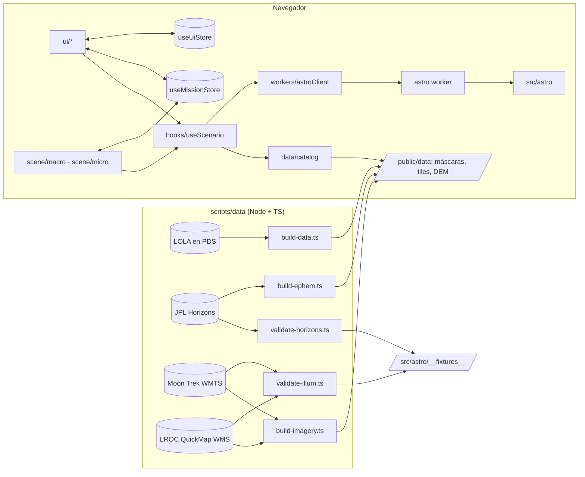

# Arquitectura de LUMEN 3D

Este documento explica cómo está organizada la aplicación, por qué se tomaron las decisiones principales y cómo extenderla. Para instalar el proyecto, ver [README.md](README.md); para usarlo, la [guía de usuario](docs/GUIA.md).

## 1. Visión general

LUMEN 3D es una SPA estática (sin backend). Toda la evaluación de escenarios ocurre en el navegador. Los datos pesados (topografía LOLA) se preprocesan una vez con scripts de Node y se publican como archivos estáticos.

## 2. Decisiones de diseño

### Solo three.js (React Three Fiber), sin CesiumJS

El dominio es una región pequeña (80°S–90°S, unos 300 km de radio), no un globo terrestre con streaming de terreno. Combinar Cesium con three.js habría supuesto dos contextos WebGL, dos cámaras y dos sistemas de coordenadas que sincronizar, y unos 3–4 MB más de bundle, sin mejorar ningún cálculo. Las coordenadas selenográficas y la proyección estereográfica polar de LOLA son unas pocas funciones puras ([src/astro/frames.ts](src/astro/frames.ts)). Las dos vistas (órbita y superficie) son dos escenas R3F que comparten el store.

### TypeScript en todo, también en el pipeline de datos

La app tiene que recalcular escenarios al instante (cambiar de fecha, de sitio o usar coordenadas personalizadas) sin servidor, así que el cálculo es TypeScript. Los productos de LOLA en PDS son binarios Int16 crudos con una etiqueta de texto, sin necesidad de GDAL. Por eso el pipeline offline también es TypeScript (Node 22+ lo ejecuta de forma nativa) y **reutiliza exactamente el mismo código** de `src/astro/` que corre en el navegador. Para que funcione en Node, los imports dentro de `src/astro/` llevan la extensión `.ts`.

### Las métricas se calculan analíticamente, no con la GPU

La energía y el enlace salen de las **efemérides comparadas con la máscara de horizonte**. Las sombras de three.js son solo la visualización que confirma el número. Así los resultados son deterministas, testeables en jsdom (que no tiene WebGL) e independientes de la resolución del shadow map. La intensidad de la luz solar en la vista de superficie es la fracción visible del disco calculada analíticamente: si una cresta a 100 km tapa el Sol, todo el tile se oscurece aunque esa cresta esté fuera del terreno 3D.

### Máscara de horizonte

Para cada acimut (0,5° en sitios curados, 1° en coordenadas personalizadas) se recorre el círculo máximo con pasos que crecen con la distancia, hasta 300 km. Se usa la pila de DEMs (20 m cerca, 240 m lejos) y geometría esférica exacta, curvatura incluida ([horizonFromDem.ts](src/astro/horizonFromDem.ts)). El máximo arranca en −90°, porque desde un pico el horizonte real queda por debajo de 0°. Ese efecto es el que da a las crestas su iluminación casi continua.

### Detalle visual procedural, separado de los cálculos

El terreno 3D sale del DEM de 20 m/px, demasiado grueso para verse como suelo a 2 m de la cámara. El grano, los cráteres pequeños y las variaciones de albedo los añade una textura de regolito **generada en un canvas** al primer uso ([regolith.ts](src/scene/micro/regolith.ts)): ruido fractal periódico y cráteres con borde elevado, convertidos en mapa de color y normal map. El shader del material (`onBeforeCompile`) mezcla tres escalas de la misma tesela para que no se note la repetición y apaga el normal map con la distancia. Su intensidad depende además de la elevación del Sol: con el Sol a 1–2°, cualquier faceta un poco inclinada quedaría negra y el suelo parecería manchado. Lo mismo vale para el aislamiento y los paneles del lander, el brillo del Sol y las estrellas ([canvasTexture.ts](src/scene/canvasTexture.ts)). Nada de esto entra en las métricas: la luz, las sombras y los números siguen saliendo del DEM y de la máscara de horizonte, y no hay imágenes extra que descargar.

### Ventanas emergentes en un portal

Los paneles usan `overflow: hidden` para recortar su contenido y sus esquinas redondeadas, así que una ventana posicionada dentro de ellos queda cortada. Las ayudas «?» se renderizan con `createPortal` en `<body>` y `position: fixed`; `placePopover` ([tourSteps.ts](src/ui/tourSteps.ts)) las coloca debajo del botón o, si no caben, encima, siempre dentro de la ventana. El recorrido guiado sigue el mismo criterio con `placeBubble`.

## 3. Módulos

| Ruta                                                                   | Responsabilidad                                                                                                                                                                                                                                                                                                                                                                                                                                                                                                                            |
| ---------------------------------------------------------------------- | ------------------------------------------------------------------------------------------------------------------------------------------------------------------------------------------------------------------------------------------------------------------------------------------------------------------------------------------------------------------------------------------------------------------------------------------------------------------------------------------------------------------------------------------ |
| `src/astro/frames.ts`                                                  | Vectores selenográficos, base ENU, acimut/elevación, círculo máximo, estereográfica polar de LOLA                                                                                                                                                                                                                                                                                                                                                                                                                                          |
| `src/astro/ephemeris.ts`                                               | Sol y Tierra en el marco fijo lunar: tabla JPL Horizons DE441 (2026–2030, `ephemTable.ts`) y, fuera de ese rango, modelo de rotación IAU con astronomy-engine, estado topocéntrico, serie compartida entre sitios                                                                                                                                                                                                                                                                                                                          |
| `src/astro/dem.ts`                                                     | Georreferencia de rásteres LOLA, muestreo bilineal, recorte y remuestreo                                                                                                                                                                                                                                                                                                                                                                                                                                                                   |
| `src/astro/horizon.ts`                                                 | Máscaras, interpolación, fracción visible de un disco sobre el horizonte                                                                                                                                                                                                                                                                                                                                                                                                                                                                   |
| `src/astro/horizonFromDem.ts`                                          | Ray-marching del horizonte sobre la pila de DEMs                                                                                                                                                                                                                                                                                                                                                                                                                                                                                           |
| `src/astro/series.ts`                                                  | Evaluación de un sitio sobre la serie de efemérides (typed arrays)                                                                                                                                                                                                                                                                                                                                                                                                                                                                         |
| `src/astro/windows.ts`                                                 | Ventanas encendido/apagado con bordes interpolados, huecos, estado en un instante                                                                                                                                                                                                                                                                                                                                                                                                                                                          |
| `src/astro/metrics.ts`                                                 | Métricas de la ventana de misión, puntuación, barrido de fechas de alunizaje                                                                                                                                                                                                                                                                                                                                                                                                                                                               |
| `src/astro/instant.ts`                                                 | Estado exacto en un instante (para paneles y escena)                                                                                                                                                                                                                                                                                                                                                                                                                                                                                       |
| `src/astro/terrainMesh.ts`                                             | Geometría del terreno (con pendiente por vértice) y del anillo de horizonte en el marco local (x = este, y = arriba, z = −norte); `sceneToLatLon` invierte el mapeo para el clic                                                                                                                                                                                                                                                                                                                                                           |
| `src/astro/slope.ts`                                                   | Pendiente con el operador de Horn (corregida por la escala estereográfica), estadísticas en un círculo, umbrales del lander                                                                                                                                                                                                                                                                                                                                                                                                                |
| `src/astro/dispersion.ts`                                              | Sensibilidad en la elipse de aterrizaje: horizonte, métricas y pendiente en centro + anillos                                                                                                                                                                                                                                                                                                                                                                                                                                               |
| `src/astro/descent.ts`                                                 | Descenso: waypoints que libran el relieve, mapa tiempo → curva (cúbica monótona), actitud de la cámara, ray-marching de la retícula sobre el DEM                                                                                                                                                                                                                                                                                                                                                                                           |
| `src/astro/energy.ts`                                                  | Potencia de los paneles (seguimiento, caja, fijo, horizontal) y simulación de la batería (SoC)                                                                                                                                                                                                                                                                                                                                                                                                                                             |
| `src/astro/dsn.ts`                                                     | Elevación de la Luna desde Goldstone, Madrid y Canberra (umbral 10°), estación principal, pérdida en espacio libre en banda X y relativa a la distancia media                                                                                                                                                                                                                                                                                                                                                                              |
| `src/astro/thermal.ts`                                                 | Temperatura radiativa simplificada (regolito y cara vertical al Sol), enfriamiento en sombra, suelo de PSR, horas bajo el límite de congelamiento; refracción terrestre (Bennett) para la comparación Tierra/Luna                                                                                                                                                                                                                                                                                                                          |
| `src/astro/illumination.ts`                                            | Mapa de iluminación anual de un tile (1 byte por celda: 0 = PSR, 255 = sin datos), consulta por lat/lon; lo genera `scripts/data/build-derived.ts`                                                                                                                                                                                                                                                                                                                                                                                         |
| `src/astro/iceAccess.ts`                                               | Ruta del rover hasta la PSR más cercana (Dijkstra sobre el DEM de 20 m con límite de pendiente), puntuación ciencia y puntuación combinada                                                                                                                                                                                                                                                                                                                                                                                                 |
| `src/astro/optimize.ts`                                                | «Sugerir mejor punto»: terreno seguro en la elipse de aterrizaje, preselección por altura y misión completa en cada candidato                                                                                                                                                                                                                                                                                                                                                                                                              |
| `src/astro/hardware.ts`                                                | Límites del módulo, veredicto ✓/!/✕ por sitio con las restricciones que fallan, codificación en la URL                                                                                                                                                                                                                                                                                                                                                                                                                                     |
| `src/workers/*`                                                        | Worker con protocolo de mensajes. Sin `Worker` (tests) se usa el mismo manejador en el hilo principal                                                                                                                                                                                                                                                                                                                                                                                                                                      |
| `src/data/catalog.ts`                                                  | Catálogo de sitios, detalle (máscara y tile), sitios personalizados; `polarTiles`/`tileFor` dan a un punto del usuario el tile de 20 m que lo contiene                                                                                                                                                                                                                                                                                                                                                                                     |
| `src/config/presets.ts`                                                | Escenarios rápidos de Comparar (retraso de 14 días, cresta vs. PSR, candidatos Artemis III)                                                                                                                                                                                                                                                                                                                                                                                                                                                |
| `src/config/energyProfiles.ts`                                         | Perfiles energéticos ilustrativos y su codificación en la URL                                                                                                                                                                                                                                                                                                                                                                                                                                                                              |
| `src/i18n/`                                                            | Diccionarios ES (fuente) y EN (tipado contra ES), detección de idioma, textos de sitios en inglés                                                                                                                                                                                                                                                                                                                                                                                                                                          |
| `src/store/useMissionStore.ts`                                         | Escenarios (sitio + fecha), tiempo de misión compartido, vista (`macro`, `micro`, `landing`), reproducción, paneles; `useDescentStore` lleva la reproducción del descenso                                                                                                                                                                                                                                                                                                                                                                  |
| `src/store/useUiStore.ts`                                              | Estado solo de interfaz (fuera de la URL y de `reset()`): paneles abiertos (en `localStorage`), paso del recorrido guiado, ayuda «?» abierta                                                                                                                                                                                                                                                                                                                                                                                               |
| `src/hooks/usePanelShortcuts.ts`                                       | Teclas 1 / 2 / 3 para plegar los paneles (ignoradas en campos de texto y durante el recorrido)                                                                                                                                                                                                                                                                                                                                                                                                                                             |
| `src/hooks/useScenario.ts`                                             | Une store, datos y worker. `useAsync` conserva el resultado anterior mientras recalcula. `useBattery` simula la batería sobre la serie                                                                                                                                                                                                                                                                                                                                                                                                     |
| `src/hooks/useScience.ts`, `useCatalogViability.ts`                    | Acceso a hielo y optimizador en el worker (con caché por clave, como la dispersión), mapa de iluminación para la escena, puntuación combinada; evaluación del catálogo completo para el filtro de hardware                                                                                                                                                                                                                                                                                                                                 |
| `src/hooks/useTerrain.ts`                                              | Pila de DEMs del sitio, estadísticas de pendiente y dispersión (en caché, compartida entre panel y escena)                                                                                                                                                                                                                                                                                                                                                                                                                                 |
| `src/hooks/useUrlSync.ts`                                              | Estado ↔ URL: escenarios, Comparar, margen de enlace, perfil energético, idioma                                                                                                                                                                                                                                                                                                                                                                                                                                                            |
| `src/hooks/scenarioExport.ts`                                          | Evalúa un escenario fuera de React para exportarlo (mismos datos que los paneles)                                                                                                                                                                                                                                                                                                                                                                                                                                                          |
| `src/scene/canvasTexture.ts`, `src/scene/SunGlare.tsx`                 | Texturas procedurales en canvas (halo, rayos, PRNG determinista) y el Sol con halo y corona, compartido por las dos escenas                                                                                                                                                                                                                                                                                                                                                                                                                |
| `src/scene/macro/`                                                     | Globo LROC, casquete polar LOLA con sombras, marcadores, vuelo hacia el sitio. `Earth.tsx` exporta `EarthGlobe` (shader día/noche, luces, nubes, brillo oceánico y atmósfera iluminados por la dirección real del Sol), que también usa el cielo de la superficie                                                                                                                                                                                                                                                                          |
| `src/scene/micro/`                                                     | Terreno con regolito procedural (`regolith.ts`) o capa de pendientes, anillo de horizonte, Sol y Tierra a tamaño angular real, estrellas con magnitud y color, trayectorias, vista aérea, zona y marcadores de dispersión, clic para reubicar. En la vista `landing`: `DescentControls` (cámara en una Catmull-Rom), `DescentReticle` (con pulso), `DescentDust` (polvo balístico en un pool fijo), `Lander` procedural y su cámara orbital; la telemetría por fotograma va en `descentTelemetry` (fuera de React) y el HUD la lee a 10 Hz |
| `src/ui/`                                                              | Paneles plegables (`CollapsiblePanel`), línea temporal (canvas, con batería), horizonte 360° (canvas), barrido de fechas, comparación, exportación, modo educativo                                                                                                                                                                                                                                                                                                                                                                         |
| `src/ui/Splash.tsx`                                                    | Pantalla de inicio con el logo: visible hasta que carga el catálogo y pasa un tiempo mínimo; se salta con clic o teclado                                                                                                                                                                                                                                                                                                                                                                                                                   |
| `src/ui/Tour.tsx`, `tourSteps.ts`, `HelpButton.tsx`                    | Recorrido guiado (pasos, foco atrapado, ← →/Esc), temas de ayuda «?» y la colocación de burbujas y ventanas emergentes dentro de la ventana                                                                                                                                                                                                                                                                                                                                                                                                |
| `src/ui/ViewHud.tsx`, `CompassTape.tsx`, `DescentHud.tsx`, `icons.tsx` | HUD de cada vista: cinta de rumbo, barras de herramientas, interruptores, telemetría del descenso con indicador de fases; iconos SVG en lugar de emojis                                                                                                                                                                                                                                                                                                                                                                                    |

### Simulación de aterrizaje y rover

| Módulo                                                                   | Qué hace                                                                                                                                                                                                                                                |
| ------------------------------------------------------------------------ | ------------------------------------------------------------------------------------------------------------------------------------------------------------------------------------------------------------------------------------------------------- |
| `src/astro/descentPhysics.ts`, `descentPlan.ts`, `src/config/landers.ts` | Descenso propulsado: masa puntual 3-DOF, ecuación del cohete, guiado ZEM/ZEV y fase terminal; `planDescent` elige la altura de inicio que libra el relieve y calcula el desvío recomendado a terreno seguro                                             |
| `src/astro/traverse.ts`                                                  | Recorrido del rover: remuestreo de la ruta al hielo, velocidad por pendiente, potencia de tracción, batería (`stepBattery` de `energy.ts`), Sol y Tierra en la posición del rover con horizontes cada ~200 m. Job `traverse` del worker y `useTraverse` |
| `src/scene/micro/DescentControls.tsx`, `Rover.tsx`                       | Cámara sobre la trayectoria física; rover procedural con cámara de seguimiento, luz y sombra que lo siguen. Telemetría en `descentTelemetry.ts` y `roverTelemetry.ts`, leída por `DescentHud` y `RoverHud` a 10 Hz sin pasar por React                  |
| `src/store/useDescentStore.ts`, `useRoverStore.ts`                       | Reproducción (el reloj vive en refs de la escena), modelo y vehículo elegidos                                                                                                                                                                           |
| `src/config/challenges.ts`, `src/ui/Challenges.tsx`                      | Modo Retos: comprobaciones puras sobre el estado que la app ya calcula                                                                                                                                                                                  |
| `scripts/data/lola-global.ts`                                            | Recorte por Range de LOLA cilíndrico global y reproyección a tiles estereográficos locales (`DemMeta.projection`) para los sitios fuera del polo                                                                                                        |
| `e2e/smoke.spec.ts`, `playwright.config.ts`                              | Pruebas de humo de extremo a extremo sobre el build                                                                                                                                                                                                     |

## 4. Flujo de datos

1. `App` muestra el `Splash` y, en paralelo, carga `public/data/sites/index.json` y lo fusiona con [src/config/sites.ts](src/config/sites.ts). Después aplica la URL (`useUrlSync`). El splash se retira cuando el catálogo está listo (y como mínimo ~1,8 s); solo entonces puede aparecer la invitación al recorrido.
2. `useScenarioData(escenario)` pide el detalle del sitio (máscara y tile, en caché por id). Con él lanza `runScenario` en el worker, que devuelve la serie de 10 min de la ventana de misión y sus métricas.
3. `useInstant` calcula el estado exacto en `inicio + offsetH`. Todos los escenarios comparten `offsetH` (T+), así la comparación es en el mismo momento de la misión.
4. La escena lee el mismo estado instantáneo: posición del Sol y la Tierra, intensidad de la luz y luz terrestre (earthshine).
5. La reproducción (`usePlayback`) avanza `offsetH` unas 30 veces por segundo.
6. `useBattery` integra la batería sobre la serie en el hilo principal (es barato) cada vez que cambia el perfil.
7. Cuando el escenario ya terminó, `useDispersion` lanza el análisis de la elipse de aterrizaje en el worker. El worker atiende las peticiones en orden, así que esperar evita que 17 horizontes retrasen los números principales.
8. Un clic en el terreno (modo «Reubicar con clic») convierte el punto 3D a lat/lon con `sceneToLatLon` y crea un sitio personalizado. Si cae en un tile curado, su horizonte se calcula con la pila 20 m + 480 m.

## 5. Datos (`public/data`)

| Archivo                       | Contenido                                                                                                       |
| ----------------------------- | --------------------------------------------------------------------------------------------------------------- |
| `sites/index.json`            | Coordenadas refinadas, altura y precisión de cada sitio                                                         |
| `sites/<id>.json`             | Máscara (720 acimuts), distancia a la obstrucción y metadatos del tile                                          |
| `terrain/<id>.bin`            | Tile Int16 de 1024 × 1024 a 20 m/px (DN × 0,5 = metros sobre la esfera de 1737,4 km)                            |
| `dem/south_480m.bin` (+ json) | 75°S–90°S para coordenadas personalizadas                                                                       |
| `illum/<id>.bin`              | Iluminación media anual por celda de ~100 m del tile (Uint8; 0 = PSR). Metadatos en `sites/<id>.json` → `illum` |
| `dem/south_960m.bin` (+ json) | Relieve del casquete en la vista orbital                                                                        |
| `ephem/de441.bin` (+ json)    | Tabla JPL Horizons DE441 del Sol y la Tierra (2026–2030)                                                        |
| `imagery/index.json`          | Mosaicos por teselas (`src/astro/imagery.ts`): globo y casquete de Moon Trek, imagen NAC de LROC por sitio      |

`npm run data:imagery` guarda las teselas tal como las sirven Moon Trek (WMTS) y el WMS de LROC QuickMap, sin recodificar (el pipeline no necesita librerías de imagen); `src/data/loadImagery.ts` las une en un canvas y crea la textura. Sin `imagery/index.json` la app usa materiales lisos.

`npm run data` descarga solo las filas necesarias de `LDEM_80S_20M` (1,8 GB en total) mediante peticiones HTTP con rango, y las guarda en caché en `data-cache/` (ignorado por git).

`npm run data:derived` no descarga nada: lee los tiles y el DEM de 480 m ya publicados y añade a `index.json` la pendiente del sitio (`slopeCenterDeg`, `slopeP90Deg`) y el resumen de acceso a hielo (`ice`, con rover de 20°), y genera `illum/<id>.bin`. El mapa de iluminación es caro (~15 min por tile en un núcleo): se reutiliza si ya existe (salvo `--force`) e `index.json` se fusiona al final, así que varios sitios pueden generarse en paralelo. El filtro de hardware usa esos campos para no descargar los 9 tiles.

## 6. Integración de los recursos externos

Los cuatro recursos del reto se consultan **solo desde `scripts/data/` (Node)**, nunca desde el navegador: así no hay problemas de CORS, la app sigue siendo un sitio estático que funciona sin conexión a esos servicios y cada respuesta queda en caché en `data-cache/` (repetir un script no hace peticiones). La app lee lo publicado en `public/data/` y, si falta, usa un respaldo. Ver también el diagrama de la [§ 1](#1-visión-general).

### JPL Horizons (NASA/JPL)

|                 |                                                                                                                                                                                                                                                                                                                                                                                 |
| --------------- | ------------------------------------------------------------------------------------------------------------------------------------------------------------------------------------------------------------------------------------------------------------------------------------------------------------------------------------------------------------------------------- |
| Servicio        | API `https://ssd.jpl.nasa.gov/api/horizons.api`, cliente con caché en [scripts/data/horizons.ts](scripts/data/horizons.ts)                                                                                                                                                                                                                                                      |
| Tabla de la app | [build-ephem.ts](scripts/data/build-ephem.ts) (`npm run data:ephem`): `COMMAND=301`, `CENTER=500@399`, cantidades 14 (punto subterrestre), 15 (subsolar), 19 y 20 (distancias), cada 2 h de 2026 a 2030. Se corrige la aberración del punto subterrestre y se guarda como vectores Sol/Tierra en el marco fijo lunar → `public/data/ephem/de441.bin` (+ json)                   |
| Uso en la app   | [src/data/loadEphem.ts](src/data/loadEphem.ts) la instala en el hilo principal y en el worker; [src/astro/ephemTable.ts](src/astro/ephemTable.ts) la interpola (Lagrange cúbica) y [src/astro/ephemeris.ts](src/astro/ephemeris.ts) (`bodyFixedEphemeris`) la usa en todas las métricas. `ephemerisSource` alimenta el indicador de [TimeControls](src/ui/TimeControls.tsx)     |
| Respaldo        | Modelo IAU con astronomy-engine fuera de 2026–2030 o sin tabla                                                                                                                                                                                                                                                                                                                  |
| Validación      | [validate-horizons.ts](scripts/data/validate-horizons.ts) (`npm run validate`): cantidad 4 (az/el aparentes) desde `coord@301` en cada sitio → `__fixtures__/horizons.json`; y la Luna desde las tres estaciones DSN (`coord@399`, `APPARENT=AIRLESS`) contra [src/astro/dsn.ts](src/astro/dsn.ts) → `__fixtures__/horizons-dsn.json`. Ambos se comprueban en los tests sin red |

### Moon Trek (NASA/JPL Solar System Treks)

|               |                                                                                                                                                                                                                                                                                                                                                     |
| ------------- | --------------------------------------------------------------------------------------------------------------------------------------------------------------------------------------------------------------------------------------------------------------------------------------------------------------------------------------------------- |
| Servicio      | WMTS REST `https://trek.nasa.gov/tiles/Moon/{EQ,SP}/<capa>/1.0.0/default/default028mm/{nivel}/{fila}/{col}.{jpg,png}`                                                                                                                                                                                                                               |
| Capas         | `EQ/LRO_WAC_Mosaic_Global_303ppd_v02` (nivel 2, 8 × 4 teselas) y `SP/LRO_WAC_Mosaic_SPole60_100m_v02` (nivel 3, 4 × 4 teselas, estereográfica polar: el mismo plano que LOLA)                                                                                                                                                                       |
| Pipeline      | [build-imagery.ts](scripts/data/build-imagery.ts) (`npm run data:imagery`) guarda las teselas tal como llegan en `public/data/imagery/trek-global/` y `trek-sp/` y las lista en `imagery/index.json` (tipos en [src/astro/imagery.ts](src/astro/imagery.ts))                                                                                        |
| Uso en la app | [src/data/loadImagery.ts](src/data/loadImagery.ts) (`useMosaicTexture`) las une en un canvas → textura. [MacroScene](src/scene/macro/MacroScene.tsx): `Globe` usa el mosaico global y `PolarCap` el polar con UV calculadas en el plano estereográfico (`polarCapGeometry` con `imageExtent`, [macroGeometry.ts](src/scene/macro/macroGeometry.ts)) |
| Enlace        | `moonTrekUrl` en [src/config/externalLinks.ts](src/config/externalLinks.ts): hash con centro y extensión en grados (vista cilíndrica `EPSG::104903`)                                                                                                                                                                                                |
| Respaldo      | Sin `imagery/index.json`: materiales grises lisos                                                                                                                                                                                                                                                                                                   |
| Validación    | [validate-illum.ts](scripts/data/validate-illum.ts): capa `SP/AVGVISIB_85S_060M_201608_EARTH_SP` (visibilidad media de la Tierra, LOLA) en el píxel de cada sitio frente a nuestra visibilidad anual (máscara + DE441)                                                                                                                              |

### LROC QuickMap (Arizona State University)

|               |                                                                                                                                                                                                                                                                                                                                                                                                            |
| ------------- | ---------------------------------------------------------------------------------------------------------------------------------------------------------------------------------------------------------------------------------------------------------------------------------------------------------------------------------------------------------------------------------------------------------- |
| Servicio      | WMS `https://wms.im-ldi.com/` (el que sirve las capas de QuickMap), `SRS=IAU2000:30120` (estereográfica polar sur, la de LOLA)                                                                                                                                                                                                                                                                             |
| Capas         | `luna_wac_global,luna_nac_sp_mosaic` (NAC de 1 m/px sobre WAC) e `luna_polar_illumination_pct` (Speyerer y Robinson, 2013)                                                                                                                                                                                                                                                                                 |
| Pipeline      | [build-imagery.ts](scripts/data/build-imagery.ts): por cada tile de 20 m, 2 × 2 peticiones de 1024 px (10 m/px; una de 2048 px agota el tiempo del servidor) → `public/data/imagery/nac/<id>/`. Calcula qué parte del tile está dentro del mosaico NAC (≤ 85,5° S) y lo indica en la atribución                                                                                                            |
| Uso en la app | [MicroScene](src/scene/micro/MicroScene.tsx): la capa «Imagen orbital LRO» (`showNac` en el store) comparte vértices con el terreno y le añade UV de `terrainGridUv`; material sin iluminar, porque la foto ya trae sus sombras. Interruptor y crédito en [ViewHud](src/ui/ViewHud.tsx). Solo se descarga al activarla                                                                                     |
| Enlace        | `quickmapUrl` en [src/config/externalLinks.ts](src/config/externalLinks.ts): `prjExtent` en metros de la proyección cilíndrica (`proj=10`)                                                                                                                                                                                                                                                                 |
| Respaldo      | Sin imagen para el tile: el interruptor no aparece                                                                                                                                                                                                                                                                                                                                                         |
| Validación    | [validate-illum.ts](scripts/data/validate-illum.ts): el mapa de iluminación a la resolución de `illum/<id>.bin` frente al nuestro, celda a celda (Spearman e IoU de la clase «nunca iluminado») → `__fixtures__/illum-validation.json`, comprobado en [illumValidation.test.ts](src/astro/illumValidation.test.ts). El lector PNG mínimo ([scripts/data/png.ts](scripts/data/png.ts)) usa solo `node:zlib` |

Las capas de visualización de QuickMap y Moon Trek tienen una escala de grises no documentada; por eso la validación usa solo estadísticos de orden y no porcentajes absolutos.

### Portal lunar de la CSA

|               |                                                                                                                                                                                                                                                                                                                                               |
| ------------- | --------------------------------------------------------------------------------------------------------------------------------------------------------------------------------------------------------------------------------------------------------------------------------------------------------------------------------------------- |
| Fuente        | `https://www.asc-csa.gc.ca/eng/astronomy/moon-exploration/` y sus páginas del rover utilitario y de las misiones Artemis (consultadas en noviembre de 2026)                                                                                                                                                                                   |
| Uso en la app | Tarjeta `c8` y lista de fuentes en [ExplainPanel](src/ui/ExplainPanel.tsx) (textos `explain.c8.*` y `explain.sources.*` en [src/i18n](src/i18n/es.ts)); perfil `csa-rover` en [energyProfiles.ts](src/config/energyProfiles.ts) y escenario rápido `csa-rover` en [presets.ts](src/config/presets.ts), que fija el perfil mediante `energyId` |
| Naturaleza    | Contenido, no datos: las cifras del rover son un presupuesto ilustrativo, como los demás perfiles                                                                                                                                                                                                                                             |

## 7. Convenciones

- Datos en `config/` y `data/`, estado en `store/`, cálculo en `astro/` y presentación en `scene/` y `ui/`. Los componentes 3D no contienen lógica de negocio.
- Lo que cambia en cada frame se muta en objetos three.js dentro de `useFrame`, nunca con `setState`.
- Los textos visibles pasan por `useT()` ([src/i18n](src/i18n/index.ts)); `es.ts` es la fuente y `en.ts` está tipado contra ella, así que una clave que falte no compila. El código y los comentarios, en inglés.
- La información de las gráficas no depende solo del color: patrones y etiquetas en la línea temporal, puntos llenos/huecos en el horizonte, iconos ✓/!/✕ junto a los niveles, paleta Okabe-Ito en la capa de pendientes, forma de la retícula según la pendiente, ✓ en las fases completadas del descenso.
- Los shaders propios (`ShaderMaterial`) incluyen los chunks `logdepthbuf_*`, porque el `Canvas` usa búfer de profundidad logarítmico.
- La regla `react-hooks/immutability` no deja mutar objetos devueltos por hooks: el estado por fotograma vive en clases con métodos (`DustSim`) o se cambia mediante funciones (`setRegolithSunElevation`).
- Las animaciones de interfaz respetan `prefers-reduced-motion`.
- Prettier (sin `;`, comillas simples, 100 columnas) y ESLint con las reglas de React Hooks.

### Estilos y tema

- Los colores, radios, sombras y tiempos son tokens en `src/styles/tokens.css`; ningún otro
  archivo define colores. Ver [docs/DISENO.md](docs/DISENO.md).
- El tema se cambia con la clase `.dark` en `<html>` (`src/ui/theme.ts`). La escena 3D lleva su
  propio `.dark` y no cambia a claro.
- Las gráficas en canvas leen la paleta con `useChartTheme()` (`src/ui/chartTheme.ts`) y la
  escena usa `SCENE_COLORS` (`src/scene/sceneColors.ts`).
- Avisos, vacíos y esperas usan `src/ui/kit/` (`Notice`, `Empty`, `Busy`, `Stat`).

## 8. Tests

| Qué                                  | Cómo                                                                                                                                                                                       |
| ------------------------------------ | ------------------------------------------------------------------------------------------------------------------------------------------------------------------------------------------ |
| Efemérides                           | Fixture de JPL Horizons, 528 posiciones (instantes fuera de la malla de 2 h) (tolerancia 0,001° con la tabla DE441, 0,02° con el modelo IAU) y casos físicos (Sol en el polo, cara oculta) |
| Proyección, DEM, horizonte, ventanas | Unitarios con DEMs sintéticos (cráter, cúpula, rampa)                                                                                                                                      |
| Métricas y barrido de fechas         | Series sintéticas y un caso real (sitio ecuatorial: 50 % de luz, 100 % de DTE)                                                                                                             |
| Datos generados                      | Integridad de `public/data` (cobertura de sitios, tamaños, PSR frente a borde)                                                                                                             |
| Store y URL                          | Validación de entradas y límites; ida y vuelta de escenarios, margen, perfil e idioma                                                                                                      |
| Pendiente, dispersión, energía       | Planos inclinados de ángulo conocido, terreno plano, noche larga con agotamiento analítico                                                                                                 |
| Exportación                          | Filas = muestras, booleanos coherentes con el umbral, JSON columnar                                                                                                                        |
| i18n                                 | Paridad de claves y parámetros ES/EN, detección de idioma, textos de sitios                                                                                                                |
| UI                                   | Testing Library con cálculo real en el hilo principal                                                                                                                                      |
| Paneles, recorrido y ayuda           | Paneles plegables y su persistencia, recorrido completo, teclado, `placeBubble`/`placePopover` dentro de la ventana, ayuda «?» en un portal fuera de contenedores con `overflow: hidden`   |
| DSN, temperatura, hardware           | Cobertura de las tres estaciones en 30 días, FSPL a la distancia media; equilibrio con Sol en el cénit, enfriamiento y suelo PSR; límites con margen del 20 % y URL hostil                 |
| Hielo y optimizador                  | DEM sintético con PSR al este: ruta recta, rodeo de un muro de 40°, PSR inalcanzable; el optimizador nunca propone pendientes ≥ 10°                                                        |
| Paneles nuevos                       | Estaciones DSN en el panel, tarjeta térmica en una PSR (−233 °C), filtro de hardware con un sitio descartado y envío a Comparar                                                            |
| Pantalla de inicio y exportación     | Splash con temporizadores falsos (espera al catálogo y al tiempo mínimo, se salta con clic); el menú Exportar solo ofrece descargas                                                        |

jsdom no implementa WebGL, así que `src/scene/` no se renderiza en los tests. Para comprobarlo visualmente se usan capturas con Chromium headless (Playwright) sobre la GPU real (`--use-angle=d3d11`); con SwiftShader la escena de superficie es demasiado lenta para capturarla.

## 9. Cómo extender

- **Nuevo sitio curado**: entrada en `SITE_SEEDS` y `npm run data -- <id>`. Con `snapMode: 'sun'` el pipeline busca el punto mejor iluminado dentro de `snapRadiusM`.
- **Otra métrica**: añádela a `computeMetrics` ([metrics.ts](src/astro/metrics.ts)) con su test, y muéstrala en `WindowSummary` y en las filas de `CompareView` (con sus claves en `es.ts`/`en.ts`).
- **Nuevo escenario rápido**: entrada en `PRESETS` ([presets.ts](src/config/presets.ts)) con sus textos en los diccionarios. Puede fijar `missionDays` y `scienceWeight`.
- **Otro límite de hardware**: campo en `HardwareLimits` con su rango en `LIMIT_RANGES` ([hardware.ts](src/astro/hardware.ts)), su comprobación en `classifySite` y su posición en `encodeLimits`/`decodeLimits` (añádelo al final para no romper URLs antiguas).
- **Otra estación terrena**: entrada en `DSN_STATIONS` ([dsn.ts](src/astro/dsn.ts)) y su nombre `dsn.<id>` en los diccionarios.
- **Nuevo perfil energético**: entrada en `ENERGY_PRESETS` ([energyProfiles.ts](src/config/energyProfiles.ts)).
- **Otro idioma**: copia `en.ts`, tradúcelo y añádelo a `LANGS`/`DICTS` en [src/i18n/index.ts](src/i18n/index.ts).
- **Nuevo paso del recorrido**: entrada en `TOUR_STEPS` ([tourSteps.ts](src/ui/tourSteps.ts)) con el `data-tour` del elemento a resaltar (y, si hace falta, el panel que abrir o la vista a la que cambiar), más `tour.<id>.title`/`.body` en los diccionarios.
- **Nueva ayuda «?»**: entrada en `HELP_TOPICS` con su texto `help.<tema>` y el paso del recorrido al que enlaza; colócala con `<HelpButton topic="…" />` o con la prop `help` de `CollapsiblePanel`.
- **Más detalle visual**: las texturas procedurales se crean con `canvasTexture` y se cachean; mantenlas fuera de `src/astro/` y de cualquier cálculo de métricas.
- **Guía de usuario**: cualquier cambio visible en la interfaz debe reflejarse en [docs/GUIA.md](docs/GUIA.md) (y, si cambia una captura, en `docs/img/`).
- **Polo norte**: los productos LOLA del norte usan la misma proyección con el signo cambiado. Habría que generalizar `southPolarToMap` y el pipeline.
- **Efemérides fuera de 2026–2030**: hecho para 2026–2030 con la tabla DE441 de JPL Horizons (`npm run data:ephem`, ver `src/astro/ephemTable.ts`). Para ampliar el rango basta con cambiar `START`/`STOP` en `scripts/data/build-ephem.ts` (~100 KB por año).
