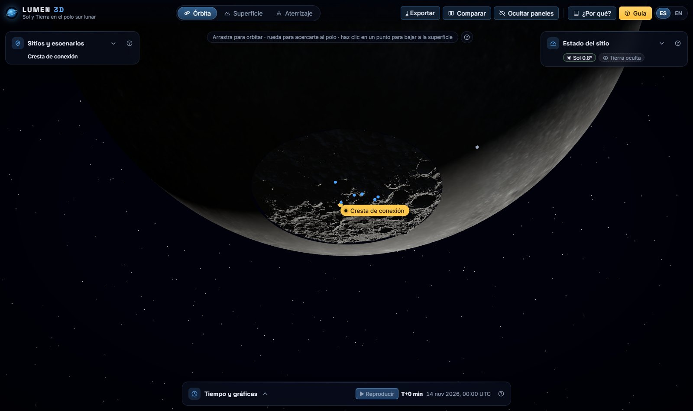
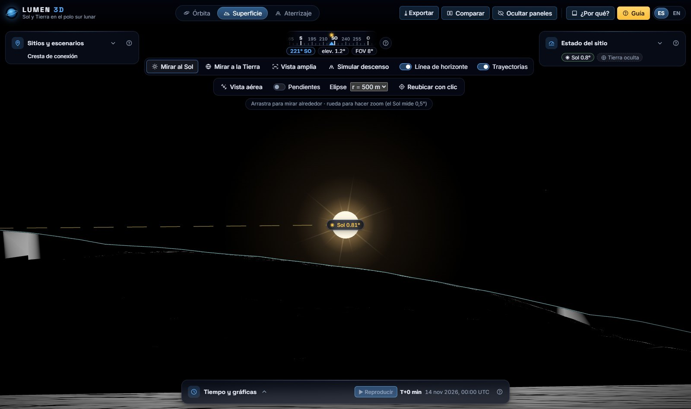
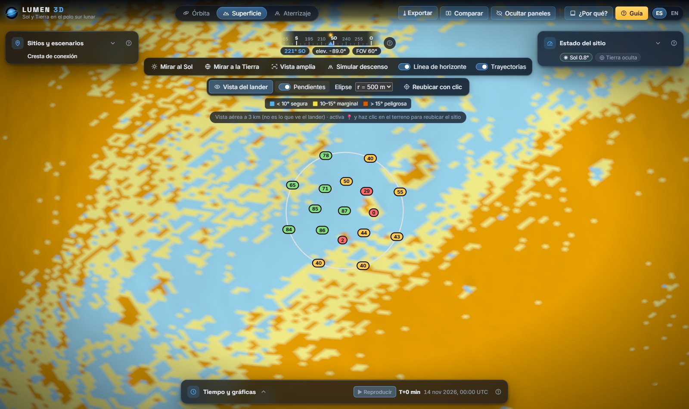
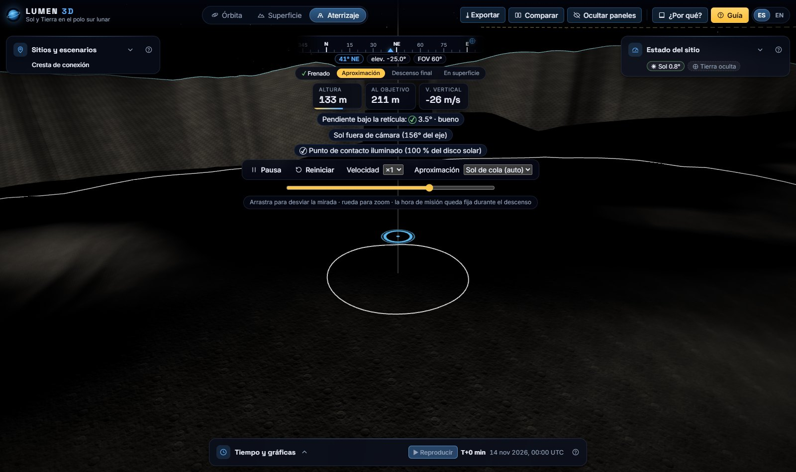
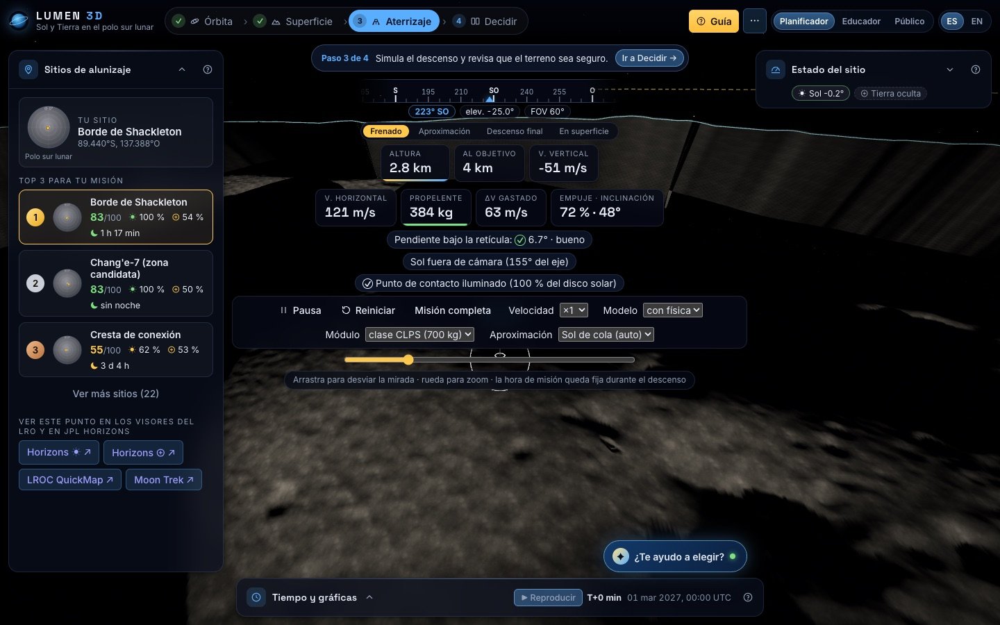
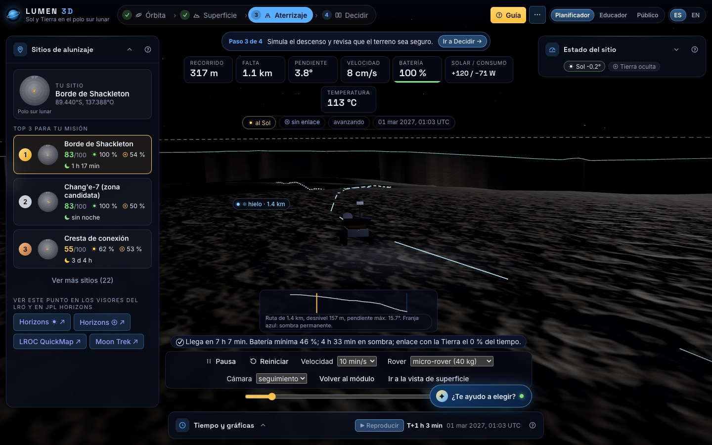

# LUMEN 3D

Herramienta web para **comparar sitios y fechas de alunizaje en el polo sur de la Luna** y decidir si una misión es viable. Para cada combinación de sitio y fecha muestra dónde están el Sol y la Tierra respecto al **horizonte real** (topografía LOLA del Lunar Reconnaissance Orbiter) y calcula:

- **Energía**: elevación solar, fracción visible del disco, noche más larga y **estado de carga de la batería** con un perfil energético configurable.
- **Comunicación directa con la Tierra (DTE)**: visibilidad con un **ángulo mínimo de enlace** sobre el relieve, tiempo hasta la puesta o salida y cortes de enlace.
- **Seguridad de aterrizaje**: **pendiente del terreno** a 20 m/px y **sensibilidad dentro de la elipse de aterrizaje**: cuánto cambia la misión si el lander toca suelo unos cientos de metros más allá.

Responde al reto de NASA Space Apps sobre iluminación y comunicaciones en el polo sur lunar. La interfaz está en **español e inglés**.

📘 **[Guía de usuario completa](docs/GUIA.md)**: qué hace cada parte de la pantalla y cómo leer los resultados.

| Órbita                                                        | Superficie: el Sol rozando la cresta                |
| ------------------------------------------------------------- | --------------------------------------------------- |
|                        |      |
| **Pendientes y elipse de aterrizaje de 500 m**                | **Descenso: telemetría y retícula de pendiente**    |
|  |   |
| **Módulo en superficie**                                      | **Comparar: cresta iluminada vs. cráter en sombra** |
|                   |        |
| **Descenso con física: propelente y Δv**                      | **Rover camino del hielo**                          |
|           |                         |

## Qué se puede hacer

| Función                                       | Dónde                                                                                                                                                                                                                                                                                                                      |
| --------------------------------------------- | -------------------------------------------------------------------------------------------------------------------------------------------------------------------------------------------------------------------------------------------------------------------------------------------------------------------------- |
| Elegir un sitio curado                        | Panel izquierdo: Artemis III (Shackleton, cresta de conexión, de Gerlache, Malapert), IM-2, VIPER, Nobile Rim 2, Chang'e-7, PSRs y, con relieve real LOLA, las referencias IM-1, IM-3, Blue Ghost, Luna-25, Chandrayaan-3, Chang'e-4/6, SLIM y Apolo 11/15/17                                                              |
| Introducir coordenadas propias                | Panel izquierdo → _Coordenadas personalizadas_ (horizonte calculado en el navegador; con LOLA 20 m si el punto cae en un tile curado)                                                                                                                                                                                      |
| Elegir cuánto detalle ver                     | **Modo** planificador / educador / público, en la bienvenida (_¿Quién eres?_) y en la barra superior: el público ve Sol, Tierra y puntuación; el educador añade física, hielo y gráficas; el planificador lo ve todo (DSN, elipse de aterrizaje, hardware, exportar). Se recuerda y viaja en la URL (`?mode=`)             |
| Empezar                                       | Pantalla de inicio con el logo mientras cargan los sitios; la primera vez, invitación al **recorrido guiado**                                                                                                                                                                                                              |
| Ver el contexto orbital                       | Vista **Órbita**: Luna iluminada por el Sol real, relieve LOLA del polo, sitios clicables, Sol con halo y Tierra con día/noche, nubes y atmósfera                                                                                                                                                                          |
| Mirar desde el aterrizador                    | Vista **Superficie**: cámara a 2 m, terreno LOLA de 20 m/px con textura de regolito, Sol y Tierra a su tamaño angular real, cielo estrellado, sombras, línea del horizonte y cinta de rumbo con ☀/⊕                                                                                                                        |
| Ver la foto real del LRO                      | Superficie → **Imagen orbital LRO**: mosaico LROC NAC (10 m/px) sobre el relieve, con sus sombras originales                                                                                                                                                                                                               |
| Contrastar con QuickMap, Moon Trek y Horizons | Panel izquierdo, siempre visible → **Ver este punto…**: abre el sitio activo (también reubicado o personalizado) en LROC QuickMap y Moon Trek, y consulta en **JPL Horizons** el Sol o la Tierra desde ese punto para la ventana de misión actual                                                                          |
| Ver pendientes del terreno                    | Superficie → **Vista aérea** + **Pendientes**: capa < 10° segura / 10–15° marginal / > 15° peligrosa; tarjeta _Terreno · aterrizaje_                                                                                                                                                                                       |
| Analizar la elipse de aterrizaje              | Superficie → **Elipse** (500 m, 1 km, 2 km; forma 1:1, 2:1 o 3:1): elipse 3σ orientada según la aproximación, 17 puntos ponderados por probabilidad, tabla mín/mediana/máx, puntuación esperada y probabilidad de pendiente segura                                                                                         |
| Reubicar el sitio con un clic                 | Superficie → **Reubicar con clic** y clic en el terreno (o en un marcador de la elipse de aterrizaje): se recalcula el horizonte con LOLA 20 m                                                                                                                                                                             |
| Sugerir un punto mejor                        | Tarjeta de la elipse de aterrizaje → **Sugerir mejor punto**: busca terreno con pendiente < 10° dentro de la elipse de aterrizaje, evalúa la misión en los 40 puntos más altos y propone los 3 mejores con **Ir a este punto**                                                                                             |
| Acceso a hielo (PSR)                          | Tarjeta **Acceso a hielo**: distancia y ruta del rover hasta la sombra permanente más cercana (≤ 2 km, sin pendientes > 20°); Superficie → **Sombra permanente** colorea la iluminación anual y dibuja la ruta                                                                                                             |
| Equilibrar ciencia e ingeniería               | Control **Ingeniería ↔ Ciencia** junto a la puntuación: mezcla la puntuación de ingeniería con la de acceso a hielo (0 % por defecto, sin cambios en los números de siempre)                                                                                                                                               |
| Ver la temperatura                            | Tarjeta **Temperatura estimada**: cara al Sol (~+110 °C) y regolito, mínimo de la ventana y horas bajo −100 °C; en una PSR, ~−233 °C                                                                                                                                                                                       |
| Seguir el enlace con la DSN                   | Tarjeta de la Tierra: distancia, pérdida en espacio libre en banda X y qué estación (Goldstone, Madrid, Canberra) ve la Luna; marcadores en el globo terrestre                                                                                                                                                             |
| Filtrar por hardware                          | **Hardware**: pendiente máx., noche máx., DTE mín. y pendiente del rover; todos los sitios en ✓/!/✕ y **Enviar viables a Comparar**                                                                                                                                                                                        |
| Simular el descenso                           | Vista **Aterrizaje** (o Superficie → **Simular descenso**): descenso **con física** (empuje, gravedad lunar, propelente y Δv, guiado hasta el contacto) con tres módulos; telemetría, retícula de pendiente, aviso de desvío a terreno seguro y resumen de Δv y propelente al tocar suelo. Modo rápido ilustrativo de 45 s |
| Ver el rover ir al hielo                      | Tras el contacto, **Desplegar rover** (o **Misión completa**, o **Ver el recorrido** en la tarjeta de hielo): el rover recorre la ruta hasta la sombra permanente con batería, potencia, temperatura, Sol/sombra y enlace; tres cámaras y dos rovers                                                                       |
| Simular la batería                            | Tarjeta **Energía · batería**: perfiles (lander de caja, rover con seguimiento, panel fijo) o personalizado; carril _Batería_ en la línea temporal y alerta si se agota antes del amanecer                                                                                                                                 |
| Exigir margen de enlace                       | Barra inferior → **Elev. mín. enlace (°)**: la Tierra debe superar el relieve por ese margen (multitrayecto); línea discontinua en el horizonte                                                                                                                                                                            |
| Ver la evolución en el tiempo                 | Barra inferior: fecha de alunizaje, duración de la misión, reproducción, saltos al siguiente ocaso o puesta de la Tierra                                                                                                                                                                                                   |
| Leer la línea temporal                        | Pestaña _Línea temporal_: franjas de Sol, enlace DTE, ambos y batería, más la altura de cada astro sobre el horizonte local                                                                                                                                                                                                |
| Ver el horizonte de 360°                      | Pestaña _Horizonte 360°_: perfil del terreno con las trayectorias del Sol y la Tierra; **Si fuera la Tierra** añade la refracción atmosférica y el crepúsculo para contrastar                                                                                                                                              |
| Buscar fechas alternativas                    | Pestaña _Fechas alternativas_: puntuación de cada día de alunizaje durante los próximos 12 meses                                                                                                                                                                                                                           |
| Leer el veredicto                             | Bajo la puntuación: **Viable / Al límite / Descartado** frente a los límites de hardware, con el límite que falla                                                                                                                                                                                                          |
| Ver qué pasa si la fecha se mueve             | Bajo el veredicto: puntuación aterrizando 1, 3 o 7 días antes o después; clic en un valor para usar esa fecha                                                                                                                                                                                                              |
| Exigir estación DSN                           | Barra inferior → **Exigir estación DSN**: el enlace solo cuenta si Goldstone, Madrid o Canberra ven la Luna (≈1,6 % menos de enlace, huecos de hasta ~90 min); viaja en la URL (`dsn=1`)                                                                                                                                   |
| Consultar el glosario                         | **¿Por qué?** → **Glosario**: los diez términos que usa la interfaz, en ES y EN                                                                                                                                                                                                                                            |
| Reproducir un día lunar y misiones largas     | Barra inferior → **☾ Día lunar** (29,5 días desde el alunizaje); duración de **hasta 365 días** con muestreo adaptativo y velocidades de hasta un mes por segundo. En la escena, cuenta atrás permanente de ocaso y puesta de la Tierra                                                                                    |
| Jugar los retos                               | **Más → Retos** (o en la bienvenida): cinco misiones guiadas con objetivos, pistas y puntuación: encontrar luz, no perder a la Tierra, sobrevivir a la noche, aterrizar con margen y llegar al hielo                                                                                                                       |
| Ver las estaciones                            | Pestaña _Estaciones_: energía, enlace DTE y elevación solar máxima mes a mes de 2026 a 2030 (la oscilación de ±1,54°); clic en un mes para aterrizar ahí                                                                                                                                                                   |
| Ver el mapa polar en 2D                       | Pestaña _Mapa polar_: casquete 80°S–90°S en proyección estereográfica con relieve LOLA, iluminación anual y sombra permanente de los sitios curados, y los sitios clicables                                                                                                                                                |
| Comparar escenarios                           | **Comparar**: hasta 4 escenarios (sitio + fecha) lado a lado, en el mismo instante de misión                                                                                                                                                                                                                               |
| Escenarios rápidos                            | **Comparar** o **¿Por qué?**: «¿Y si Artemis III se retrasa 14 días?», «Pico de luz vs. cráter en sombra», «Candidatos Artemis III», «Luz vs. hielo»                                                                                                                                                                       |
| Exportar datos                                | **Exportar**: serie temporal (CSV), escenario completo (JSON), perfil de horizonte (CSV) o todos los escenarios de Comparar (JSON)                                                                                                                                                                                         |
| Compartir un escenario                        | La URL de la barra del navegador guarda sitios, fechas, vista, escenarios de Comparar, margen de enlace, perfil energético, límites de hardware, peso científico e idioma                                                                                                                                                  |
| Cambiar de idioma                             | Botones **ES / EN** (por defecto, el idioma del navegador; también `?lang=en`)                                                                                                                                                                                                                                             |
| Entender por qué                              | **¿Por qué?**: explicaciones para público general, cada una con un sitio que la ilustra; tarjeta **Canadá en la Luna** (CSA) y lista de fuentes                                                                                                                                                                            |
| Aprender la interfaz                          | **Guía**: recorrido de 12 pasos (← → y Esc); botón **?** en cada panel y en el HUD con su explicación; [guía completa](docs/GUIA.md)                                                                                                                                                                                       |
| Organizar la pantalla                         | Paneles plegables (minimizados muestran un resumen); teclas **1 / 2 / 3** para el izquierdo, el derecho y el inferior; **Ocultar paneles** deja solo la escena                                                                                                                                                             |

## Recursos de la NASA y la CSA

El reto pide usar cuatro recursos. Así los usa LUMEN 3D (detalle técnico en [ARCHITECTURE.md § 6](ARCHITECTURE.md#6-integración-de-los-recursos-externos)):

| Recurso                                                                                 | Dónde se ve en la app                                                                                                                                                                                                | Cómo se usa                                                                                                                                                                                             | Cómo se comprueba                                                                                                                                                            |
| --------------------------------------------------------------------------------------- | -------------------------------------------------------------------------------------------------------------------------------------------------------------------------------------------------------------------- | ------------------------------------------------------------------------------------------------------------------------------------------------------------------------------------------------------- | ---------------------------------------------------------------------------------------------------------------------------------------------------------------------------- |
| [**JPL Horizons**](https://ssd.jpl.nasa.gov/horizons/) (NASA/JPL)                       | Todo lo que depende del Sol y la Tierra: energía y batería, enlace DTE, línea temporal, horizonte 360°, fechas alternativas, cielo 3D. Tarjeta de la DSN. La barra de tiempo indica «Efemérides: JPL Horizons DE441» | `npm run data:ephem` descarga los puntos subsolar y subterrestre de la Luna cada 2 h (2026–2030, DE441) y los publica como una tabla de 514 KB que la app interpola. Fuera de ese rango, modelo IAU     | `npm run validate`: 360 posiciones del Sol y la Tierra en los 15 sitios (máx. **1,4″**) y 180 de la Luna vista desde Goldstone, Madrid y Canberra (máx. **0,0012°**)         |
| [**Moon Trek**](https://trek.nasa.gov/moon/) (NASA/JPL)                                 | Vista **Órbita**: el globo y el relieve del casquete polar llevan los mosaicos LRO WAC. Botón **Moon Trek ↗** en el panel de sitios                                                                                  | `npm run data:imagery` descarga teselas WMTS del mosaico global (2048 × 1024) y del polar (~1 km/px). En validación, su mapa LOLA de visibilidad media de la Tierra                                     | `npm run validate:illum`: nuestra visibilidad anual de la Tierra ordena los 9 sitios polares igual que Moon Trek (Spearman **0,99**)                                         |
| [**LROC QuickMap**](https://quickmap.lroc.im-ldi.com/) (ASU)                            | Vista **Superficie** → **Imagen orbital LRO**: la foto real del LRO sobre el relieve. Botón **LROC QuickMap ↗** en el panel de sitios                                                                                | `npm run data:imagery` pide al WMS de QuickMap el mosaico NAC del polo sur a 10 m/px sobre cada tile de 20 m. En validación, el mapa WAC de iluminación de Speyerer y Robinson (2013)                   | `npm run validate:illum`: nuestros mapas de iluminación ordenan las celdas como LROC (Spearman **0,94–0,98**); la sombra permanente de Shackleton coincide al **98 %** (IoU) |
| [**Portal lunar de la CSA**](https://www.asc-csa.gc.ca/eng/astronomy/moon-exploration/) | **¿Por qué?** → tarjeta **Canadá en la Luna** y lista de fuentes. Perfil de energía **Rover utilitario canadiense** y escenario rápido «Rover canadiense: ¿pasa la noche?»                                           | Textos redactados a partir del portal (consultado en noviembre de 2026): Canadarm3 y Gateway, Jeremy Hansen en Artemis II, rover utilitario para la década de 2030 que debe sobrevivir a la noche lunar | Es contexto, no datos: los parámetros del rover son ilustrativos                                                                                                             |

Limitaciones: el mosaico NAC solo llega a 85,5° S (en Mons Mouton y Cabeus la capa muestra el mosaico WAC de 100 m, y la atribución lo dice); las sombras de esa foto son las de cuando se tomó, no las de la fecha simulada; los enlaces a QuickMap y Moon Trek abren la vista cilíndrica, que cerca del polo se ve deformada.

## Requisitos

- Node.js **20.19+** para la app; **22.18+** para los scripts de datos (`npm run data`, `npm run validate`), que usan la ejecución nativa de TypeScript de Node. Probado con Node 24.
- npm 10+
- Un navegador con WebGL 2

## Instalación y uso

```bash
npm install
npm run dev
```

El navegador se abre solo en <http://localhost:5173>. Si sale otro puerto (5174, 5175…) es que ya hay otro `npm run dev` abierto en otra terminal: ciérralo con `Ctrl+C` o usa la URL que imprime Vite. Si PowerShell responde _"npm.ps1 no se puede cargar porque la ejecución de scripts está deshabilitada"_, ejecuta una vez `Set-ExecutionPolicy -Scope CurrentUser RemoteSigned`.

Los datos ya procesados están en `public/data/`, así que no hace falta descargar nada para usar la app.

## Datos y precisión

| Qué                   | Fuente                                                                                                                                       | Cómo se usa                                                                            |
| --------------------- | -------------------------------------------------------------------------------------------------------------------------------------------- | -------------------------------------------------------------------------------------- |
| Topografía local      | LOLA `LDEM_80S_20M` (20 m/px), [PDS Geosciences](https://pds-geosciences.wustl.edu/lro/lro-l-lola-3-rdr-v1/lrolol_1xxx/data/lola_gdr/polar/) | Recorte de 20,5 × 20,5 km por sitio: terreno 3D, pendientes y horizonte cercano        |
| Topografía regional   | LOLA `LDEM_75S_240M` (240 m/px)                                                                                                              | Horizonte lejano (hasta 300 km) y, remuestreada a 480 m, coordenadas personalizadas    |
| Efemérides            | [JPL Horizons](https://ssd.jpl.nasa.gov/horizons/) DE441, tabla precalculada 2026–2030 (`public/data/ephem/`, 514 KB)                        | Sol y Tierra en el marco fijo lunar, con libración, aberración y paralaje topocéntrico |
| Efemérides (respaldo) | [astronomy-engine](https://github.com/cosinekitty/astronomy) con el modelo de rotación IAU de la Luna                                        | Fechas fuera de 2026–2030, o si la tabla no está publicada                             |
| Imágenes y contexto   | Moon Trek, LROC QuickMap y portal de la CSA                                                                                                  | Ver [Recursos de la NASA y la CSA](#recursos-de-la-nasa-y-la-csa)                      |

**Efemérides de JPL Horizons** (DE441, marco MEAN_ME): `npm run data:ephem` descarga de Horizons los puntos subsolar y subterrestre de la Luna y sus distancias cada 2 h entre 2026 y 2030, y los publica como una única tabla de vectores en el marco fijo lunar, válida para cualquier sitio. La app (hilo principal y worker) y el pipeline la interpolan (Lagrange cúbica). Fuera de ese rango usan el modelo IAU.

**Validación**: `npm run validate` compara el acimut y la elevación aparentes del Sol y la Tierra (cantidad 4 de Horizons) en los 22 sitios del catálogo y 12 instantes de 2026–2030 elegidos a las hh:37, fuera de la malla de 2 h de la tabla, para validar también la interpolación (528 posiciones). Diferencia máxima: **1,5″ con la tabla DE441** y **24″ (0,007°) con el modelo IAU**, unas 40 veces menor que el radio del disco solar. Los valores de referencia se guardan en `src/astro/__fixtures__/horizons.json` y los tests los comprueban sin red. El mismo script compara con Horizons la Luna vista desde Goldstone, Madrid y Canberra (geometría de la DSN): **0,0012°** como máximo en 180 posiciones (`horizons-dsn.json`).

**Validación con LROC QuickMap y Moon Trek** (`npm run validate:illum`): las capas de referencia son imágenes de visualización con una escala de grises no documentada, así que solo se usan estadísticos de orden.

| Comparación                                    | Referencia                                                        | Resultado                                                                                                               |
| ---------------------------------------------- | ----------------------------------------------------------------- | ----------------------------------------------------------------------------------------------------------------------- |
| Sol, celda a celda (100 m), 4 sitios a ≥ 88° S | Iluminación WAC en % (Speyerer y Robinson, 2013), WMS de QuickMap | Spearman **0,94–0,98**                                                                                                  |
| Sombra permanente                              | Clase «nunca iluminado» del mismo mapa                            | IoU **0,98** en el interior de Shackleton; 0,43–0,57 en los PSR pequeños de las crestas (resolución y método distintos) |
| Tierra, por sitio (9 sitios)                   | Visibilidad media de la Tierra de LOLA (Moon Trek)                | Spearman **0,99**                                                                                                       |

**Contraste con la literatura**: la iluminación anual calculada para el borde de Shackleton (87 %), la cresta de conexión (76 %) y el borde de de Gerlache (81 %) está en el rango publicado para los puntos mejor iluminados del polo (~80–90 %, Mazarico et al., 2011, _Icarus_ 211). Los interiores de Shackleton y Haworth dan 0 % (regiones de sombra permanente).

### Supuestos de ingeniería

| Modelo               | Supuesto                                                                                                                                                                                                                                                                                                                                                                                                                                                                                                                                                  |
| -------------------- | --------------------------------------------------------------------------------------------------------------------------------------------------------------------------------------------------------------------------------------------------------------------------------------------------------------------------------------------------------------------------------------------------------------------------------------------------------------------------------------------------------------------------------------------------------- |
| Visibilidad          | Sin atmósfera ni refracción: un astro es visible si al menos la **mitad del disco** supera el horizonte topográfico.                                                                                                                                                                                                                                                                                                                                                                                                                                      |
| Enlace DTE           | La Tierra debe superar el relieve por un **margen configurable** (3° por defecto; típico 3–5°) para evitar el multitrayecto. No se modela el presupuesto de enlace completo (potencia, ganancia de antenas, ruido).                                                                                                                                                                                                                                                                                                                                       |
| DSN                  | Una estación (Goldstone, Madrid, Canberra) «ve» la Luna con elevación ≥ 10°, calculada para el centro lunar (el desplazamiento del sitio es despreciable a 384 000 km). Pérdida en espacio libre a 8,45 GHz (banda X) y relativa a la distancia media. Solo geometría: sin programación de pases ni la inclinación terrestre en el globo 3D.                                                                                                                                                                                                              |
| Temperatura          | Equilibrio radiativo instantáneo con el Sol (albedo 0,12, emisividad 0,95), enfriamiento exponencial en sombra (τ = 4 h) hacia 95 K, y 40 K si el sitio no ve el Sol en toda la ventana. Sin conducción ni calefactores: orden de magnitud, no un modelo térmico.                                                                                                                                                                                                                                                                                         |
| Sombra permanente    | Mapa por sitio con celdas de ~100 m: horizonte a 3° por celda (tile de 20 m reducido + DEM de 480 m hasta 300 km) frente a un año de posiciones solares cada 6 h (cubre toda la oscilación de ±1,54°). PSR = la fracción visible del disco nunca supera el 1 %.                                                                                                                                                                                                                                                                                           |
| Acceso a hielo       | Ruta de menor coste (Dijkstra, 8 vecinos) sobre el DEM de 20 m hasta la celda PSR más cercana a ≤ 2 km, sin pisar pendientes mayores que el límite del rover (20° por defecto); el coste crece con la pendiente. Puntuación ciencia: 100 a ≤ 500 m de ruta, 0 a 2 km, hasta la mitad menos si la ruta roza el límite.                                                                                                                                                                                                                                     |
| Mejor punto          | Rejilla cada 40 m en la elipse de aterrizaje, pendiente < 10° y sin vecinos ≥ 15°; se evalúan los 40 puntos más altos con horizonte a 1° y serie de 30 min, ordenados por la puntuación (combinada si hay peso científico).                                                                                                                                                                                                                                                                                                                               |
| Filtro de hardware   | Rojo si se supera algún límite (pendiente p90 en 500 m, noche más larga, % DTE); ámbar si alguno queda a menos de un 20 % del límite. Los sitios de referencia usan la pendiente del DEM LOLA global de 60 m.                                                                                                                                                                                                                                                                                                                                             |
| Pendiente            | Operador de Horn 3×3 sobre el DEM (base de 40 m en el tile de 20 m/px), corregido por el factor de escala estereográfico. **< 10°** segura, **10–15°** marginal, **> 15°** peligrosa. Con el DEM de 480 m/px la pendiente sale suavizada y se avisa.                                                                                                                                                                                                                                                                                                      |
| Elipse de aterrizaje | Huella 3σ de un error normal bivariado: semieje mayor en la dirección de aproximación (500 m, 1 km o 2 km) y menor 1, 1/2 o 1/3 de aquel. Centro + 2 anillos de 8 puntos, cada uno con la probabilidad de su celda. Por punto: horizonte a 1° y serie con paso de 30 min.                                                                                                                                                                                                                                                                                 |
| Energía y batería    | Potencia = panel × fracción visible del disco × coseno de incidencia (seguimiento, caja de 4 caras, panel vertical fijo u horizontal). Opera con Sol y batería sobre el umbral; si no, hiberna. Sin pérdidas térmicas ni de conversión. Perfiles ilustrativos, no de vehículos reales.                                                                                                                                                                                                                                                                    |
| Descenso             | Con física: masa puntual de 3 grados de libertad, gravedad lunar constante, empuje acotado y ecuación del cohete; guiado ZEM/ZEV hasta una puerta a 30 m y descenso vertical a 1–1,5 m/s. Se simula la aproximación final desde 3,5 km y 170 m/s (~300 m/s de Δv); el frenado desde la órbita (~1 700 m/s) se carga al propelente pero no se simula. Sin dinámica de actitud ni errores de navegación; módulos ilustrativos. El modo rápido es una trayectoria **cinemática**. La hora de misión queda fija y la iluminación es la del punto de contacto. |
| Rover                | Ruta de menor coste al PSR remuestreada cada 10 m. Velocidad nominal reducida linealmente con la pendiente (mín. 20 %); tracción = m·g·v·(sen θ + 0,15·cos θ)/0,6; batería con el mismo integrador que el módulo; Sol y Tierra en la posición del rover contra horizontes calculados cada ~200 m; dentro de una celda PSR el Sol vale 0. Rovers ilustrativos (40 kg a 10 cm/s; 350 kg a 20 cm/s). Sin hundimiento, patinaje ni frenado regenerativo.                                                                                                      |
| Puntuación           | 50 % energía + 35 % enlace + 15 % supervivencia (penaliza noches de más de 5 días). El veredicto de batería se muestra aparte y no altera la puntuación. Con el control Ingeniería ↔ Ciencia en _w_ > 0 se muestra además la combinada (1 − _w_) · ingeniería + _w_ · ciencia.                                                                                                                                                                                                                                                                            |

**Otras limitaciones**:

- Las coordenadas de los sitios curados son aproximadas. Las de las crestas se refinan automáticamente al punto más iluminado (o más alto) dentro de un radio dado.
- Los sitios de referencia fuera del polo (IM-1, Luna-25, Chandrayaan-3, Chang'e-4/6, Blue Ghost, SLIM, Apolo 11/15/17) usan el relieve LOLA global: tile de 60 m/px (±30 km, LDEM_512) y horizonte hasta 300 km (LDEM_64). Sus pendientes salen de ese DEM de 60 m (más suaves que con 20 m) y no tienen mapas de iluminación/PSR ni mosaico NAC. Un punto reubicado junto a ellos calcula su horizonte solo con el tile (hasta ~30 km); el resto de coordenadas fuera del casquete polar siguen con horizonte esférico ideal.
- Con el modelo IAU (fechas fuera de 2026–2030) no se modela la aberración de la luz (~20″), que explica su sesgo residual frente a Horizons. La tabla DE441 sí la incluye.

### Columnas de la exportación CSV

Cada fila es una muestra de la serie (paso de 10 min). La cabecera `#` incluye sitio, coordenadas, fuente del horizonte, fecha de alunizaje, umbral de visibilidad, margen de enlace y perfil energético.

| Columna                                                              | Significado                                                       |
| -------------------------------------------------------------------- | ----------------------------------------------------------------- |
| `utc_iso`                                                            | Instante de la muestra (UTC)                                      |
| `sun_az_deg`, `sun_el_deg`                                           | Acimut (desde el norte, sentido horario) y elevación del Sol      |
| `sun_horizon_el_deg`                                                 | Elevación del horizonte topográfico en el acimut del Sol          |
| `sun_frac`                                                           | Fracción visible del disco solar (0–1)                            |
| `earth_az_deg`, `earth_el_deg`, `earth_horizon_el_deg`, `earth_frac` | Lo mismo para la Tierra (la fracción incluye el margen de enlace) |
| `sunlit`, `dte`, `both`                                              | 1/0: Sol visible, enlace DTE, ambos a la vez                      |
| `array_power_w`                                                      | Potencia generada por los paneles del perfil (W)                  |
| `battery_soc_pct`                                                    | Estado de carga de la batería (%)                                 |
| `operating`                                                          | 1 operando, 0 hibernando                                          |

El JSON contiene lo mismo en formato columnar, más las métricas y las ventanas de Sol y DTE.

## Despliegue

Versión publicada: **<https://pandisdp.github.io/LUMEN/>** (GitHub Pages). El workflow `.github/workflows/pages.yml` publica `main` en cada push y cualquier rama con _Run workflow_; mientras GitHub Actions no esté disponible en la cuenta, el mismo archivo documenta el despliegue manual a la rama `gh-pages`.

`npm run build` genera un sitio estático en `dist/` (incluye los datos, ~40 MB; 9 MB son las imágenes de Moon Trek y LROC) que puede servirse desde cualquier hosting estático. Se recomienda caché larga (`immutable`) para `/assets/*` (nombres con hash) y caché corta para `/data/*` y `/textures/*`.

## Scripts

| Comando                  | Descripción                                                                                                                                                                  |
| ------------------------ | ---------------------------------------------------------------------------------------------------------------------------------------------------------------------------- |
| `npm run dev`            | Servidor de desarrollo con HMR                                                                                                                                               |
| `npm run build`          | Verifica tipos y genera el build de producción en `dist/`                                                                                                                    |
| `npm run preview`        | Sirve `dist/` localmente                                                                                                                                                     |
| `npm run typecheck`      | Solo verificación de tipos (`tsc -b`)                                                                                                                                        |
| `npm run lint`           | ESLint                                                                                                                                                                       |
| `npm run format`         | Formatea con Prettier                                                                                                                                                        |
| `npm test`               | Tests (Vitest)                                                                                                                                                               |
| `npm run test:e2e`       | Build de producción + 6 pruebas de humo con Playwright (Chrome): escenario, audiencias, gráficas, descenso, rover y móvil                                                    |
| `npm run data`           | Regenera `public/data/` desde LOLA (descarga ~700 MB por rangos, con caché en `data-cache/`)                                                                                 |
| `npm run data -- <id> …` | Regenera solo los sitios indicados (por ejemplo, tras cambiar sus coordenadas)                                                                                               |
| `npm run data:ephem`     | Descarga de JPL Horizons la tabla de efemérides DE441 (2026–2030) a `public/data/ephem/` (caché en `data-cache/horizons/`)                                                   |
| `npm run validate`       | Compara las efemérides (y la geometría DSN) con JPL Horizons y actualiza los fixtures de los tests                                                                           |
| `npm run validate:illum` | Compara los mapas de iluminación y la visibilidad de la Tierra con LROC QuickMap y Moon Trek y actualiza su fixture                                                          |
| `npm run data:imagery`   | Descarga los mosaicos de Moon Trek (globo y casquete) y las imágenes LROC NAC de cada sitio a `public/data/imagery/` (caché en `data-cache/imagery/`, admite `<id> …`)       |
| `npm run data:derived`   | Pendientes, mapas de iluminación/PSR y acceso a hielo desde los datos ya publicados (sin descargas; ~15 min por sitio, admite `<id> …` en paralelo, `--no-illum`, `--force`) |

Para añadir un sitio curado: añade una entrada en [src/config/sites.ts](src/config/sites.ts) (y su texto en inglés en [src/i18n/sites.ts](src/i18n/sites.ts)) y ejecuta `npm run data -- <id>`.

## Estructura

```
LUMEN_3D/
├─ public/data/          Datos LOLA procesados (máscaras de horizonte, tiles de terreno, DEM polar,
│                        mapas de iluminación anual en illum/)
├─ public/textures/      Luna (LROC) y Tierra (día, noche, nubes, máscara oceánica)
├─ scripts/data/         Pipeline de datos LOLA y validación con JPL Horizons (Node + TS)
├─ docs/
│  ├─ GUIA.md            Guía de usuario completa
│  └─ img/               Capturas del README y de la guía
├─ src/
│  ├─ astro/             Núcleo de cálculo puro y testeado (efemérides, horizonte, ventanas, métricas,
│  │                     pendientes, dispersión, energía, DSN, temperatura, iluminación/PSR,
│  │                     acceso a hielo, optimizador de punto, filtro de hardware)
│  ├─ workers/           Web Worker: series temporales, horizontes personalizados, dispersión,
│  │                     optimizador y acceso a hielo
│  ├─ config/            Sitios curados, escenarios rápidos y perfiles energéticos
│  ├─ data/              Carga del catálogo, detalle de sitio, tiles y DEMs
│  ├─ i18n/              Diccionarios ES/EN y textos de sitios
│  ├─ store/             Estado global (Zustand): misión, interfaz (paneles, recorrido, ayuda), descenso
│  ├─ hooks/             Unión de store, datos y worker; URL; exportación; atajos de paneles
│  ├─ scene/             Vistas 3D: macro/ (órbita: Tierra, Sol), micro/ (superficie, regolito,
│  │                     lander, descenso, polvo) y piezas compartidas (texturas procedurales, brillo solar)
│  ├─ assistant/         Asistente flotante: cliente simulado por palabras clave y cliente HTTP opcional
│  │                     (VITE_ASSISTANT_URL) para un backend externo que no forma parte del repo
│  └─ ui/                Pantalla de inicio, paneles plegables, HUD, gráficas, comparación, exportación,
│                        recorrido guiado, ayuda «?», modo por audiencia y asistente
├─ ARCHITECTURE.md       Diseño técnico, decisiones y guía de extensión
└─ README.md
```

## Notas para Windows

VS Code y algunas terminales entregan la ruta del proyecto con la letra de unidad en minúscula (`c:\...`). Con eso, Vitest carga sus módulos dos veces y falla con _"failed to find the current suite"_. Los scripts `test*` usan [`scripts/vitest.mjs`](scripts/vitest.mjs), que lanza Vitest desde la ruta canónica (`C:\...`). Usa siempre `npm test` en lugar de `npx vitest`.

## English summary

**LUMEN 3D** is a web tool to compare landing sites and dates at the lunar south pole and judge mission viability. For any site and date it places the Sun and the Earth against the **real horizon** (LOLA topography, 20 m/px near the site and 240 m/px out to 300 km) and reports:

- **Power**: Sun elevation, visible fraction of the solar disc, longest night, and **battery state of charge** for a configurable power profile (tracking, box-shaped or fixed arrays; operating/survival loads). It warns when the craft runs out of power before sunrise.
- **Direct-to-Earth link**: Earth visibility with a **minimum elevation margin** above the terrain (multipath), link windows and outages.
- **Landing safety**: **terrain slope** (Horn operator on the 20 m DEM; < 10° safe, 10–15° marginal, > 15° hazardous) and **landing-ellipse sensitivity**: 17 points within 0.5–2 km are evaluated so you can see how a few hundred metres change the mission. Click the terrain to relocate the site and recompute its horizon at 20 m/px.
- **Descent view**: a kinematic approach from 3.5 km with altitude, range, a slope-coded hazard reticle, a Sun-in-the-camera warning and touchdown lighting; after touchdown, orbit the lander to see its panels and shadow (`?view=landing&ap=<deg>`).
- **Science vs. engineering**: a yearly illumination map per site marks **permanently shadowed regions** (possible water ice); the **ice-access** card gives the rover route (≤ 2 km, no slope above the rover limit) and a science score, and an **Engineering ↔ Science** control blends it into the score.
- **Contingencies**: **Suggest a better point** searches the landing ellipse for safe ground (< 10°) with the best score; the **Hardware** filter applies the lander's slope, night and link limits to every site at once and sends the viable ones to Compare.
- **Earth vs. Moon**: a simplified radiative **temperature** estimate (~+110 °C on a Sun-facing wall, ~−233 °C in a PSR) and an **“If this were Earth”** toggle on the 360° horizon (refraction and twilight).
- **Deep Space Network**: Earth-Moon range, X-band free-space loss and which complex (Goldstone, Madrid, Canberra) sees the Moon, also marked on the 3D Earth.
- **What-if tools**: side-by-side comparison of up to 4 scenarios, one-click presets (14-day slip, sunlit ridge vs. shadowed crater, Artemis III candidates, light vs. ice), a 12-month landing-date sweep, CSV/JSON export, and URLs that keep the full state.
- **Interface**: logo start screen, collapsible panels (keys 1/2/3), a 12-step guided tour, an audience mode (planner / educator / public) that trims the panels to what each reader needs, a **?** help popover on every panel, regolith-textured terrain, a heading tape, a phase stepper and engine dust during the descent, and a detailed procedural lander.

Ephemerides come from a JPL Horizons (DE441) table for 2026–2030, interpolated in the browser, and agree with Horizons' apparent az/el within 1.4″ at every catalogue site; outside that span the app falls back to astronomy-engine with the IAU lunar rotation model (within 0.007°). The four challenge resources are used as follows: **JPL Horizons** provides every Sun/Earth position (validated to 1.4″) and checks the DSN geometry; **Moon Trek** supplies the LRO WAC mosaics of the orbital globe and polar cap and the LOLA Earth-visibility map used to validate the DTE results (Spearman 0.99); **LROC QuickMap** supplies the NAC image layer in the surface view and the WAC illumination map used to validate ours (Spearman 0.94–0.98); the **CSA** portal feeds the “Canada on the Moon” card and the Canadian utility rover profile. Run it with `npm install && npm run dev`, or switch the UI to English with the **EN** button or `?lang=en`. The full user guide is [docs/GUIA.md](docs/GUIA.md) (Spanish, with an English summary at the end).

## Créditos

- Topografía: Lunar Orbiter Laser Altimeter (LOLA), NASA/GSFC, vía PDS Geosciences Node.
- Mosaicos LRO WAC del globo y del polo sur: NASA/GSFC/Arizona State University, vía [Moon Trek](https://trek.nasa.gov/moon/) (NASA/JPL Solar System Treks).
- Mosaico LROC NAC del polo sur y mapa de iluminación WAC (Speyerer y Robinson, 2013): NASA/GSFC/Arizona State University, vía [LROC QuickMap](https://quickmap.lroc.im-ldi.com/).
- Contexto de la exploración lunar canadiense: [Agencia Espacial Canadiense](https://www.asc-csa.gc.ca/eng/astronomy/moon-exploration/).
- Efemérides de referencia: JPL Horizons (NASA/JPL-Caltech).
- Texturas de la Tierra (día, luces nocturnas, nubes y máscara oceánica): [ejemplos de three.js](https://github.com/mrdoob/three.js/tree/r170/examples/textures/planets), derivadas de NASA Blue Marble y Earth at Night (NASA Visible Earth).
- Regolito, aislamiento del lander, paneles solares y brillo del Sol: texturas procedurales generadas en el navegador (sin imágenes externas).
- Tipografías: Inter y Space Grotesk (Google Fonts, SIL Open Font License).
- Paleta de las capas: [Okabe & Ito](https://jfly.uni-koeln.de/color/), apta para daltonismo.
- Bibliotecas: React Three Fiber, drei y Zustand ([pmndrs](https://github.com/pmndrs)), y astronomy-engine (Don Cross).
