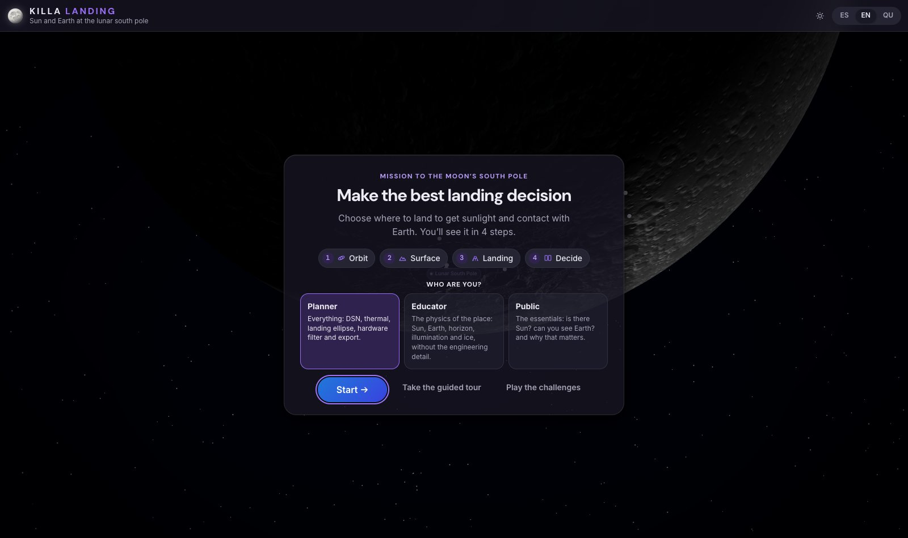
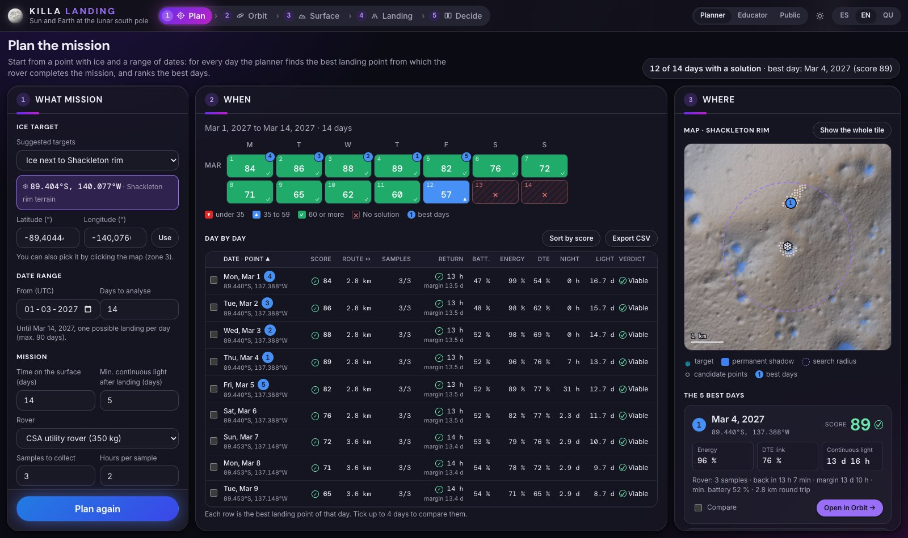
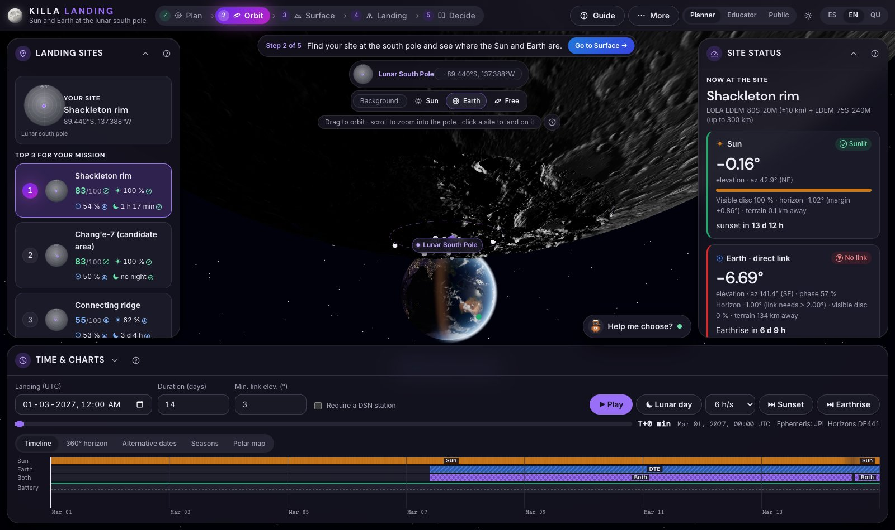
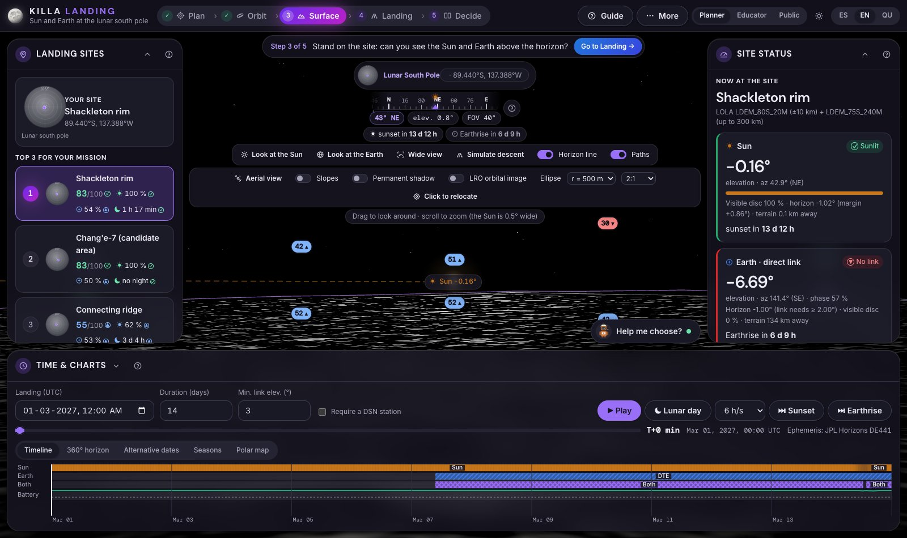
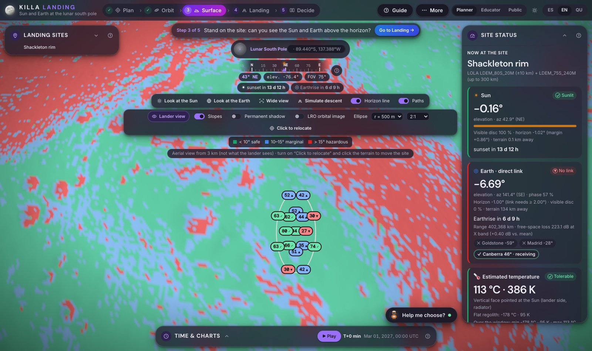
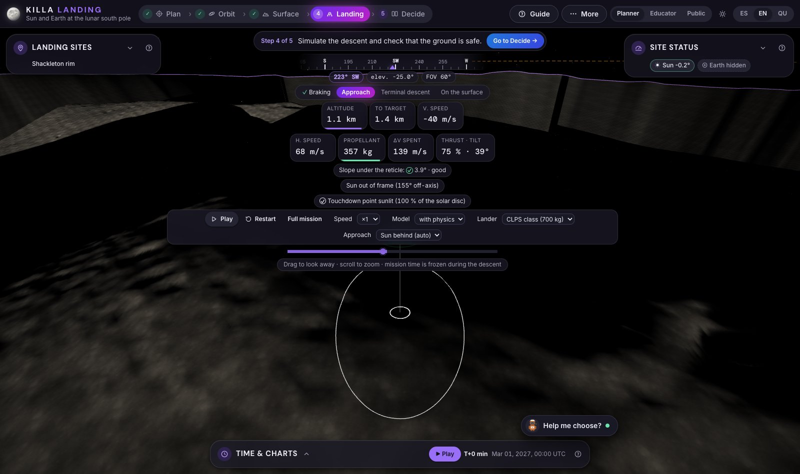
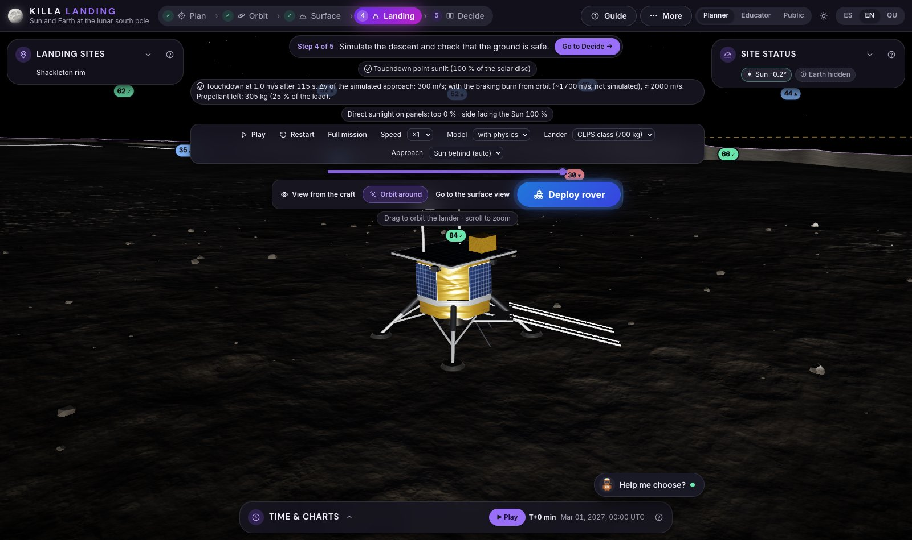
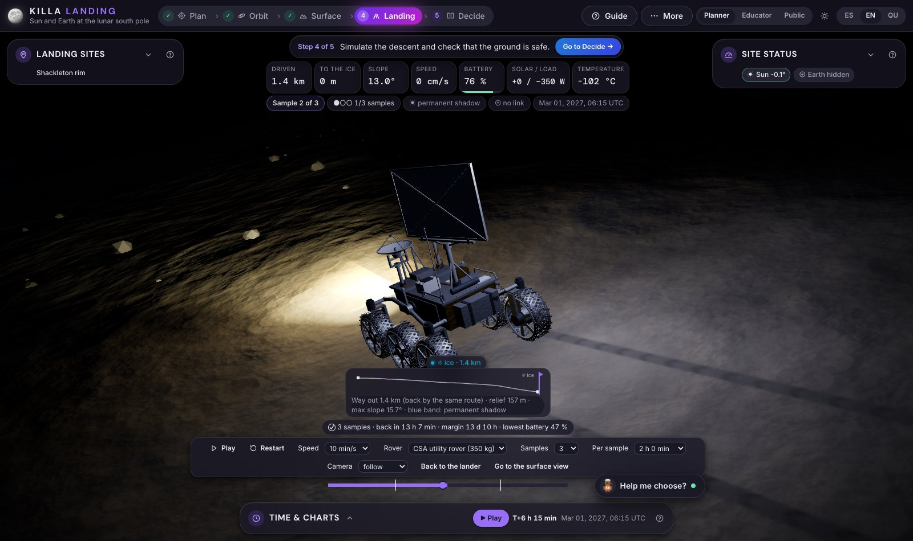
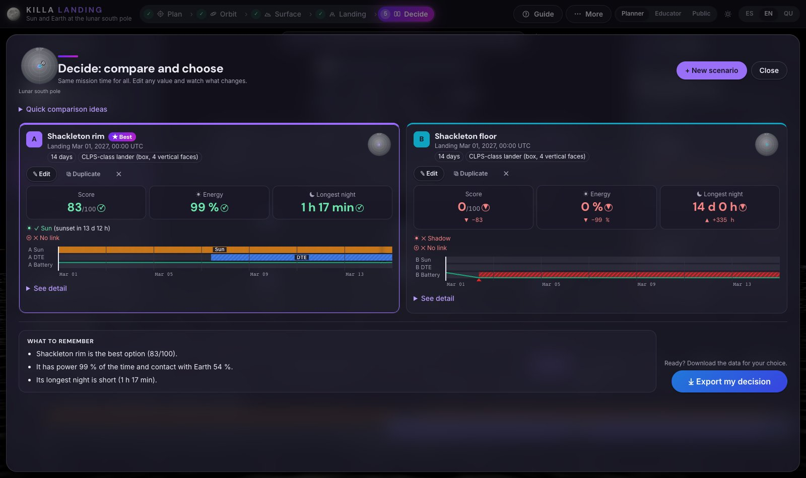
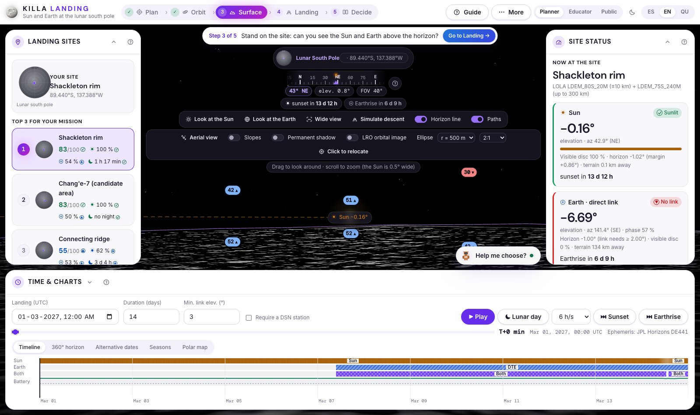

# Killa Landing

> _Killa_ means "Moon" in Quechua. The GitHub repository (`PandisDP/LUMEN`), the site address and a few internal identifiers (the npm package name `lumen-3d`, the `lumen3d.*` storage keys, the `lumen3d_*` export file names) use the name LUMEN.

Killa Landing is a static web application for **planning landings at the lunar south pole**. For any site and landing date it places the Sun and the Earth against the **real terrain horizon** (LOLA topography from the Lunar Reconnaissance Orbiter), computes solar power and direct-to-Earth communications over the mission, checks the landing slope, simulates the powered descent and a rover round trip to permanently shadowed ice, and includes a planner that finds the best landing point for every day of a date range. Everything is computed in the browser: there is no backend.

**Live demo:** <https://pandisdp.github.io/LUMEN/>

The interface is available in Spanish, English and Quechua (the Quechua translation is partial and under review). Use the **EN** button in the top bar or add `?lang=en` to the address.

Related documents:

| Document                           | Contents                                                          |
| ---------------------------------- | ----------------------------------------------------------------- |
| [ARCHITECTURE.md](ARCHITECTURE.md) | Technical design, algorithms, data formats, how to extend         |
| [docs/GUIDE.md](docs/GUIDE.md)     | User guide: every part of the screen and how to read the results  |
| [docs/MISSION.md](docs/MISSION.md) | The mission-planning problem the planner solves, stated formally  |
| [docs/DESIGN.md](docs/DESIGN.md)   | Visual system: tokens, colour roles, components, the Killa mascot |

## Screenshots

| Welcome: choose an audience                        | Plan step: the best landing per day             |
| -------------------------------------------------- | ----------------------------------------------- |
|               |         |
| **Orbit view: the south pole and the Earth**       | **Surface view: the Sun grazing the ridge**     |
|                   |            |
| **Slope layer and landing ellipse**                | **Descent with physics: telemetry and reticle** |
|  |      |
| **Lander on the surface**                          | **Rover: heading to the ice**                   |
|       |  |
| **Rover: sampling in permanent shadow**            | **Decide: compare scenarios**                   |
|      |       |
| **Light theme**                                    |                                                 |
|            |                                                 |

## Contents

- [What the app does](#what-the-app-does)
- [Feature tour](#feature-tour)
- [URL parameters](#url-parameters)
- [Data sources and external resources](#data-sources-and-external-resources)
- [Models and assumptions](#models-and-assumptions)
- [Accuracy checks](#accuracy-checks)
- [Requirements](#requirements)
- [Install and run](#install-and-run)
- [npm scripts](#npm-scripts)
- [Tests](#tests)
- [Data pipeline](#data-pipeline)
- [Deployment](#deployment)
- [Project structure](#project-structure)
- [Browser support and performance](#browser-support-and-performance)
- [Troubleshooting](#troubleshooting)
- [Windows notes](#windows-notes)
- [Known limitations](#known-limitations)
- [Credits](#credits)
- [Licence](#licence)

## What the app does

At the lunar south pole the Sun never climbs more than about 1.5° above the ideal horizon and the Earth hugs the horizon too, so the terrain decides everything: a ridge a few hundred metres high, tens of kilometres away, is enough to hide either of them. Killa Landing answers, for a site and a date:

- **Power.** Sun elevation, visible fraction of the solar disc, longest night, and the **battery state of charge** over the mission for a configurable power profile.
- **Direct-to-Earth (DTE) link.** Earth visibility with a **minimum elevation margin** above the terrain, link windows and outages, optionally requiring a Deep Space Network station to have the Moon in view.
- **Landing safety.** Terrain **slope** and the sensitivity of the mission inside the **landing ellipse** (what happens if the lander touches down a few hundred metres away).
- **Science access.** A yearly illumination map marks **permanently shadowed regions** (PSRs, where water ice can survive) and a rover route to the nearest one is computed on the 20 m terrain.
- **Operations.** A physics-based **descent simulation** and a **rover round trip** (drive to the ice, take samples, drive back to the lander before the mission ends).
- **Planning.** A **planner** that, starting from an ice target and a range of dates, finds for each day the best landing point that satisfies every constraint and ranks the days.

## Feature tour

### Start: splash, welcome and audience modes

- A splash screen with the logo is shown while the site catalogue loads (at least 1.8 s; click, Enter, Space or Escape skip it).
- The welcome card asks **"Who are you?"** and offers a guided tour and the Challenges mode.
- The **audience mode** (top bar, **Mode**) only changes what is shown, never what is computed:

  | Mode         | What it shows                                                                                                                                                            |
  | ------------ | ------------------------------------------------------------------------------------------------------------------------------------------------------------------------ |
  | **Planner**  | Everything: DSN, thermal estimate, landing ellipse, hardware filter, export, link-margin control, custom coordinates. Adds the **Plan** step. This is the default mode.  |
  | **Educator** | The physics of the place (Sun, Earth, horizon, illumination, ice, slopes, charts) without the DSN row, the landing ellipse, the hardware filter, export and link margin. |
  | **Public**   | The essentials (is there Sun, is the Earth in view, the score) with the "Why?" explanations opened automatically once per session.                                       |

  The mode is remembered between visits and travels in the URL (`?mode=`).

### The steps: Plan → Orbit → Surface → Landing → Decide

The step bar at the top leads through the decision. Everyone gets four steps (**Orbit**, **Surface**, **Landing**, **Decide**); the Planner mode adds a first step, **Plan**. A "Go to …" button moves to the next step and any step can be opened directly.

| Step        | What happens there                                                                                                                                            |
| ----------- | ------------------------------------------------------------------------------------------------------------------------------------------------------------- |
| **Plan**    | Planner mode only. The mission planner (see [Planner](#planner)). The other modes choose a site from a **Top 3** instead.                                     |
| **Orbit**   | The Moon lit by the real Sun, the LOLA relief of the polar cap, clickable sites, the Sun with glare and the Earth with day/night side, clouds and atmosphere. |
| **Surface** | Camera 2 m above the ground on the LOLA terrain, Sun and Earth at their true angular size, stars, shadows, horizon line, sky paths and a compass tape.        |
| **Landing** | The descent simulation; after touchdown, the lander on the surface and the rover round trip.                                                                  |
| **Decide**  | The Compare view: up to four scenarios side by side, the scenario editor, takeaways and export.                                                               |

### Sites, Top 3 and custom coordinates

- The left panel (**Landing sites**) shows the **Top 3** south-pole sites for the current date, mission length and hardware limits, ranked live; **See more sites** opens the whole catalogue.
- The catalogue has **22 curated sites**:
  - 11 at the south pole, with 20 m LOLA terrain: Shackleton rim, Connecting ridge, de Gerlache rim, Malapert massif, Mons Mouton (IM-2), Nobile rim (VIPER target area), Nobile Rim 2, Haworth floor (PSR), Shackleton floor (PSR), Cabeus (LCROSS impact) and a Chang'e-7 candidate area;
  - 11 reference sites away from the pole, with 60 m LOLA terrain: IM-1 (Malapert A), Luna-25 (planned site), Chandrayaan-3, Chang'e-4, Chang'e-6, Blue Ghost M1, IM-3 (Reiner Gamma), SLIM, Apollo 11, Apollo 15 and Apollo 17.
- **Custom coordinates** (Planner and Educator modes): enter a latitude and longitude. South of 75.5°S the horizon is computed in the browser from the 480 m LOLA DEM (or at 20 m when the point falls inside a curated tile); within 28 km of a reference site the 60 m tile of that site is used; anywhere else the app falls back to an ideal spherical horizon.
- **Click to relocate** (Surface view, aerial view): click the terrain, or a marker of the landing ellipse, to move the site there; the horizon is recomputed from the 20 m terrain.
- **See this point in …**: buttons that open the active point in LROC QuickMap and Moon Trek, and a pre-filled JPL Horizons query (apparent azimuth and elevation of the Sun or the Earth from the site, hourly, over the current mission window).
- A small locator shows where the site is on the Moon.

### Site status, score and verdict

The right panel (**Site status**) shows, for the active scenario:

- **Now at the site**: Sun elevation and azimuth, visible fraction of its disc, the horizon elevation in that direction and the distance to the terrain that defines it; the same for the Earth, with its phase and whether the DTE link is active; a countdown to the next sunset/sunrise and Earthset/Earthrise.
- **Deep Space Network**: Earth–Moon range, X-band free-space loss, and which complex (Goldstone, Madrid, Canberra) has the Moon above 10°.
- **Window metrics**: energy relative to continuous full Sun, time in sunlight, time with DTE link, time with Sun and Earth at once, longest night, longest link outage, mean and maximum Sun elevation.
- **Score** (0–100): 50 % energy + 35 % Earth link + 15 % survival (see [Models and assumptions](#models-and-assumptions)). An **Engineering ↔ Science** control blends it with the ice-access score.
- **Verdict**: _Viable_, _Marginal_ or _Ruled out_ against the hardware limits (landing slope, longest night, minimum DTE link), naming the limit that fails or is tight.
- **If the date moves**: the score of the same mission landing 1, 3 or 7 days earlier or later; click a value to use that date.
- Cards: **Power · battery** (profiles: CLPS-class box lander, small rover, Canadian utility rover concept, fixed vertical panel, or custom values), **Estimated temperature**, **Terrain · landing** (local slope, p90 and maximum within the ellipse radius, share of ground under 10°), **3σ landing ellipse**, **Ice access (PSR)**.

### Time controls and lunar-day playback

The bottom panel (**Time & charts**) sets the landing date (UTC) and the mission duration (1 to 365 days, default 14) and moves the shared mission clock (T+):

- Slider, **Play/Pause** and speeds of 1, 6, 24, 72, 168 or 720 mission hours per second.
- **Lunar day**: rewinds and plays one synodic day (29.5 Earth days) from the landing.
- Jumps to the next sunrise/sunset and Earthrise/Earthset.
- **Min. link elev. (°)**: the margin the Earth must clear above the terrain (0–10°, default 3°).
- **Require a DSN station**: the link only counts while Goldstone, Madrid or Canberra see the Moon.
- An indicator tells which ephemeris is in use: _JPL Horizons DE441_ or _IAU model (outside 2026–2030)_.
- Missions longer than 60 days are sampled every 30 minutes and longer than 180 days every hour, instead of every 10 minutes.

### Charts

| Tab                   | What it shows                                                                                                                                                                         |
| --------------------- | ------------------------------------------------------------------------------------------------------------------------------------------------------------------------------------- |
| **Timeline**          | Strips for Sun, Earth link, both at once and battery over the mission, plus the height of each body above the local horizon. Click to jump to that moment.                            |
| **360° horizon**      | The terrain profile all around the site with the paths of the Sun and the Earth and the link threshold. **If this were Earth** adds atmospheric refraction and twilight for contrast. |
| **Alternative dates** | The score of the same mission for every landing day over the next 12 months.                                                                                                          |
| **Seasons**           | Month by month from 2026 to 2030: mean energy, DTE link and maximum Sun elevation (the ±1.54° yearly swing). Click a month to land in it.                                             |
| **Polar map**         | The cap from 80°S to 90°S in polar stereographic projection with LOLA relief, the yearly illumination and permanent shadow of the curated tiles, and clickable sites.                 |

The 360° horizon, Alternative dates and Seasons tabs are hidden in Public mode.

### Surface layers and the landing ellipse

In the Surface view (**Controls**):

- **Look at the Sun / Look at the Earth**, **Wide view**, **Horizon line**, **Paths**.
- **Aerial view** from 3 km and **Lander view**.
- **Slopes**: colours the terrain as < 10° safe, 10–15° marginal, > 15° hazardous.
- **Permanent shadow**: colours the terrain by mean yearly illumination, marks PSRs and draws the rover route to the ice.
- **LRO orbital image**: a real LRO mosaic draped on the relief (LROC NAC at 10 m/px where it exists; the 100 m WAC mosaic north of 85.5°S). Its shadows are those of the photograph, not the simulated date.
- **Ellipse**: a 3σ landing ellipse of 500 m, 1 km or 2 km semi-major axis, with an along/cross ratio of 1:1, 2:1 or 3:1, laid along the approach track. The mission is evaluated at 17 points (centre plus two rings of eight) weighted by the probability of landing there; the card gives minimum / median / maximum, the expected score, the probability of a good score (≥ 60) and the probability of a safe slope.
- **Suggest a better point**: searches the ellipse for safe ground (slope < 10° with no neighbour ≥ 15°), evaluates the full mission at the 40 highest candidates and proposes the best three, each with a **Go to this point** button.

### Hardware filter

**More → Hardware** (Planner mode): set what the lander tolerates — maximum landing slope (p90 within 500 m), maximum continuous night, minimum DTE link and the rover's maximum slope — and every curated site is marked at once as viable (✓), marginal (!, less than 20 % headroom) or ruled out (✕). **Send viable to Compare** loads the viable ones into the Compare view.

### Compare view and scenario editor

The **Decide** step compares up to **four scenarios** (A–D). A scenario is a site plus a landing date plus its own mission settings (duration, link margin, DSN requirement, power profile, hardware limits, science weight). All scenarios share the same mission time, so they are compared at the same T+.

- **+ New scenario**, **Edit**, **Duplicate** and remove; the **scenario editor** changes the site, date, duration, science weight and the lander and rover limits, and applies changes instantly.
- **Quick scenarios**: "What if Artemis III slips 14 days?", "Near-eternal-light peak vs. crater floor", "Artemis III candidates", "Light vs. ice" (30 % science weight) and "Canadian rover: does it survive the night?" (30 days with the utility rover profile).
- The best scenario is highlighted and a **What to remember** box summarises it in plain language.

### Export and sharing

- **Export** (Planner mode): time series (CSV), full scenario (JSON), horizon profile (CSV), or all the Compare scenarios (JSON).
- The address bar always holds the full state, so copying it shares exactly what is on screen (see [URL parameters](#url-parameters)).

Columns of the time-series CSV (one row per sample; `#` header lines carry the site, coordinates, horizon source, landing date, visibility threshold, link margin and power profile):

| Column                                                               | Meaning                                                        |
| -------------------------------------------------------------------- | -------------------------------------------------------------- |
| `utc_iso`                                                            | Sample instant (UTC)                                           |
| `sun_az_deg`, `sun_el_deg`                                           | Sun azimuth (clockwise from north) and elevation               |
| `sun_horizon_el_deg`                                                 | Elevation of the terrain horizon at the Sun's azimuth          |
| `sun_frac`                                                           | Visible fraction of the solar disc (0–1)                       |
| `earth_az_deg`, `earth_el_deg`, `earth_horizon_el_deg`, `earth_frac` | The same for the Earth (the fraction includes the link margin) |
| `sunlit`, `dte`, `both`                                              | 1/0: Sun visible, DTE link, both at once                       |
| `array_power_w`                                                      | Power generated by the arrays of the profile (W)               |
| `battery_soc_pct`                                                    | Battery state of charge (%)                                    |
| `operating`                                                          | 1 operating, 0 hibernating                                     |

The JSON export holds the same data in columnar form plus the metrics and the Sun and DTE windows.

### Descent simulation

The **Landing** step (or **Simulate descent** in the Surface view) flies the final approach to the site:

- **Model**: _with physics_ (a point mass with bounded thrust, lunar gravity and the rocket equation, guided to touchdown) or _quick_ (a 45-second illustrative fly-down without physics). If the guidance cannot close, the quick fly-down is shown and the reason is stated (out of propellant, terrain under the approach, hard landing, timeout).
- **Lander**: CLPS class (700 kg dry), small (200 kg) or heavy (6 t). The values are illustrative.
- **Approach**: Sun behind (automatic), Sun ahead, or a chosen azimuth.
- Telemetry: phase (braking, approach, terminal descent, on the surface), altitude, distance to target, vertical and horizontal speed, propellant, Δv spent, thrust and tilt; a reticle coloured by the slope under it; a warning when the Sun is in the camera's field of view; whether the touchdown point is sunlit.
- **Hazard advice**: if the target is not safe ground the guidance reports where it would divert (within 300 m) and the extra Δv, with a **Land there** button that moves the site.
- A touchdown summary gives the vertical speed, the Δv of the simulated approach and the total including the braking burn from orbit, and the propellant left.
- After touchdown: view from the craft, orbit around the lander (procedural model, panels and shadow), playback at 1×, 2× or 4×.

### Rover round trip

After touchdown, **Deploy rover** (or **Full mission**, which plays the descent and then the traverse, or **See the traverse** on the ice card) runs the rover mission:

1. the rover rolls down the lander's ramps and drives to the permanently shadowed ground along the least-cost route;
2. it takes the requested **samples** at the ice (1–10 samples of 0.5–6 h each; default 3 × 2 h);
3. it drives back to the lander along the same route and must arrive **before the surface mission ends**.

- **Rovers**: a micro-rover (40 kg, 10 cm/s, 600 Wh) and a CSA-inspired utility rover (350 kg, 20 cm/s, 5 000 Wh; the default). Both are illustrative.
- The HUD shows the state (_Heading to the ice_, _Recharging_, _Sample 2 of 3_, _Heading back_, _Back at the lander_, or a failure), distance driven, slope, speed, battery, solar input and load, temperature, Sun/shadow and link, an elevation profile of the route, three cameras (follow, mast, top-down) and playback at 120× to 3 600×.
- When the trip fails the HUD says why — no route, out of battery before the ice, did not finish the samples, out of battery on the way back, back late, or battery below the minimum — and offers **fix actions**: _Collect fewer samples_, _Shorten each sample_, _Use the utility rover_.
- `&view=landing&rover=1` opens the traverse directly, skipping the descent.

### Planner

The **Plan** step (Planner mode) starts from the ice instead of from a landing site.

**Inputs**

| Zone             | Inputs                                                                                                                                                                                                                                                                                                    |
| ---------------- | --------------------------------------------------------------------------------------------------------------------------------------------------------------------------------------------------------------------------------------------------------------------------------------------------------- |
| **What mission** | Ice target: a suggested target (ice next to a sunlit curated site, or a permanently shadowed interior), a hand-typed point, or a click on the map. Time on the surface, minimum continuous light after landing, samples and hours per sample, rover, minimum rover battery, search radius (1, 2 or 3 km). |
| **When**         | First date and number of days (up to 90; landing dates must fall within 2026–2030).                                                                                                                                                                                                                       |
| **Constraints**  | The active scenario's hardware limits (landing slope, longest night, minimum DTE link, rover slope), link margin, DSN requirement and science weight.                                                                                                                                                     |

Defaults: 30 days analysed, 15 days of continuous light, 20 % minimum rover battery, 2 km radius, 3 samples of 2 h.

**What it computes.** For each day of the range, the best landing point around the target from which the mission closes. A point is rejected on a day by the first of these constraints it fails:

| Violation           | Meaning                                                                |
| ------------------- | ---------------------------------------------------------------------- |
| `no-route`          | No drivable route from the point to the ice                            |
| `no-sun-at-landing` | Touchdown in the dark                                                  |
| `short-light`       | Less continuous sunlight from touchdown than required                  |
| `slope`             | Landing slope (p90 within 500 m) over the hardware limit               |
| `night`             | Longest night over the hardware limit                                  |
| `dte`               | Direct-to-Earth link under the hardware minimum                        |
| `rover-unreachable` | The rover does not make it to the ice                                  |
| `rover-samples`     | It reaches the ice but cannot finish the sampling                      |
| `rover-no-return`   | It samples, but the battery fails on the way back                      |
| `rover-late`        | It comes back after the end of the surface mission                     |
| `rover-battery`     | It completes the round trip in time but dips below the minimum battery |

**Results**

- A **calendar** of the range coloured by the score of each day's best point (under 35, 35–59, 60 or more; the best days highlighted; days with no solution show why). It can be driven with the arrow keys, Home and End.
- A **day-by-day table** (sortable) with the landing point, round-trip route, energy, DTE link, longest night, continuous light, samples, return time and margin, lowest rover battery and verdict; **Export CSV** writes one row per day.
- A **map** of the 20 m terrain around the target with permanent shadow, the search radius, the candidate points and the best days.
- **The 5 best days**, ranked by score, then by time to spare at the lander, then by lowest battery. Each can be **opened in Orbit** (it becomes the active scenario as a custom site, with its ice target) and up to four can be sent to **Compare**.
- When no day has a solution, the planner names the constraint that rejects most points and offers up to three one-click fixes (widen the date range, lower the minimum light, widen or narrow the radius, lower the minimum battery, collect fewer or shorter samples, switch to the utility rover, extend the mission). Each fix changes one input; press **Plan** again to recompute.

The plan runs in a web worker in batches of three days, shows progress, can be cancelled, and remembers its inputs between visits.

### Challenges mode

**More → Challenges** (also offered on the welcome card) is a game mode built on what the app already computes: five short guided missions with goals, optional hints and a score (100 points each, 15 fewer per hint revealed, never below 40; best scores are remembered).

| Challenge                | Goal                                                                                                                         |
| ------------------------ | ---------------------------------------------------------------------------------------------------------------------------- |
| **Find the light**       | A south-pole site with the Sun up at least 80 % of a 14-day mission                                                          |
| **Don't lose the Earth** | Direct-to-Earth link at least 50 % of the time over 14 days                                                                  |
| **Survive the night**    | A 30-day mission whose longest night is at most 120 h and whose verdict is not "Ruled out"                                   |
| **Land with margin**     | A site with a safe slope (p90 < 15°) and a physics descent that touches down with at least 20 % propellant margin            |
| **Bring ice back**       | A site with a drivable route to the ice; the rover collects every sample, returns in time and never drops below 30 % battery |

Each challenge puts the app in a starting state where the goals are not met; the user solves it with the normal controls and the checklist ticks itself off.

### Why?, glossary, guided tour and help

- **Why?** opens eight explanation cards for a general audience (why the Sun never climbs at the pole, why a few metres change everything, why there is no twilight, the far side, two-week nights, Canada on the Moon…), each with a button that opens a site illustrating it, a list of the external resources used, and a ten-term **glossary**.
- **Guide** starts a 12-step guided tour (← → to move, Esc to close).
- Every panel and the view controls have a **?** button with contextual help.

### Assistant and the Killa mascot

A floating **assistant** proposes three ready-made scenarios for the current date and mission — best overall, best contact with Earth, and best light plus ice — which can be applied or compared, and answers short questions about light, Earth, slope, ice and night.

By default the answers are computed on the device from the catalogue evaluation (keyword matching, labelled "Demo mode" in the UI). If the build-time variable `VITE_ASSISTANT_URL` is set, the assistant posts to `{VITE_ASSISTANT_URL}/suggest` and `/ask` and falls back to the local answers on any failure; no such backend is part of this repository.

**Killa** is the app's mascot (a copper robot with a crescent Moon on its chest). It appears only where the app speaks or waits — the assistant, loading states, empty states and errors — and as the favicon.

### Languages

| Code | Language                         | Status                                                                                                                                                                                                               |
| ---- | -------------------------------- | -------------------------------------------------------------------------------------------------------------------------------------------------------------------------------------------------------------------- |
| `es` | Spanish                          | Source dictionary (949 keys).                                                                                                                                                                                        |
| `en` | English                          | Complete; typed against the Spanish dictionary, so a missing or extra key does not compile.                                                                                                                          |
| `qu` | Quechua (Southern, Cusco-Collao) | Partial: 750 of 949 keys (79 %). Anything missing falls back to Spanish. The translation was written by a language model, not a native speaker,, and has not been reviewed by one. The texts live in `src/i18n/qu/`. |

The language is taken from `?lang=`, then from the saved choice, then from the browser language (Spanish → ES, Quechua → QU, anything else → EN). Site names and descriptions are available in Spanish and English.

### Themes

Dark by default, light as the alternative (Sun/Moon button in the top bar). The 3D scene and everything floating on it stay dark in both themes. The choice is remembered.

### Keyboard and accessibility

| Key                 | Effect                                               |
| ------------------- | ---------------------------------------------------- |
| `1` · `2` · `3`     | Expand or minimise the left, right and bottom panels |
| `←` `→` · `Esc`     | Guided tour: previous / next step, close             |
| `Esc`               | Close a help popover                                 |
| Enter · Space · Esc | Skip the splash screen                               |
| Arrow keys          | Surface view: turn the camera                        |
| Arrows · Home · End | Planner calendar: move between days                  |

- Panels are collapsible (a minimised panel shows a summary) and **Hide panels** leaves only the 3D scene.
- States never rely on colour alone: each level carries a glyph and a text label; the timeline uses patterns and labels; the horizon chart uses filled and hollow dots.
- Charts and controls carry ARIA labels; the guided tour traps focus; a visible focus ring is part of the design tokens.
- Animations respect `prefers-reduced-motion`.

## URL parameters

The address is rewritten as the state changes (once a site has been chosen). All parameters are optional.

| Parameter    | Example                       | Meaning                                                                                                                                                                             |
| ------------ | ----------------------------- | ----------------------------------------------------------------------------------------------------------------------------------------------------------------------------------- |
| `site`       | `site=shackleton-rim`         | Curated site id.                                                                                                                                                                    |
| `lat`, `lon` | `lat=-89.1&lon=-60`           | Custom coordinates (degrees; used instead of `site`).                                                                                                                               |
| `date`       | `date=2027-03-01T00:00Z`      | Landing date and time (UTC).                                                                                                                                                        |
| `days`       | `days=14`                     | Mission duration in days (1–365).                                                                                                                                                   |
| `view`       | `view=micro`                  | `macro` (Orbit), `micro` (Surface) or `landing`.                                                                                                                                    |
| `ap`         | `ap=90`                       | Approach azimuth of the descent, degrees. Omitted = automatic (Sun behind the craft).                                                                                               |
| `rover`      | `rover=1`                     | With `view=landing`: open the rover traverse directly, skipping the descent.                                                                                                        |
| `ice`        | `ice=-89.4044,-140.0766`      | Ice target of a planner pick (`lat,lon`): the rover goes to the shadowed ground nearest to this point.                                                                              |
| `link`       | `link=3`                      | DTE link margin, degrees (0–10).                                                                                                                                                    |
| `dsn`        | `dsn=1`                       | The link also needs a DSN station with the Moon in view.                                                                                                                            |
| `hw`         | `hw=15,120,30,20`             | Hardware limits: max landing slope (°), max night (h), min DTE (%), rover max slope (°). Written only when they differ from the defaults.                                           |
| `sci`        | `sci=0.3`                     | Science weight in the score (0–1). Written only when above 0.                                                                                                                       |
| `en`         | `en=lander`                   | Power profile: `lander`, `rover`, `csa-rover`, `fixed`, or `custom:panel,az,peak,battery,active,hibernate,threshold,initial` (e.g. `custom:vertical-box,0,150,1500,150,45,25,100`). |
| `s`          | `s=siteA@date,siteB@date~d30` | Scenario list for Compare (two to four items, comma-separated): `site@date` with optional per-scenario overrides. Custom sites use the id `custom:lat:lon`.                         |
| `a`          | `a=0`                         | Index of the active scenario in `s`.                                                                                                                                                |
| `cmp`        | `cmp=1`                       | Open the Compare view.                                                                                                                                                              |
| `lang`       | `lang=en`                     | Interface language: `es`, `en` or `qu`.                                                                                                                                             |
| `mode`       | `mode=public`                 | Audience mode: `planner`, `educator` or `public`.                                                                                                                                   |

Per-scenario overrides inside `s` are appended with `~` and only written for settings that differ from the active scenario (whose settings are the top-level parameters). Lists inside an override use `_` instead of `,`:

| Override             | Meaning                           |
| -------------------- | --------------------------------- |
| `~d30`               | Mission duration, days            |
| `~l3`                | Link margin, degrees              |
| `~gs1`               | DSN station required (`1`) or not |
| `~sci0.3`            | Science weight                    |
| `~enrover`           | Power profile                     |
| `~hw15_120_30_20`    | Hardware limits                   |
| `~i-89.1234_45.6789` | Ice target of that scenario       |

A link that names a site, coordinates or a scenario list skips the welcome and site-choice screens.

## Data sources and external resources

Every external resource is queried **only by the offline scripts** in `scripts/data/`, never by the running app (the exception is the outbound links and the pre-filled Horizons query the user can open). The processed products are committed under `public/data/` (about 65 MB), so nothing has to be downloaded to run the app.

| Resource                                                                                                                                                     | Provider                                      | What it is used for                                                                                                                                                                                                                                   |
| ------------------------------------------------------------------------------------------------------------------------------------------------------------ | --------------------------------------------- | ----------------------------------------------------------------------------------------------------------------------------------------------------------------------------------------------------------------------------------------------------- |
| LOLA `LDEM_80S_20M` (20 m/px, 80°S–90°S), [PDS Geosciences Node](https://pds-geosciences.wustl.edu/lro/lro-l-lola-3-rdr-v1/lrolol_1xxx/data/lola_gdr/polar/) | NASA/GSFC (LRO Lunar Orbiter Laser Altimeter) | A 1024 × 1024 tile (20.5 km) around each polar site: 3D terrain, slopes, near-field horizon, illumination maps, rover routes.                                                                                                                         |
| LOLA `LDEM_75S_240M` (240 m/px, 75°S–90°S)                                                                                                                   | NASA/GSFC                                     | Far-field horizon out to 300 km for the polar sites; resampled to 480 m for custom coordinates and to 960 m for the relief of the orbital view and the polar map.                                                                                     |
| LOLA global `LDEM_512` (512 px/deg ≈ 59 m) and `LDEM_64` (64 px/deg ≈ 474 m)                                                                                 | NASA/GSFC                                     | Reference sites north of 80.2°S: a 60 m tile (±30 km) reprojected to a local stereographic projection, and the far-field horizon to 300 km (build time only).                                                                                         |
| [JPL Horizons](https://ssd.jpl.nasa.gov/horizons/), ephemeris DE441                                                                                          | NASA/JPL-Caltech                              | Sun and Earth positions in the Moon body-fixed frame, tabulated every 2 h from 2025-12-31 to 2031-01-02 (`public/data/ephem/de441.bin`, 514 KB) and interpolated in the browser. Also the reference for the accuracy checks and for the DSN geometry. |
| [astronomy-engine](https://github.com/cosinekitty/astronomy)                                                                                                 | Don Cross (npm package)                       | Fallback ephemeris with the IAU lunar rotation model for dates outside the table (or if the table is missing), and the Moon seen from the DSN stations.                                                                                               |
| [Moon Trek](https://trek.nasa.gov/moon/) WMTS                                                                                                                | NASA/JPL Solar System Treks                   | LRO WAC global mosaic (2048 × 1024) on the orbital globe and LRO WAC south-pole mosaic (about 1 km/px) on the polar cap; the LOLA mean Earth-visibility map as a cross-check; an outbound link per site.                                              |
| [LROC QuickMap](https://quickmap.lroc.im-ldi.com/) WMS                                                                                                       | Arizona State University (LROC)               | LROC NAC south-pole mosaic at 10 m/px over each polar tile (WAC 100 m north of 85.5°S) for the "LRO orbital image" layer; the WAC illumination map of Speyerer & Robinson (2013) as a cross-check; an outbound link per site.                         |
| [CSA Moon exploration portal](https://www.asc-csa.gc.ca/eng/astronomy/moon-exploration/)                                                                     | Canadian Space Agency                         | Context only: the "Canada on the Moon" explanation card and the idea behind the utility rover profile and its quick scenario. The rover's numbers are an illustrative budget, not CSA specifications.                                                 |

What is shipped in `public/`:

| Path                                          | Size   | Contents                                                        |
| --------------------------------------------- | ------ | --------------------------------------------------------------- |
| `public/data/terrain/`                        | 44 MB  | 22 terrain tiles (1024 × 1024 Int16, 2 MiB each)                |
| `public/data/dem/`                            | 10 MB  | South-polar DEM at 480 m and 960 m                              |
| `public/data/imagery/`                        | 10 MB  | Moon Trek mosaics (globe and polar cap) and 11 LROC site images |
| `public/data/ephem/`                          | 520 KB | DE441 Sun/Earth table                                           |
| `public/data/illum/`                          | 484 KB | 11 yearly illumination maps (one per polar site)                |
| `public/data/sites/`                          | 268 KB | Site index and one horizon-mask file per site                   |
| `public/textures/`                            | 1.7 MB | Earth textures (day, night lights, clouds, ocean mask)          |
| `public/pets/killa.svg`, `public/favicon.svg` | —      | Mascot icon and logo                                            |

## Models and assumptions

All models are first-order engineering estimates intended for comparing sites and dates. Parameter values below are read from the source.

| Model               | Parameters and assumptions                                                                                                                                                                                                                                                                                                                                                                                                                                                                                                                                                                              |
| ------------------- | ------------------------------------------------------------------------------------------------------------------------------------------------------------------------------------------------------------------------------------------------------------------------------------------------------------------------------------------------------------------------------------------------------------------------------------------------------------------------------------------------------------------------------------------------------------------------------------------------------- |
| Geometry            | Reference sphere of 1 737.4 km (LOLA heights are relative to it). Observer 2 m above the terrain. No atmosphere, no refraction.                                                                                                                                                                                                                                                                                                                                                                                                                                                                         |
| Visibility          | A body is "visible" when at least **half of its disc** is above the terrain horizon. The visible fraction of the disc is computed analytically against a locally straight horizon.                                                                                                                                                                                                                                                                                                                                                                                                                      |
| Horizon mask        | Ray-marched along great circles out to 300 km with exact spherical geometry (curvature included). Curated sites: 0.5° azimuth bins. Custom points: 1° (0.5° inside a curated tile). Starts from −90°, since from a peak the true horizon lies below 0°.                                                                                                                                                                                                                                                                                                                                                 |
| DTE link            | The Earth must clear the terrain by a configurable margin (default 3°, range 0–10°). Optionally a DSN complex must see the Moon. No link budget (power, antenna gain, noise) is modelled.                                                                                                                                                                                                                                                                                                                                                                                                               |
| DSN                 | Goldstone, Madrid and Canberra "see" the Moon at elevation ≥ 10°, computed for the Moon's centre. The station coordinates are constants in `src/astro/dsn.ts` (no source is cited there). Free-space path loss at 8 450 MHz (X band), also relative to the mean distance of 384 400 km. Geometry only: no pass scheduling.                                                                                                                                                                                                                                                                              |
| Score               | `round(0.5 · energy % + 0.35 · DTE % + 15 · survival)`, with `survival = 1 − min(longest night / 120 h, 1)`. The battery verdict is shown separately and does not change the score.                                                                                                                                                                                                                                                                                                                                                                                                                     |
| Science score       | 100 when the rover route to the ice is ≤ 500 m, falling linearly to 0 at 2 km, and up to halved when the route's steepest slope approaches the rover limit. Combined score = `(1 − w) · engineering + w · science`.                                                                                                                                                                                                                                                                                                                                                                                     |
| Slope               | Horn's 3 × 3 operator on the DEM (a 40 m baseline on the 20 m tiles), corrected by the stereographic scale factor. < 10° safe, 10–15° marginal, > 15° hazardous. The reference sites use the 60 m tiles and custom points outside a tile the 480 m DEM, which smooth the slope.                                                                                                                                                                                                                                                                                                                         |
| Hardware verdict    | Defaults: landing slope ≤ 15° (p90 within 500 m), night ≤ 120 h, DTE ≥ 30 %, rover slope ≤ 20°. _Ruled out_ if any limit is exceeded; _marginal_ if any is met with less than 20 % headroom.                                                                                                                                                                                                                                                                                                                                                                                                            |
| Landing ellipse     | 3σ footprint of a bivariate normal landing error; semi-major axis 500 m, 1 km or 2 km along the approach track, semi-minor 1, 1/2 or 1/3 of it. Centre plus 2 rings of 8 points, each weighted by the probability of its cell. Per point: 1° horizon and a 30-minute series (60 minutes for missions over 180 days).                                                                                                                                                                                                                                                                                    |
| Better-point search | 40 m grid inside the ellipse; slope < 10° with no 3 × 3 neighbour ≥ 15°; the 40 highest points are evaluated with a 1° horizon and a 30-minute series; the best 3 by (combined) score are returned.                                                                                                                                                                                                                                                                                                                                                                                                     |
| Power and battery   | Array power = peak power × visible disc fraction × incidence factor (two-axis tracking, four-face vertical box, one fixed vertical face, or horizontal). The craft operates while the Sun is up and the battery is above its hibernation threshold, otherwise it draws the survival load. Explicit Euler integration; surplus is curtailed. No thermal, ageing or conversion losses. Profiles are illustrative (e.g. the default lander: 150 W per face, 1 500 Wh, 150 W operating, 45 W survival, hibernates below 25 %).                                                                              |
| Temperature         | Instantaneous radiative equilibrium while lit (solar constant 1 361 W/m², albedo 0.12, emissivity 0.95) for flat regolith and for a Sun-facing vertical face; exponential cooling in shadow (τ = 4 h) towards 95 K, or 40 K where the site sees no Sun in the whole window. Freeze limit 173 K (−100 °C). No conduction or heaters: an order of magnitude, not a thermal model.                                                                                                                                                                                                                         |
| Permanent shadow    | Per polar tile, cells of about 100 m: a 3° horizon per cell (tile downsampled 5× plus the 480 m DEM to 300 km) against Sun positions every 6 h for 1 461 samples starting 2026-01-01 (about one year). A cell is a PSR when the visible disc fraction never exceeds 1 %.                                                                                                                                                                                                                                                                                                                                |
| Ice access          | Least-cost route (Dijkstra, 8 neighbours) on the 20 m DEM to the nearest PSR cell within 2 km, never over pixels steeper than the rover limit; the cost grows with slope. With a planner ice target, the route goes to the shadowed cell nearest to that target (snapped within 1.5 km).                                                                                                                                                                                                                                                                                                                |
| Descent (physics)   | 3-DOF point mass, constant gravity 1.62 m/s², bounded thrust with a minimum throttle, mass flow from the rocket equation. ZEM/ZEV guidance to a gate 30 m above the target, then a vertical terminal descent at 1.5 m/s (1 m/s in the last 5 m). Simulated from 3.5 km altitude and 7.5 km range at 170 m/s horizontal and 50 m/s vertical descent rate. The braking burn from orbit (1 700 m/s) is charged to the propellant with the rocket equation but not integrated. Touchdown limits: 2.5 m/s vertical, 1 m/s horizontal. Hazard gate at 500 m: divert to the nearest safe ground within ±300 m. |
| Descent (quick)     | A purely kinematic 45-second fly-down along waypoints that clear the terrain. Mission time is frozen during the descent; the lighting is that of the touchdown instant.                                                                                                                                                                                                                                                                                                                                                                                                                                 |
| Landers             | CLPS class: 700 kg dry, 1 200 kg propellant, 4 000 N, Isp 320 s. Small: 200 kg, 520 kg, 2 000 N, 320 s. Heavy: 6 000 kg, 8 500 kg, 45 000 N, 311 s. Illustrative orders of magnitude, not the specifications of any vehicle.                                                                                                                                                                                                                                                                                                                                                                            |
| Rover traverse      | Route resampled every 10 m. Commanded speed derated linearly with slope (never below 20 %). Traction power = `m · g · v · (sin θ + 0.15 · cos θ) / 0.6` (rolling resistance 0.15, drivetrain efficiency 0.6), never negative. Same battery step as the lander. Sun and Earth at the rover's own position against horizons ray-marched every ~200 m of route; inside a PSR cell the Sun is forced to 0. Below its hibernation threshold the rover stops and waits until it is 10 points above it (giving up after 14 days, or immediately on permanently shadowed ground).                               |
| Rover sampling      | `samples × hours per sample` stopped at the ice with the instrument on (30 W for the micro-rover, 150 W for the utility rover, on top of the operating load). If the battery falls below the hibernation threshold on permanently shadowed ground, the sampling fails: there is no Sun to recharge with.                                                                                                                                                                                                                                                                                                |
| Rover success       | Reaches the ice, completes every sample, returns to the lander, and returns before the end of the surface mission. The planner additionally requires the lowest battery of the whole trip to stay above the chosen minimum.                                                                                                                                                                                                                                                                                                                                                                             |
| Rovers              | Micro-rover: 40 kg, 0.1 m/s, 120 W tracking array, 600 Wh, 70 W operating, 18 W survival. Utility rover: 350 kg, 0.2 m/s, 400 W, 5 000 Wh, 200 W operating, 10 W survival. Illustrative values.                                                                                                                                                                                                                                                                                                                                                                                                         |

**Not simulated**

- The Earth–Moon transfer, lunar orbit insertion and the braking burn from orbit (the last is only accounted for as a fixed Δv). [docs/MISSION.md](docs/MISSION.md) states the surface problem the planner solves.
- Attitude dynamics, engine lag and navigation errors during the descent; the guidance does not steer around terrain ahead of it.
- The hand-over of the samples to the lander and any ascent or return to Earth: the rover mission ends when the rover is back at the lander.
- Rover slip, sinkage, obstacle avoidance below the 20 m DEM and regenerative braking.
- A communications link budget, relay satellites, and DSN scheduling.
- Thermal control, heaters and battery ageing.

## Accuracy checks

These are engineering checks of the ephemeris and illumination products against independent references. They run offline and store their reference values as test fixtures, so the unit tests verify them without network access.

**Ephemeris against JPL Horizons** (`npm run validate`). The script queries Horizons for the apparent azimuth and elevation of the Sun and the Earth from all 22 catalogue sites at 12 instants spread over 2026–2030, chosen at hh:37 so that none coincides with a 2-hour sample of the table (this exercises the interpolation as well as the frame conversion): 528 reference positions, stored in `src/astro/__fixtures__/horizons.json`.

| Model                                 | Maximum difference over the 528 positions |
| ------------------------------------- | ----------------------------------------- |
| DE441 table, cubic interpolation      | **1.5″** (0.0004°)                        |
| IAU model (astronomy-engine fallback) | **24″** (0.0067°)                         |

For scale, the solar disc is about 0.27° in radius. The unit tests enforce 0.001° for the table and 0.02° for the IAU model.

**DSN geometry.** The same script compares the Moon's azimuth and elevation from Goldstone, Madrid and Canberra with Horizons at 60 instants per station (180 positions, `horizons-dsn.json`): maximum difference **0.0012°**.

**Illumination against LROC QuickMap and Moon Trek** (`npm run validate:illum`). The reference layers are display images with an undocumented grey scale, so only order-preserving statistics are used. Results are stored in `src/astro/__fixtures__/illum-validation.json`.

| Comparison                                                           | Reference                                                           | Result                                                                                                |
| -------------------------------------------------------------------- | ------------------------------------------------------------------- | ----------------------------------------------------------------------------------------------------- |
| Yearly Sun illumination, cell by cell (100 m), 4 tiles south of 88°S | LROC WAC illumination map (Speyerer & Robinson, 2013), QuickMap WMS | Spearman rank correlation 0.94–0.98                                                                   |
| Permanently shadowed cells                                           | The "never illuminated" class of the same map                       | Intersection over union 0.98 inside Shackleton; 0.44–0.57 for the small PSRs on the three ridge tiles |
| Yearly Earth visibility, per site (9 polar sites)                    | LOLA mean Earth-visibility map (Moon Trek)                          | Spearman rank correlation 0.99                                                                        |

The lower overlap on the ridge tiles reflects the different resolution and method of the two maps for small shadowed patches.

## Requirements

- **Node.js 20.19 or newer** for the app (`engines` in `package.json`). The data and validation scripts are TypeScript files run directly by `node`, which needs a Node version with built-in type stripping (22.18 or newer). CI uses Node 22.
- npm (a `package-lock.json` is committed; use `npm ci` for reproducible installs).
- A browser with WebGL 2.
- For the end-to-end tests: Google Chrome installed locally (CI uses Playwright's Chromium).

## Install and run

```bash
git clone https://github.com/PandisDP/LUMEN.git
cd LUMEN
npm install
npm run dev
```

The dev server opens the browser at <http://localhost:5173> (or the next free port if another dev server is running; use the URL Vite prints). The processed data is already in `public/data/`, so no download is needed.

Production build and local preview:

```bash
npm run build     # type-check, then build into dist/
npm run preview   # serve dist/ locally
```

Optional build-time environment variable: `VITE_ASSISTANT_URL` (base URL of an assistant backend; see [Assistant and the Killa mascot](#assistant-and-the-killa-mascot)).

## npm scripts

| Command                  | What it does                                                                                                |
| ------------------------ | ----------------------------------------------------------------------------------------------------------- |
| `npm run dev`            | Vite dev server with hot reload                                                                             |
| `npm run build`          | `tsc -b` (type check) and `vite build` into `dist/`                                                         |
| `npm run preview`        | Serve `dist/` locally                                                                                       |
| `npm run typecheck`      | Type check only (`tsc -b`)                                                                                  |
| `npm run lint`           | ESLint                                                                                                      |
| `npm run format`         | Format with Prettier                                                                                        |
| `npm run format:check`   | Check formatting without writing                                                                            |
| `npm test`               | Unit and component tests (Vitest, single run)                                                               |
| `npm run test:watch`     | Vitest in watch mode                                                                                        |
| `npm run test:coverage`  | Vitest with V8 coverage                                                                                     |
| `npm run test:e2e`       | Production build, then the Playwright smoke tests                                                           |
| `npm run data`           | Rebuild `public/data/` from LOLA (see [Data pipeline](#data-pipeline))                                      |
| `npm run data:ephem`     | Download the DE441 table from JPL Horizons                                                                  |
| `npm run data:derived`   | Slopes, illumination/PSR maps and ice access from the published data                                        |
| `npm run data:imagery`   | Download the Moon Trek mosaics and the LROC site images                                                     |
| `npm run validate`       | Compare the ephemeris and the DSN geometry with JPL Horizons and refresh the test fixtures                  |
| `npm run validate:illum` | Compare the illumination maps and Earth visibility with LROC QuickMap and Moon Trek and refresh the fixture |

## Tests

- **Unit and component tests** — `npm test`: **1 849 tests in 66 files** (Vitest with jsdom and Testing Library), all passing at the time of writing. They cover the astronomy core (ephemeris against the Horizons fixtures, projections, DEM sampling, horizon, windows, metrics, slopes, dispersion, energy, thermal, DSN, ice access, descent physics and planning, rover traverse, planner), the configuration (sites, challenges, energy profiles), the stores and URL round trips, the dictionaries (key and parameter parity, Quechua being partial), the worker handlers and the UI components. jsdom has no WebGL, so the 3D scene components are not rendered in these tests; their pure geometry helpers are tested.
- **End-to-end smoke tests** — `npm run test:e2e`: **7 Playwright tests** in `e2e/smoke.spec.ts`, run against the production build served by `vite preview` on port 4173:
  1. a shared scenario loads and shows the state of the site;
  2. each audience sees its own level of detail;
  3. the seasons chart and the polar map render;
  4. the physical descent lands with propellant to spare;
  5. the rover drives to the ice, takes its samples and returns to the lander;
  6. the layout holds on a phone;
  7. the planner finds the best landing per day and opens a pick in Orbit.

  Locally they drive the installed Chrome with the GPU; in CI they use Playwright's Chromium with software WebGL (SwiftShader) and one retry.

- **Continuous integration** — `.github/workflows/ci.yml` runs, on every push and pull request, `npm ci`, `typecheck`, `lint`, `npm test` and `npm run build` on Node 22, then a second job installs Chromium and runs `npm run test:e2e`, uploading the Playwright traces if it fails.

## Data pipeline

The scripts in `scripts/data/` are only needed to regenerate or extend the published data. They share the astronomy code of `src/astro/` with the app and cache every download in `data-cache/` (ignored by git), so re-running a script makes no new requests.

| Command                          | Downloads                                                                                                         | Produces                                                                                                                                                          |
| -------------------------------- | ----------------------------------------------------------------------------------------------------------------- | ----------------------------------------------------------------------------------------------------------------------------------------------------------------- |
| `npm run data`                   | LOLA polar products (only the rows around each site, by HTTP range requests) and windows of the LOLA global grids | `sites/index.json` (refined coordinates and heights), `sites/<id>.json` (horizon mask), `terrain/<id>.bin`, `dem/south_480m.*`, `dem/south_960m.*`                |
| `npm run data -- <id> …`         | The same, for the listed sites only                                                                               | Those sites; the rest of the index is kept                                                                                                                        |
| `npm run data:ephem`             | JPL Horizons: sub-Earth and sub-solar points of the Moon and ranges, every 2 h                                    | `ephem/de441.bin` and `ephem/de441.json`                                                                                                                          |
| `npm run data:derived`           | Nothing                                                                                                           | Slope figures and the ice-access summary in `sites/index.json`; `illum/<id>.bin` (about 15 minutes per tile on one core)                                          |
| `npm run data:derived -- <id> …` | Nothing                                                                                                           | Only those sites; several runs can go in parallel. `--no-illum` skips the illumination maps; `--force` recomputes maps that already exist                         |
| `npm run data:imagery`           | Moon Trek WMTS tiles and LROC QuickMap WMS images                                                                 | `imagery/trek-global/`, `imagery/trek-sp/`, `imagery/nac/<id>/` and `imagery/index.json`. `npm run data:imagery -- <id> …` fetches only the images of those sites |
| `npm run validate`               | JPL Horizons reference positions                                                                                  | `src/astro/__fixtures__/horizons.json` and `horizons-dsn.json`                                                                                                    |
| `npm run validate:illum`         | The LROC illumination layer and the Moon Trek Earth-visibility layer                                              | `src/astro/__fixtures__/illum-validation.json`                                                                                                                    |

To add a curated site, see [ARCHITECTURE.md](ARCHITECTURE.md#18-how-to-extend).

## Deployment

The app is a static site: `npm run build` writes everything to `dist/` (about 71 MB, of which 67 MB is `data/`), which can be served by any static host. As a hosting recommendation (not something the repository configures): the files under `assets/` have hashed names and can be cached for a long time, while `data/` and `textures/` keep their names between builds and are better served with a short cache.

The live site, <https://pandisdp.github.io/LUMEN/>, is a GitHub Pages project site served from the **`gh-pages` branch**. Because it lives under `/LUMEN/`, the build needs that base path. The manual procedure, as documented in `.github/workflows/pages.yml`, is:

```bash
npx vite build --base=/LUMEN/ && touch dist/.nojekyll
cd dist && git init -b gh-pages && git add -A && git commit -m deploy \
  && git push -f https://github.com/PandisDP/LUMEN.git gh-pages
```

with Pages set to "Deploy from a branch: gh-pages /" in the repository settings.

The repository also contains the workflow `.github/workflows/pages.yml` ("Deploy to GitHub Pages"): on every push to `main`, or when started by hand on any branch, it installs dependencies, type-checks, runs `vite build --base=/<repository name>/`, uploads `dist/` as a Pages artifact and deploys it with `actions/deploy-pages`.

All data and asset URLs are built from `import.meta.env.BASE_URL`, so the same code works at the root of a domain and under a sub-path.

## Project structure

```
LUMEN/
├─ index.html              Entry page (fonts, theme applied before first paint)
├─ vite.config.ts          Vite and Vitest configuration (vendor chunks, jsdom)
├─ playwright.config.ts    End-to-end test configuration
├─ eslint.config.js        ESLint flat config
├─ public/
│  ├─ data/                Processed data: sites, terrain, dem, illum, ephem, imagery
│  ├─ textures/            Earth textures
│  ├─ pets/killa.svg       Mascot icon (favicon)
│  └─ favicon.svg          Logo (cratered full Moon)
├─ scripts/
│  ├─ data/                Data pipeline and accuracy checks (Node + TypeScript)
│  └─ vitest.mjs           Runs Vitest from the canonical path (see Windows notes)
├─ e2e/smoke.spec.ts       Playwright smoke tests
├─ docs/                   User guide, mission problem, visual system, Quechua notes, screenshots
├─ src/
│  ├─ astro/               Pure computation core (no React, no DOM): ephemeris, frames, DEM, horizon,
│  │                       series, windows, metrics, slope, dispersion, energy, thermal, DSN,
│  │                       illumination, ice access, optimiser, hardware, descent, traverse, planner
│  ├─ workers/             Web worker, its message protocol, handlers and client
│  ├─ data/                Loading of the catalogue, site details, DEMs, ephemeris table, imagery
│  ├─ config/              Sites, quick scenarios, power profiles, landers, ice targets,
│  │                       challenges, external links
│  ├─ store/               Zustand stores: mission, UI, view, descent, rover, planner
│  ├─ hooks/               Glue between stores, data and worker; URL sync; export; shortcuts
│  ├─ scene/               3D scenes: macro/ (orbit), micro/ (surface, lander, descent, rover)
│  ├─ ui/                  Panels, HUDs, charts, planner, compare, challenges, tour, assistant,
│  │                       kit/ (Notice, Empty, Busy, Stat), theme and chart theme
│  ├─ assistant/           Assistant clients: local mock and optional HTTP client
│  ├─ i18n/                Dictionaries: es (source), en, qu/ (partial Quechua), site texts
│  ├─ styles/              tokens.css (design tokens) and the stylesheets
│  └─ test/setup.ts        Vitest setup
├─ ARCHITECTURE.md
└─ README.md
```

## Browser support and performance

- WebGL 2 is required. The canvas uses a logarithmic depth buffer, antialiasing, shadows and a device pixel ratio capped at 2.
- The heavy JavaScript libraries are split into separately cached chunks (`three` with React Three Fiber and drei, `react` with zustand, `astronomy-engine`).
- Horizon ray-marching, time series, date sweeps, the ellipse analysis, the better-point search, ice routes, rover traverses and the planner run in a **web worker**, so the interface stays responsive. Results are cached by key, and the previous values stay on screen (dimmed) while new ones are computed.
- The body of a minimised panel is unmounted (`src/ui/CollapsiblePanel.tsx`), so its charts are not drawn and the jobs that only they need (the 12-month date sweep, the seasons sweep) are not requested.
- Terrain tiles are 2 MiB each and are fetched on demand, one per visited site; the LRO image layer is downloaded only when it is switched on.
- The layout adapts to phone widths (covered by an end-to-end test).

## Troubleshooting

| Symptom                                                  | Cause and remedy                                                                                                                                   |
| -------------------------------------------------------- | -------------------------------------------------------------------------------------------------------------------------------------------------- |
| Black screen in the Surface view                         | It is night at the site. Move the time, or switch on **Slopes**, which is always visible.                                                          |
| Slopes, Ellipse and Click to relocate are missing        | Custom coordinates with no LOLA terrain (away from the pole and far from a curated site).                                                          |
| The rover "Did not finish the samples"                   | It cannot recharge on the ice. Use the utility rover, or ask for fewer samples or fewer hours per sample.                                          |
| Numbers are dimmed for a moment                          | They are being recomputed; the previous values are shown until the new ones arrive.                                                                |
| The scene is slow                                        | Minimise panels you are not using or reduce the window size.                                                                                       |
| "No data: run `npm run data`" as the horizon source      | The files under `public/data/` are missing; the app falls back to an ideal spherical horizon. Restore them from the repository or regenerate them. |
| The time bar says "IAU model (outside 2026–2030)"        | The date is outside the DE441 table (or `public/data/ephem/` is missing); the analytic fallback is in use.                                         |
| The dev server opens on port 5174 or higher              | Another `npm run dev` is still running. Stop it with `Ctrl+C` or use the URL Vite prints.                                                          |
| The deployed site shows a blank page under a sub-path    | The build was made without `--base=/<path>/`.                                                                                                      |
| `npm run data` fails with a syntax error on a `.ts` file | The Node version is too old to run TypeScript directly; use Node 22.18 or newer.                                                                   |
| `npm run test:e2e` cannot launch the browser locally     | The local configuration drives the installed Google Chrome; install it, or run with `CI=1` after `npx playwright install chromium`.                |

## Windows notes

VS Code and some shells hand processes a working directory with a lower-case drive letter (`c:\...`). Vitest then loads its own modules twice and fails with _"failed to find the current suite"_. The `test*` scripts therefore go through [`scripts/vitest.mjs`](scripts/vitest.mjs), which starts Vitest from the canonical path. Always use `npm test` rather than `npx vitest`.

If PowerShell refuses to run npm with _"npm.ps1 cannot be loaded because running scripts is disabled"_, run `Set-ExecutionPolicy -Scope CurrentUser RemoteSigned` once.

## Known limitations

- Coordinates of the curated sites are approximate, taken from public mission material and the literature. Ridge and rim sites are refined by the pipeline to the best-lit (or highest) point within a given radius.
- The reference sites away from the pole use 60 m terrain: their slopes are smoother than at 20 m, and they have no illumination/PSR map, no ice route and no LRO image layer. A point relocated near one of them gets a horizon limited to the 60 m tile (about 30 km).
- Custom coordinates outside the polar cap and away from a reference site use an ideal spherical horizon.
- The planner needs an ice target covered by a curated 20 m polar tile and landing dates within 2026–2030.
- Outside 2026–2030 the analytic IAU model is used, with the lower accuracy shown under [Accuracy checks](#accuracy-checks).
- The LRO image layer shows the lighting of the photographs, not of the simulated date; north of 85.5°S it falls back to the 100 m WAC mosaic.
- The outbound links to LROC QuickMap and Moon Trek open their cylindrical view, which is distorted near the pole.
- The Earth in the orbital view is not to scale and ignores the Earth's axial tilt.
- The Quechua interface is partial and has not been reviewed by a native speaker.
- The built-in assistant matches keywords; it is not a language model.
- The screenshots of the rover and planner in this README predate the latest changes to those screens.
- See also [Not simulated](#models-and-assumptions) above.

## Credits

- **Topography**: Lunar Orbiter Laser Altimeter (LOLA), Lunar Reconnaissance Orbiter, NASA/GSFC, via the PDS Geosciences Node.
- **Ephemerides**: JPL Horizons, DE441 (NASA/JPL-Caltech).
- **LRO WAC mosaics of the globe and the south pole**: NASA/GSFC/Arizona State University, via [Moon Trek](https://trek.nasa.gov/moon/) (NASA/JPL Solar System Treks).
- **LROC NAC south-pole mosaic and WAC illumination map** (Speyerer & Robinson, 2013): NASA/GSFC/Arizona State University, via [LROC QuickMap](https://quickmap.lroc.im-ldi.com/).
- **Mean Earth-visibility map** used as a cross-check: LOLA (NASA/GSFC), via Moon Trek.
- **Context on Canadian lunar exploration**: [Canadian Space Agency](https://www.asc-csa.gc.ca/eng/astronomy/moon-exploration/).
- **Earth textures** (`public/textures/`: day, night lights, clouds, ocean mask): the repository does not record their origin in code; earlier project documentation attributed them to the three.js example textures, derived from NASA Blue Marble and Earth at Night imagery.
- **Regolith, lander insulation, solar panels, Sun glare, stars, rover and tracks**: procedural textures and geometry generated in the browser.
- **Fonts**: Inter, DM Sans and DM Mono, loaded from Google Fonts.
- **Libraries**: React, Vite, three.js, React Three Fiber and drei, zustand, astronomy-engine (Don Cross), Vitest, Testing Library and Playwright.
- **Visual system**: the Genius Mining AI design system, as described in [docs/DESIGN.md](docs/DESIGN.md).

## Licence

The repository contains **no licence file**, and `package.json` marks the package as `private`. No licence is therefore granted by the repository itself; ask the owner before reusing the code. The external data keeps the terms of its providers listed under [Credits](#credits).
