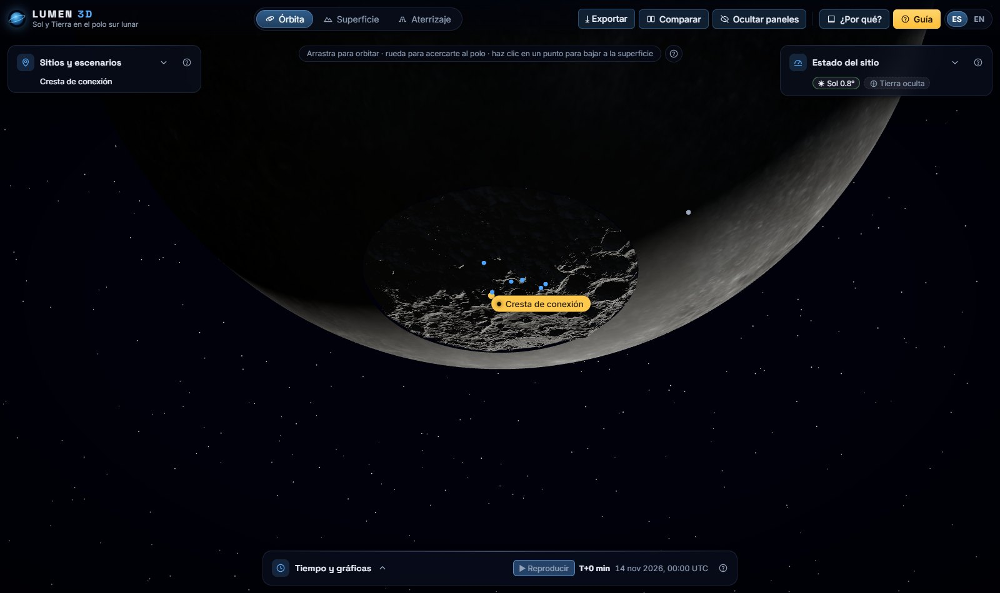
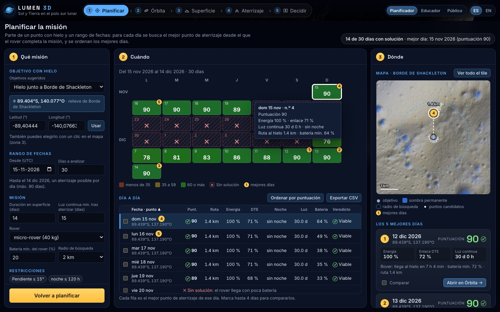
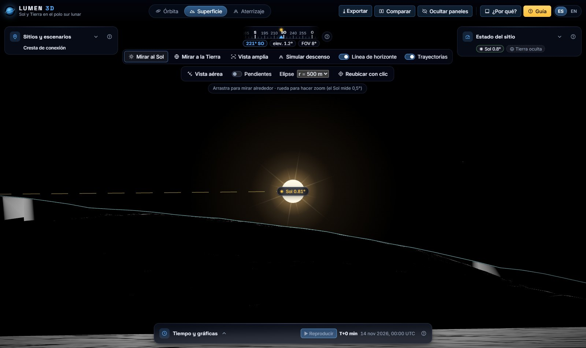
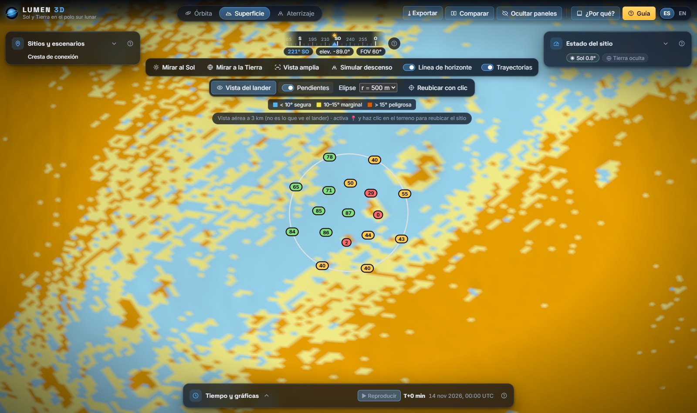
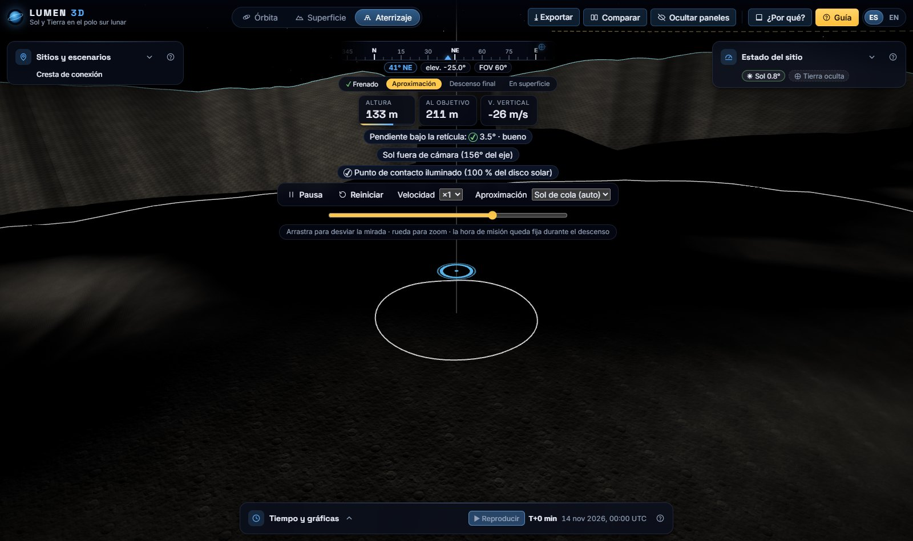
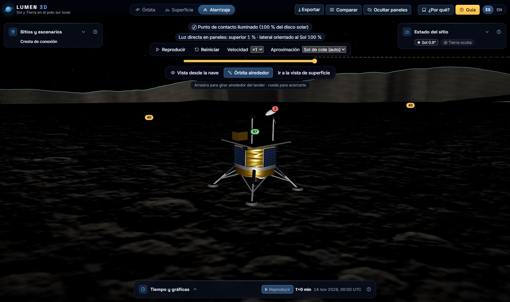
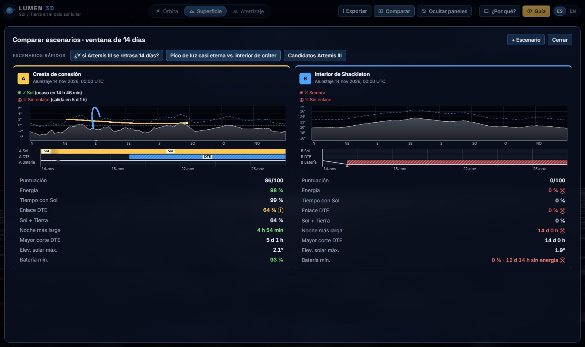

# Guía de usuario de Killa Landing

Esta guía recorre todo el sistema: qué muestra cada parte de la pantalla, cómo se usa y cómo leer los resultados. Para instalar el proyecto, ver el [README](../README.md); para el diseño técnico, [ARCHITECTURE.md](../ARCHITECTURE.md). Al final hay un [resumen en inglés](#english-summary).

**Índice**

1. [Para qué sirve](#1-para-qué-sirve)
2. [Inicio](#2-inicio)
3. [La pantalla](#3-la-pantalla)
4. [Vista Órbita](#4-vista-órbita)
5. [Vista Superficie](#5-vista-superficie)
6. [Vista Aterrizaje](#6-vista-aterrizaje)
7. [Sitios y escenarios (panel izquierdo)](#7-sitios-y-escenarios-panel-izquierdo)
8. [Estado del sitio (panel derecho)](#8-estado-del-sitio-panel-derecho)
9. [Tiempo y gráficas (panel inferior)](#9-tiempo-y-gráficas-panel-inferior)
10. [Comparar escenarios](#10-comparar-escenarios)
11. [Exportar datos](#11-exportar-datos)
12. [¿Por qué?, Guía y ayuda «?»](#12-por-qué-guía-y-ayuda-)
13. [Atajos y enlaces](#13-atajos-y-enlaces)
14. [Flujo de trabajo recomendado](#14-flujo-de-trabajo-recomendado)
15. [Glosario](#15-glosario)
16. [Problemas frecuentes](#16-problemas-frecuentes)

---

## 1. Para qué sirve

Killa Landing responde a una pregunta: **si alunizo en este sitio y en esta fecha, ¿tendré Sol para generar energía y la Tierra a la vista para comunicarme, y es seguro el terreno?**

En el polo sur lunar el Sol nunca sube más de unos grados y la Tierra roza el horizonte, así que una montaña a 100 km puede dejar un sitio a oscuras o sin enlace. La aplicación compara la posición real del Sol y la Tierra con el **horizonte real** del sitio, calculado con la topografía LOLA de la NASA, y lo resume en métricas de energía, comunicación y seguridad.

Un **escenario** es un sitio + una fecha de alunizaje. Puedes tener varios y compararlos.

## 2. Inicio

Al abrir la aplicación aparece una **pantalla de inicio con el logo** mientras se cargan los sitios. Desaparece sola en un par de segundos; un clic o las teclas Intro, Espacio o Esc la saltan.

La primera vez aparece abajo una invitación al **recorrido guiado** (1 minuto). Puedes aceptarla o pulsar «Ahora no»; el recorrido se puede repetir siempre desde el botón **Guía**.

## 3. La pantalla

| Zona                | Qué contiene                                                                                                                   |
| ------------------- | ------------------------------------------------------------------------------------------------------------------------------ |
| **Barra superior**  | Selector de vista (Órbita · Superficie · Aterrizaje), Exportar, Comparar, Ocultar paneles, ¿Por qué?, Guía e idioma (ES/EN/QU) |
| **Escena 3D**       | Ocupa toda la ventana; encima van los controles de la vista actual (HUD)                                                       |
| **Panel izquierdo** | Sitios y escenarios                                                                                                            |
| **Panel derecho**   | Estado del sitio en el instante actual y resumen de la misión                                                                  |
| **Panel inferior**  | Tiempo de misión y gráficas                                                                                                    |

Los tres paneles empiezan **minimizados**: solo se ve su cabecera con un resumen (sitio activo, Sol/Tierra, hora de misión). Pulsa la cabecera o las teclas **1**, **2** y **3** para abrirlos o cerrarlos; la elección se recuerda. **Ocultar paneles** deja solo la escena y su HUD.

Cada panel y el HUD tienen un botón **«?»** con una explicación breve y un enlace al paso correspondiente del recorrido.

### Modo por audiencia

En la pantalla de bienvenida (**¿Quién eres?**) y en la barra superior (**Modo**) se elige cuánto detalle mostrar. Los cálculos son siempre los mismos; solo cambia qué se ve. La elección se recuerda y viaja en los enlaces compartidos como `?mode=`.

| Qué se muestra                                                                    | Público | Educador | Planificador |
| --------------------------------------------------------------------------------- | :-----: | :------: | :----------: |
| Sol, Tierra, cuentas atrás, puntuación, línea temporal, batería                   |    ✓    |    ✓     |      ✓       |
| Energía, luz y DTE del resumen de la ventana                                      |    ✓    |    ✓     |      ✓       |
| Resto del resumen (ambos, noche, sin DTE, elevación solar)                        |         |    ✓     |      ✓       |
| Temperatura estimada, acceso a hielo, pendientes del terreno                      |         |    ✓     |      ✓       |
| Pestañas Horizonte 360°, Fechas alternativas y Estaciones                         |         |    ✓     |      ✓       |
| Pestaña Mapa polar                                                                |    ✓    |    ✓     |      ✓       |
| Control Ingeniería ↔ Ciencia, coordenadas personalizadas                          |         |    ✓     |      ✓       |
| Fila DSN (distancia, pérdida, estación), margen de enlace y «Exigir estación DSN» |         |          |      ✓       |
| Elipse de aterrizaje y «Sugerir mejor punto»                                      |         |          |      ✓       |
| Filtro de hardware, exportación CSV/JSON                                          |         |          |      ✓       |
| «¿Por qué?» abierto al entrar                                                     |    ✓    |    ✓     |              |

### Paso «Planificar» (modo Planificador)

En modo Planificador el proceso empieza un paso antes: **Planificar → Órbita → Superficie → Aterrizaje → Decidir**. En vez de elegir un sitio y probar fechas, se parte de **dónde está el hielo** y el sistema busca **dónde y cuándo aterrizar**.

1. **Qué misión**: el objetivo con hielo (de la lista, por coordenadas o con clic en el mapa), el rango de fechas a analizar (hasta 90 días), la duración en superficie, los días de **luz continua** exigidos tras aterrizar, el rover (por defecto el **utilitario** de 350 kg), el trabajo en el hielo (**Muestras a recoger**, de 1 a 10, por defecto 3, y **Horas por muestra**, de 0,5 a 6, por defecto 2), la batería mínima del rover y el radio de búsqueda. Las restricciones de hardware, el margen de enlace y la opción DSN son los de siempre y se editan ahí mismo.
2. **Cuándo**: un **calendario** con la mejor puntuación de cada día (✕ = sin solución, con el motivo) y la **tabla día a día**: punto de aterrizaje, **ruta ida y vuelta** (los metros que el rover recorre en total), puntuación, energía, enlace, noche más larga, luz continua, **muestras** recogidas de las pedidas, **regreso** (cuánto dura el viaje completo y el margen que queda hasta el fin de la misión), batería mínima del rover en todo el viaje y veredicto. Se ordena por cualquier columna y se exporta a CSV.
3. **Dónde**: el mapa del objetivo con la sombra permanente, los puntos candidatos y el elegido del día, y las tarjetas de **los 5 mejores días**, cada una con el resumen del rover («3 muestras · vuelve en 13 h · margen 13 d · batería mín. 47 %»). **Abrir en Órbita** carga ese punto y esa fecha y continúa el flujo normal; el rover irá a ese hielo. Marca hasta cuatro días para **Enviar a Comparar**.

Cómo decide: alrededor del objetivo se preseleccionan hasta 60 puntos de terreno seguro fuera de la sombra permanente. Para cada día se descartan los que no cumplen (sin Sol al aterrizar, luz continua insuficiente, noche o enlace fuera de los límites, pendiente, sin ruta, o un rover que no completa su viaje) y gana el de mayor puntuación de misión; a igual puntuación, el día con más margen de tiempo al regreso y, después, con más batería. Si ningún punto cumple, el día queda sin solución y se indica qué restricción lo impide.

El viaje del rover es **de ida y vuelta** y es un requisito obligatorio: tiene que llegar al hielo, recoger **todas** las muestras pedidas y estar de vuelta junto al módulo **antes del fin de la misión**, sin bajar nunca de la batería mínima. Cuando falla, el aviso dice en qué punto y propone el arreglo con un botón:

| Motivo                                     | Qué pasó                                                                              | Arreglos que se ofrecen                                                          |
| ------------------------------------------ | ------------------------------------------------------------------------------------- | -------------------------------------------------------------------------------- |
| No llega al hielo                          | La batería se agota por el camino y no puede recargar                                 | Usar el rover utilitario o reducir el radio para aterrizar más cerca             |
| No completa las muestras                   | Llega, pero la batería no alcanza para todo el muestreo: en el hielo no hay Sol       | Usar el rover utilitario, recoger menos muestras o reducir el tiempo por muestra |
| No vuelve                                  | Recoge las muestras, pero no le queda batería para el regreso                         | Usar el rover utilitario, recoger menos muestras o reducir el radio              |
| Vuelve tarde                               | Regresa después del fin de la misión (por ejemplo, tras muchas paradas para recargar) | Alargar la misión o recoger menos muestras                                       |
| Vuelve, pero con la batería bajo el mínimo | Completa el viaje a tiempo, pero en algún momento baja de la batería mínima exigida   | Usar el rover utilitario, bajar la batería mínima o recoger menos muestras       |

Con los valores por defecto (3 muestras de 2 h) el **micro-rover de 40 kg no completa el viaje desde ningún sitio**: por eso el rover por defecto es el utilitario. El micro-rover sigue disponible para misiones con menos trabajo (una o dos muestras cortas desde un punto cercano al hielo).

Límites: optimiza la fase de superficie (no el viaje Tierra–Luna); el objetivo debe estar en una zona con relieve LOLA de 20 m; exigir 15 días de luz continua deja pocos días válidos fuera del verano polar.

## 4. Vista Órbita

La Luna completa iluminada por el Sol real del instante, con los mosaicos LRO WAC de Moon Trek (NASA/JPL) sobre el globo y sobre el relieve LOLA del casquete polar, la Tierra con su fase (día/noche, nubes) y los sitios marcados:

- **Azul**: sitios del polo sur. **Gris**: sitios de referencia (Apolo, Chang'e…). **Amarillo**: el sitio activo.
- Arrastra para girar, rueda para acercar. **Clic en un sitio** para seleccionarlo y bajar a su superficie.

La Tierra y el Sol no están a escala de distancia (lo indica su etiqueta); su dirección sí es la real.

## 5. Vista Superficie

La cámara está en el sitio, a 2 m del suelo (la altura de un lander). El terreno es LOLA a 20 m/px en un recorte de 20 × 20 km, con textura de regolito; más allá, el **anillo de horizonte** dibuja el relieve lejano hasta 300 km. El Sol y la Tierra aparecen a su **tamaño angular real** (el Sol mide 0,5°), y la luz del Sol se atenúa con la fracción de su disco que asoma sobre el horizonte.

**Controles de cámara**: arrastra para mirar alrededor, rueda para hacer zoom.

**Cinta de rumbo (arriba)**: rumbo de la cámara con marcas cada 5°, puntos cardinales y los símbolos ☀ y ⊕ cuando el Sol o la Tierra están dentro de la cinta. Debajo, rumbo exacto, elevación y campo de visión (FOV).

**Barra de herramientas**:

| Control               | Qué hace                                                                                                                                                                                                                          |
| --------------------- | --------------------------------------------------------------------------------------------------------------------------------------------------------------------------------------------------------------------------------- |
| Mirar al Sol / Tierra | Apunta la cámara al astro con zoom (si está tapado, apunta a la cresta que lo tapa)                                                                                                                                               |
| Vista amplia          | Vuelve a un campo de visión de 75°                                                                                                                                                                                                |
| Simular descenso      | Abre la vista Aterrizaje                                                                                                                                                                                                          |
| Línea de horizonte    | Línea cian sobre el relieve que marca la máscara de horizonte                                                                                                                                                                     |
| Trayectorias          | Recorrido del Sol (amarillo) y la Tierra (azul) durante la ventana de misión, en discontinua                                                                                                                                      |
| Vista aérea           | Cámara cenital a 3 km para ver el entorno del sitio (no es lo que ve el lander)                                                                                                                                                   |
| Pendientes            | Capa de pendiente del terreno: azul < 10° segura, amarillo 10–15° marginal, naranja > 15° peligrosa                                                                                                                               |
| Imagen orbital LRO    | Foto real del Lunar Reconnaissance Orbiter sobre el relieve (mosaico LROC NAC de 10 m/px vía LROC QuickMap; al norte de 85,5° S, WAC de 100 m). Sus sombras son las de la foto, no las de la fecha simulada                       |
| Sombra permanente     | Capa de iluminación media de un año: azul rayado = sombra permanente (PSR, posible hielo), de gris a amarillo según la luz; dibuja en discontinua la ruta del rover hasta el hielo                                                |
| Elipse                | Elipse de aterrizaje 3σ de 500 m, 1 km o 2 km de semieje mayor, orientada según la aproximación, y su forma (círculo, 2:1, 3:1); 17 puntos evaluados (su puntuación sobre el terreno), ponderados por la probabilidad de caer ahí |
| Reubicar con clic     | Activa el modo de selección: un clic en el terreno mueve el sitio a ese punto y recalcula su horizonte                                                                                                                            |

Las pendientes y la reubicación solo están disponibles en sitios con terreno LOLA de 20 m (los del polo sur). La capa de sombra permanente necesita además el mapa de iluminación del sitio (`npm run data:derived`).

## 6. Vista Aterrizaje

Simula la aproximación final: desde unos 3,5 km de altura, a 7,5 km del sitio, hasta tocar suelo. La hora de misión queda fija durante el descenso.

Hay dos modelos (selector **Modelo**):

- **Con física** (por defecto): el módulo es una masa con motor. Se integran el empuje, la gravedad lunar (1,62 m/s²) y el consumo de propelente (ecuación del cohete), y un guiado lo lleva hasta una puerta a 30 m sobre el objetivo y de ahí en vertical hasta el contacto. Dura unos 2 minutos. Con **Módulo** eliges el vehículo (clase CLPS, pequeño o pesado; valores ilustrativos).
- **Rápido**: el recorrido ilustrativo de 45 s, sin física. También se muestra, con un aviso, si el guiado físico no cierra el descenso (por ejemplo, un relieve que corta la aproximación).

**Indicador de fases**: Frenado → Aproximación → Descenso final → En superficie (✓ en las completadas).

**Telemetría**: altura sobre el terreno (con una barra en escala logarítmica), distancia al objetivo y velocidad vertical. Con física, además: velocidad horizontal, **propelente** restante (kg y barra), **Δv gastado** y empuje e inclinación del motor.

**Avisos**:

- **Pendiente bajo la retícula**: la retícula marca dónde apunta la cámara; su color **y su forma** indican la pendiente (círculo = segura, rombo = marginal, aspa = peligrosa).
- **Sol en el campo de visión**: aviso si el Sol entra en la cámara (deslumbra a las cámaras de navegación).
- **Punto de contacto iluminado / en sombra**: si el sitio tiene Sol en el momento del aterrizaje.
- **Terreno inseguro en el objetivo**: si la pendiente del punto de contacto supera 10° (o alguna celda vecina 15°), el aviso dice a cuántos metros se desviaría el guiado hacia terreno seguro y cuánto Δv extra cuesta; **Aterrizar ahí** mueve el sitio a ese punto.

En los últimos ~30 m el chorro del motor levanta **polvo**, que sale en trayectorias rasantes (sin aire no forma nubes).

**Controles**: Pausa/Reproducir, Reiniciar, velocidad ×1/×2/×4, deslizador de progreso y **Aproximación** (Sol de cola, automático; Sol de frente, el peor caso; o desde un rumbo concreto). Arrastra para desviar la mirada (vuelve sola) y usa la rueda para zoom.

Al tocar suelo, con física, se resume el descenso: velocidad de contacto, Δv de la aproximación simulada, el total estimado con el frenado desde la órbita (~1 700 m/s, que no se simula) y el propelente restante.

Además:

- **Vista desde la nave** o **Órbita alrededor** del lander (cámara que gira en torno al módulo).
- Se muestra la **luz directa en los paneles** (superior y lateral orientado al Sol).
- **Desplegar rover** inicia el viaje de ida y vuelta al hielo (siguiente apartado). **Misión completa**, disponible desde el principio, encadena descenso y recorrido.

El módulo es un lander tipo CLPS (~4 m de alto) con aislamiento dorado, paneles solares, propulsores RCS, tanques y antena. Se asienta sobre la pendiente real del terreno y su panel principal mira al acimut del perfil energético, así que las luces y sombras que ves son las de la fecha elegida.

### Recorrido del rover: ida al hielo, muestreo y regreso

Si desde el sitio hay ruta transitable hasta una zona de sombra permanente (tarjeta **Acceso a hielo**), el rover hace en la escena el viaje completo: va hasta el hielo, recoge las muestras y vuelve al módulo por el mismo camino.

- **Qué se ve**: el rover baja por las rampas del módulo y sigue la ruta punteada. Son dos vehículos detallados: un micro-rover de cuatro ruedas y un utilitario de seis con suspensión articulada, panel que se orienta al Sol y antena que apunta a la Tierra cuando hay enlace. El viaje tiene tres partes:
  - **Ida**: avanza hasta el hielo dejando huellas y levantando polvo; al entrar en sombra enciende los faros.
  - **Muestreo**: se detiene sobre el hielo y el **taladro trabaja** durante todo el tiempo de cada muestra. Al terminar la última gira para mirar hacia el módulo.
  - **Regreso**: vuelve por la misma ruta y deja un **segundo juego de huellas** junto al de ida. El recorrido termina cuando se detiene junto al módulo.

  La luz y la sombra son las de la hora de misión, que **avanza con el rover**.

- **Estado**: una etiqueta dice en cada momento qué hace el rover: **Yendo al hielo**, **Recargando** (parado al Sol hasta recuperar batería), **Muestra 2 de 3**, **Regresando** y **✓ De vuelta en el módulo**. Si el viaje fracasa, la etiqueta lo dice con ▼: **Sin batería**, **No completó las muestras** o **Volvió tarde**. Al lado, un contador marca las muestras ya recogidas (●●○ 2/3 muestras).
- **Telemetría**: distancia recorrida, lo que **falta** (al hielo durante la ida, al módulo durante el regreso), pendiente, velocidad, **batería**, potencia solar y consumo, temperatura, si está al Sol, en sombra o en **sombra permanente**, y si tiene **enlace con la Tierra**. Debajo, el perfil de altura de la ruta con el tramo en sombra permanente en azul y el punto de giro marcado: el cursor llega hasta el hielo y vuelve.
- **Resumen**: si todo sale bien, una línea como «3 muestras · vuelve en 13 h 8 min · margen 13 d 10 h · batería mín. 47 %»: las muestras recogidas, lo que dura el viaje completo, el tiempo que sobra hasta el fin de la misión y la batería más baja de todo el viaje. Si falla, un aviso explica el motivo y ofrece el arreglo con un botón: **Usar el rover utilitario**, **Recoger menos muestras** o **Reducir el tiempo por muestra**.
- **Controles**: reproducir, reiniciar, velocidad (de 2 min a 1 h de misión por segundo), deslizador de progreso (cubre el viaje entero), **Rover** (utilitario de 350 kg, el de por defecto, o micro-rover de 40 kg, cada uno con su perfil energético) **Muestras** y **Por muestra** (cuántas muestras recoge y cuánto trabaja en cada una; son los mismos datos del paso **Planificar** y se recuerdan entre visitas) y **Cámara** (seguimiento, mástil o cenital). Arrastra para girar alrededor del rover. Al cambiar el rover o el trabajo, el recorrido empieza de nuevo.
- La tarjeta **Acceso a hielo** del panel derecho resume el resultado y enlaza con **Ver el recorrido**, que abre esta vista sin pasar por el descenso. El enlace compartible lleva `rover=1`.

**Por qué puede fallar.** El viaje solo cuenta como logrado si el rover llega, recoge todas las muestras y vuelve antes del fin de la misión:

| Motivo                   | Qué pasó                                                                                               | Qué probar                                                                |
| ------------------------ | ------------------------------------------------------------------------------------------------------ | ------------------------------------------------------------------------- |
| Sin batería              | Se agota en la ida o en el regreso y no hay Sol suficiente para recargar                               | El rover utilitario, un sitio con ruta más corta u otra fecha con más Sol |
| No completó las muestras | Llegó al hielo, pero la batería bajó al mínimo durante el muestreo y allí no puede recargar            | El rover utilitario, menos muestras o menos horas por muestra             |
| Volvió tarde             | Llegó al módulo después del fin de la misión, casi siempre por largas paradas de recarga               | Una misión más larga, menos trabajo en el hielo u otra fecha de alunizaje |
| Batería bajo el mínimo   | Completó el viaje a tiempo, pero en algún momento bajó de la batería mínima exigida (20 % por defecto) | El rover utilitario, menos trabajo en el hielo o una ruta más corta       |

Como referencia, desde el borde de Shackleton (ruta de 1,4 km, alunizaje el 1 de marzo de 2027, misión de 14 días) el rover utilitario recoge 3 muestras de 2 h y vuelve en 13,1 h con una batería mínima del 47 %; el micro-rover llega, pero solo completa una muestra.

El detalle del suelo por debajo de la resolución de LOLA (rocas, cráteres de metros, ondulación) es **ilustrativo**: no entra en las pendientes, la ruta ni la energía. La cámara ajusta la exposición como lo haría una real, porque con el Sol rasante el suelo queda casi sin luz directa.

**El modelo y sus supuestos.** Es una estimación: velocidad reducida por la pendiente, potencia de tracción por peso y rodadura, horizonte calculado cada ~200 m de ruta. No simula hundimiento ni patinaje. Además:

- **Consumo del instrumento**: mientras toma una muestra, el rover gasta su consumo normal más el del taladro y el análisis: 30 W en el micro-rover y 150 W en el utilitario. Son supuestos razonables, no datos de un instrumento concreto, igual que el tiempo por muestra.
- **Sin recarga en sombra permanente**: en el hielo no hay Sol, así que el muestreo se paga solo con batería. En la ida y el regreso, si la batería baja demasiado, el rover para al Sol a recargar; durante el muestreo no puede, y el viaje fracasa.
- **Plazo**: el rover debe estar junto al módulo antes del **fin de la misión** (fecha de alunizaje + duración en superficie).
- **Regreso por la misma ruta**: se recalculan la energía (las subidas de la ida son bajadas a la vuelta) y la posición del Sol a esa hora.
- **Lo que no se simula**: la entrega de las muestras al módulo y el despegue de vuelta a la Tierra. El viaje se da por logrado cuando el rover llega junto al módulo dentro del plazo.
- El frío de la sombra permanente se muestra como dato; lo que limita el viaje es la batería.

## 7. Sitios y escenarios (panel izquierdo)

- **Pestañas A, B, C, D**: cada una es un escenario. **+ Escenario** añade otro (máximo 4).
- **Lista de sitios**: candidatos Artemis III (borde de Shackleton, cresta de conexión, borde de de Gerlache, macizo Malapert…), IM-2, VIPER, regiones en sombra permanente (PSR) y referencias fuera del polo. La etiqueta **LOLA 20 m** indica horizonte de alta resolución. **LOLA 60 m** marca los sitios de referencia, con relieve del DEM LOLA global.
- **Ver este punto en los visores del LRO**: abre el sitio activo en **LROC QuickMap** y **Moon Trek** para contrastarlo con todas las capas del LRO.
- **Coordenadas personalizadas**: introduce latitud y longitud; el horizonte se calcula en el navegador (con LOLA 20 m si el punto cae dentro de un tile curado).

## 8. Estado del sitio (panel derecho)

En el instante actual de la misión:

- **Sol**: elevación, fracción visible del disco, elevación del horizonte en esa dirección y cuenta atrás al próximo ocaso o amanecer.
- **Tierra · enlace directo**: elevación respecto al horizonte más el margen de enlace, fase, y cuenta atrás a la próxima salida o puesta. Debajo, la **distancia Tierra-Luna**, la pérdida en espacio libre en banda X (y cuánto más o menos que a la distancia media) y las tres estaciones de la **Deep Space Network** (Goldstone, Madrid, Canberra): ✓ si ven la Luna sobre 10°, con la que «recibe» en negrita. En la vista Órbita las estaciones activas brillan sobre el globo terrestre.
- **Temperatura estimada**: cara vertical orientada al Sol (lateral del módulo, radiador) y regolito horizontal, mínimo y máximo de la ventana y horas por debajo de −100 °C sin calefacción. En una PSR, ~−233 °C. Es un equilibrio radiativo simplificado, para dar el orden de magnitud.

Para toda la ventana de misión:

- **Puntuación** (0–100): 50 % energía + 35 % enlace + 15 % supervivencia. El control **Ingeniería ↔ Ciencia** (0 % por defecto) mezcla esta puntuación con la de acceso a hielo y muestra la **puntuación combinada**; Comparar, el filtro de hardware y «Sugerir mejor punto» la usan para ordenar.
- Energía, tiempo con Sol, enlace DTE, Sol + Tierra a la vez, noche más larga, mayor corte de enlace.
- **Energía · batería**: perfil energético (lander de caja, rover con seguimiento, panel fijo o personalizado) y estado de carga mínimo; avisa si la batería se agota antes del amanecer.
- **Terreno · aterrizaje**: pendiente en el sitio y en su entorno.
- **Sensibilidad en la elipse de aterrizaje**: mínimo, mediana y máximo de la puntuación en los 17 puntos de la elipse de aterrizaje. **Sugerir mejor punto** busca dentro de la elipse de aterrizaje terreno con pendiente < 10°, evalúa la misión en los 40 puntos más altos y propone los 3 mejores (puntuación, diferencia con el objetivo, distancia y rumbo); **Ir a este punto** reubica el sitio allí.
- **Acceso a hielo (PSR)**: distancia en línea recta y por ruta del rover hasta la sombra permanente más cercana (hasta 2 km, sin pisar pendientes mayores que el límite del rover, 20° por defecto) y la **puntuación ciencia** (100 a menos de 500 m, 0 a 2 km).

Los valores con nivel llevan icono ✓ / ! / ✕ además del color.

## 9. Tiempo y gráficas (panel inferior)

**Controles de tiempo**: fecha de alunizaje (UTC), duración de la misión en días, **Elev. mín. enlace (°)** (margen que la Tierra debe superar sobre el relieve; 3° por defecto), deslizador de tiempo, **Reproducir** con velocidad, y saltos ⏭ al siguiente ocaso, amanecer o salida de la Tierra.

**Pestañas**:

- **Línea temporal**: franjas de Sol, enlace DTE, ambos y batería a lo largo de la misión, con patrones y etiquetas (no solo color); debajo, la altura de cada astro sobre el horizonte local. Clic para saltar a ese momento.
- **Horizonte 360°**: perfil del relieve alrededor del sitio con las trayectorias del Sol y la Tierra y la línea del margen de enlace. **Si fuera la Tierra** dibuja el Sol elevado por la refracción atmosférica (guiones naranjas) y tiñe el cielo mientras el Sol está a menos de 18° bajo el horizonte (crepúsculo): en la Luna, en cambio, la oscuridad llega en cuanto el disco se oculta.
- **Fechas alternativas**: puntuación de cada día de alunizaje durante los próximos 12 meses, con los mejores días destacados.
- **Estaciones**: mes a mes de 2026 a 2030, la energía media (barras), el enlace DTE (línea azul) y la elevación solar máxima (línea blanca). Muestra el mejor y el peor mes y por qué: la declinación del Sol oscila ±1,54° a lo largo del año y en el polo eso decide si asoma sobre las crestas. Clic en un mes para aterrizar en su primer día con Sol.
- **Mapa polar**: el casquete de 80°S a 90°S visto desde arriba (polo en el centro, la Tierra hacia arriba), con el relieve LOLA sombreado, los parches de iluminación anual de los sitios curados (azul = sombra permanente, amarillo = bien iluminado) y los sitios como puntos. Clic en un punto para seleccionarlo; al pasar el ratón se leen latitud y longitud.

## 10. Comparar escenarios

**Comparar** pone hasta 4 escenarios lado a lado con las mismas métricas, horizonte, línea temporal y batería, **en el mismo instante de misión** (T+). Los **escenarios rápidos** crean comparaciones con un clic:

- «¿Y si Artemis III se retrasa 14 días?»
- «Pico de luz casi eterna vs. interior de cráter»
- «Candidatos Artemis III»
- «Luz vs. hielo» (crestas iluminadas junto a cráteres en sombra, con un 30 % de peso científico)
- «Rover canadiense: ¿pasa la noche?» (30 días con el perfil del rover utilitario de la CSA en la cresta de conexión, el macizo Malapert y Cabeus)

Además de las métricas de siempre, cada columna muestra la temperatura mínima estimada, el acceso a hielo y, si el control Ingeniería ↔ Ciencia no está en 0, la puntuación combinada.

### Filtro de hardware

El botón **Hardware** de la barra superior abre el filtro de viabilidad. Fija lo que tolera tu módulo:

| Límite                   | Se compara con                                            |
| ------------------------ | --------------------------------------------------------- |
| Pendiente máx.           | Percentil 90 de la pendiente en 500 m alrededor del sitio |
| Noche continua máx.      | Noche más larga de la ventana de misión                   |
| Enlace DTE mín.          | % del tiempo con enlace directo                           |
| Pendiente máx. del rover | Ruta al hielo (acceso a hielo y puntuación ciencia)       |

Todos los sitios del catálogo se evalúan con la fecha y el margen de enlace activos y se marcan **✓ viable**, **! al límite** (algún valor a menos de un 20 % del límite) o **✕ descartado**, con la restricción que falla. **Enviar viables a Comparar** abre Comparar con los mejores (hasta 4). Útil tras un retraso de lanzamiento o un cambio de hardware.

## 11. Exportar datos

El menú **Exportar** descarga:

| Opción                    | Archivo                                                                          |
| ------------------------- | -------------------------------------------------------------------------------- |
| Serie temporal (CSV)      | Una fila cada 10 min: Sol, Tierra, horizonte, fracciones, DTE, potencia, batería |
| Escenario completo (JSON) | La serie en formato columnar más métricas y ventanas                             |
| Perfil de horizonte (CSV) | Elevación del horizonte por acimut y distancia a la obstrucción                  |
| Todos los escenarios      | JSON con todos los escenarios de Comparar (si hay más de uno)                    |

Las columnas del CSV están descritas en el [README](../README.md#columnas-de-la-exportación-csv).

## 12. ¿Por qué?, Guía y ayuda «?»

- **¿Por qué?**: explicaciones para público general de por qué el polo sur es difícil (Sol rasante, Tierra en el horizonte, sombras permanentes…), cada una con un botón que lleva al sitio que la ilustra. La tarjeta **Canadá en la Luna** resume los aportes de la Agencia Espacial Canadiense y su rover utilitario; al final se listan los cuatro recursos de la NASA y la CSA que usa la herramienta.
- **Guía**: recorrido guiado de 12 pasos. Se navega con los botones o con ← →, y Esc lo cierra. El último paso enlaza a esta guía.
- **«?»**: ayuda contextual de cada panel y del HUD. Se cierra con Esc o con un clic fuera.

## 13. Atajos y enlaces

| Tecla / acción        | Efecto                                            |
| --------------------- | ------------------------------------------------- |
| `1` · `2` · `3`       | Abrir/cerrar panel izquierdo, derecho, inferior   |
| `←` `→` · `Esc`       | Recorrido guiado: paso anterior/siguiente, cerrar |
| `Esc`                 | Cerrar la ayuda «?»                               |
| Intro · Espacio · Esc | Saltar la pantalla de inicio                      |
| Rueda                 | Zoom en cualquier vista                           |

**La URL guarda el estado**: sitio o coordenadas, fecha, duración, vista, escenarios de Comparar, margen de enlace, perfil energético, límites de hardware (`hw=`), peso científico (`sci=`) e idioma. Basta con copiar la dirección del navegador para compartir exactamente lo que estás viendo. Parámetros útiles: `?lang=en`, `?view=landing`, `?view=landing&ap=<grados>` (rumbo de aproximación), `?site=<id>`.

## 14. Flujo de trabajo recomendado

1. En **Órbita**, elige un sitio del polo sur (o introduce coordenadas).
2. Abre el **panel derecho** (tecla 2) y mira la puntuación y la batería.
3. En el **panel inferior** (tecla 3), revisa la **Línea temporal** y busca en **Fechas alternativas** un día mejor.
4. Baja a **Superficie**: mira al Sol y a la Tierra, activa **Pendientes** y la **Elipse** para ver si el terreno es seguro y si la misión depende mucho del punto exacto.
5. Prueba el **Aterrizaje** con Sol de cola y de frente.
6. Añade escenarios y usa **Comparar** para decidir; **exporta** los datos para el informe.

## 15. Glosario

El mismo glosario está dentro de la app, al final del panel **¿Por qué?**.

| Término              | Significado                                                                                                       |
| -------------------- | ----------------------------------------------------------------------------------------------------------------- |
| Máscara de horizonte | Elevación del relieve en cada dirección vista desde el sitio (0,5° de resolución, hasta 300 km)                   |
| Fracción visible     | Parte del disco del Sol (o de la Tierra) que asoma sobre el horizonte; un astro cuenta como visible desde el 50 % |
| DTE                  | _Direct-to-Earth_: comunicación directa con la Tierra, sin satélite relé                                          |
| Margen de enlace     | Grados que la Tierra debe superar sobre el relieve para un enlace utilizable (evita el multitrayecto)             |
| Elipse de aterrizaje | Zona donde puede acabar el lander por la imprecisión del guiado                                                   |
| PSR                  | Región en sombra permanente: fondos de cráter donde nunca da el Sol                                               |
| Pendiente            | Inclinación del terreno calculada sobre el DEM de 20 m (operador de Horn)                                         |
| LOLA                 | _Lunar Orbiter Laser Altimeter_, el altímetro láser del LRO que da la topografía                                  |
| T+                   | Tiempo transcurrido desde el alunizaje; todos los escenarios lo comparten                                         |

## 16. Problemas frecuentes

| Síntoma                                    | Causa / solución                                                                                                      |
| ------------------------------------------ | --------------------------------------------------------------------------------------------------------------------- |
| Pantalla negra en Superficie               | Es de noche en el sitio (Sol bajo el horizonte). Mueve el tiempo o activa **Pendientes**, que se ve siempre           |
| No aparecen Pendientes, Elipse ni Reubicar | Coordenadas personalizadas sin terreno LOLA (fuera del polo y lejos de un sitio curado)                               |
| El rover «No completó las muestras»        | En el hielo no puede recargar. Usa el rover utilitario, o pide menos muestras o menos horas por muestra               |
| Los números aparecen atenuados un momento  | Se están recalculando; los valores anteriores se muestran hasta tener los nuevos                                      |
| La escena va lenta                         | Cierra paneles que no uses (las gráficas no se calculan si su panel está minimizado) o reduce el tamaño de la ventana |

---

## English summary

Killa Landing answers one question: _if we land at this site on this date, will there be sunlight for power, Earth in view for communications, and safe terrain?_ It compares the real Sun and Earth positions with each site's **real horizon** (NASA LOLA topography).

- **Start**: a logo splash while the site catalogue loads (click or Enter/Space/Esc to skip), then an optional 1-minute guided tour (**Guide** button replays it).
- **Layout**: top bar (views, Export, Compare, Hide panels, Why?, Guide, ES/EN/QU), full-window 3D scene with its HUD, and three panels that start minimised (keys **1**, **2**, **3**). Every panel and the HUD have a **?** help popover.
- **Orbit view**: the lit Moon (Moon Trek LRO WAC mosaics) with LOLA relief, Sun, Earth and clickable sites.
- **Surface view**: a lander's-eye camera at 2 m on 20 m/px terrain with regolith detail; heading tape with Sun/Earth markers; look at the Sun or Earth, horizon line, sky paths, aerial view, slope layer (< 10° safe, 10–15° marginal, > 15° hazardous), real LRO image layer (LROC NAC via QuickMap), landing ellipse (17 probability-weighted points) and click-to-relocate.
- **Landing view**: a physics-based descent with a phase stepper, altitude/range/vertical-speed cards, a slope-coded reticle (colour and shape), Sun-in-camera warning, engine dust in the last 30 m, and an orbit camera around the detailed lander after touchdown.
- **Panels**: sites and scenarios (up to 4, plus custom coordinates); site status (Sun, Earth link, score, battery, terrain, ellipse sensitivity); time controls with timeline, 360° horizon and a 12-month landing-date sweep.
- **Compare** up to 4 scenarios at the same mission time, with one-click presets. **Export** CSV/JSON series, horizon profile or all scenarios. The **URL** keeps the full state, so the address bar is the share link.
