# Killa Landing user guide

Killa Landing is a web app for choosing where and when to land at the lunar south pole. This guide covers every screen, control and result. To install and run the project, see the [README](../README.md); for the technical design, see [ARCHITECTURE.md](../ARCHITECTURE.md); for the mission model behind the planner, see [MISSION.md](MISSION.md); for the visual system, see [DESIGN.md](DESIGN.md).

The app runs at https://pandisdp.github.io/LUMEN/.

**Contents**

1. [What the app answers](#1-what-the-app-answers)
2. [Quick start](#2-quick-start)
3. [Audience modes](#3-audience-modes)
4. [The step flow](#4-the-step-flow)
5. [Screen layout](#5-screen-layout)
6. [Choosing a site](#6-choosing-a-site)
7. [The Plan step](#7-the-plan-step)
8. [Orbit view](#8-orbit-view)
9. [Surface view](#9-surface-view)
10. [Site status panel](#10-site-status-panel)
11. [Time controls and charts](#11-time-controls-and-charts)
12. [Landing view: the descent](#12-landing-view-the-descent)
13. [The rover round trip](#13-the-rover-round-trip)
14. [Decide: compare, edit, export](#14-decide-compare-edit-export)
15. [Hardware filter](#15-hardware-filter)
16. [The assistant](#16-the-assistant)
17. [Why?, glossary, guided tour and help](#17-why-glossary-guided-tour-and-help)
18. [Challenges](#18-challenges)
19. [Themes and languages](#19-themes-and-languages)
20. [Keyboard and accessibility](#20-keyboard-and-accessibility)
21. [URL parameters](#21-url-parameters)
22. [States, levels and glyphs](#22-states-levels-and-glyphs)
23. [Model assumptions and limits](#23-model-assumptions-and-limits)
24. [Troubleshooting and FAQ](#24-troubleshooting-and-faq)

---

## 1. What the app answers

One question: **if a mission lands at this site on this date, will it have sunlight for power, the Earth in view to communicate, and safe ground under it?**

At the lunar south pole the Sun never climbs more than about 1.6° and the Earth grazes the horizon, so a mountain 100 km away can leave a site dark or without a link. Killa Landing compares the positions of the Sun and the Earth with the terrain horizon of each site, computed from the LOLA topography of NASA's Lunar Reconnaissance Orbiter (LRO), and turns the result into figures for energy, communication, survival and terrain safety.

Three ideas run through the whole app:

- A _scenario_ is one site, one landing date and the mission settings that go with them (duration, link margin, power profile, hardware limits, science weight). Up to four scenarios are compared side by side.
- _Mission time_ is written T+ (time elapsed since touchdown). It is shared by every scenario, so a comparison always shows the same moment.
- A body counts as _visible_ when at least half of its disc is above the terrain horizon.

Sun and Earth positions come from JPL Horizons (DE441) for 2026 to 2030, and from the analytic IAU model with astronomy-engine outside that span. A label under the time slider says which one applies: **Ephemeris: JPL Horizons DE441** or **Ephemeris: IAU model (outside 2026–2030)**.

## 2. Quick start

1. Open the app. A splash with the logo shows while the site catalogue loads; a click or Enter, Space or Esc skips it.
2. On the welcome card, pick an audience under **Who are you?** (**Planner**, **Educator** or **Public**) and press **Start**. The same card offers **Take the guided tour** and **Play the challenges**.
3. Choose where to land:
   - In Planner mode the **Plan** step opens: choose an ice target and a date range, press **Plan**, then **Open in Orbit** on one of the best days.
   - In Educator and Public mode the card **Where do you want to land?** shows the three best sites for today. Pick one, or open the full list with **See more sites (22)**.
4. Follow the steps in the top bar: **Orbit**, **Surface**, **Landing**, **Decide**. The line under the top bar says what to look at and offers a button to the next step.
5. Open the panels with keys `1`, `2` and `3` to read the site status and the charts.
6. In **Decide**, compare scenarios and, in Planner mode, download the data with **Export my decision**.

The app remembers the audience, the language, the theme, which panels are open, the Plan inputs, the rover workload and the place in the flow, so a return visit resumes where the last one ended. Opening a shared link goes straight to the scenario it describes.

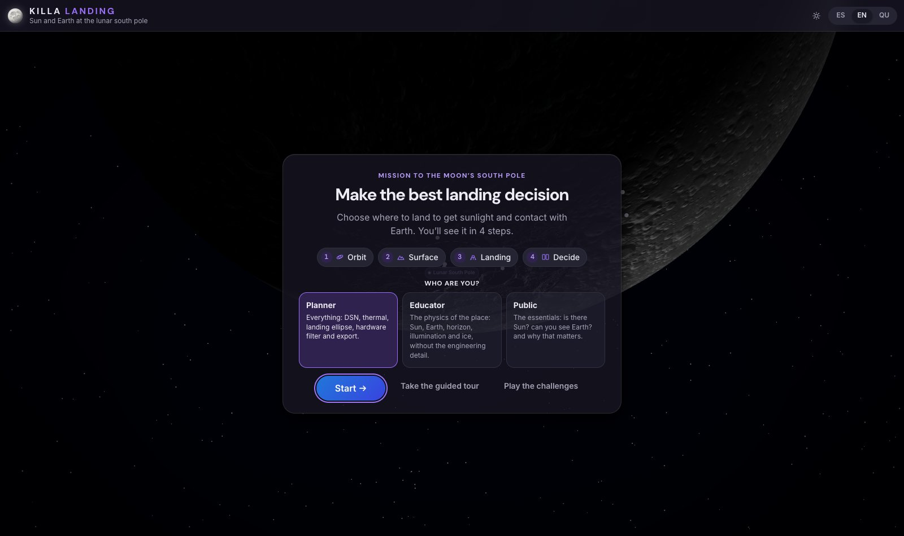

_The welcome card: pick an audience under **Who are you?** and press **Start**._

## 3. Audience modes

The mode decides how much detail is shown. The calculations are identical in the three modes. The mode is chosen on the welcome card and with the **Planner** / **Educator** / **Public** switch in the top bar, and it travels in shared links as `mode=`.

| Mode         | In one line                                                                                          |
| ------------ | ---------------------------------------------------------------------------------------------------- |
| **Planner**  | Everything: DSN, thermal, landing ellipse, hardware filter and export.                               |
| **Educator** | The physics of the place: Sun, Earth, horizon, illumination and ice, without the engineering detail. |
| **Public**   | The essentials: is there Sun? can you see Earth? and why that matters.                               |

| What is shown                                                                                       | Public | Educator | Planner |
| --------------------------------------------------------------------------------------------------- | :----: | :------: | :-----: |
| Sun and Earth cards, countdowns, score, verdict, power and battery card                             |   ✓    |    ✓     |    ✓    |
| Window summary: energy, time in sunlight, time with DTE link                                        |   ✓    |    ✓     |    ✓    |
| Rest of the window summary (Sun + Earth at once, longest night, longest link outage, Sun elevation) |        |    ✓     |    ✓    |
| Estimated temperature, ice access and terrain cards                                                 |        |    ✓     |    ✓    |
| "If the date moves" strip and the **Engineering** ↔ **Science** slider                              |        |    ✓     |    ✓    |
| Chart tabs **Timeline** and **Polar map**                                                           |   ✓    |    ✓     |    ✓    |
| Chart tabs **360° horizon**, **Alternative dates** and **Seasons**                                  |        |    ✓     |    ✓    |
| Custom coordinates in the site panel                                                                |        |    ✓     |    ✓    |
| Power and temperature read-outs of the rover                                                        |        |    ✓     |    ✓    |
| DSN row (range, path loss, stations), **Min. link elev. (°)** and **Require a DSN station**         |        |          |    ✓    |
| Landing ellipse card and **Suggest a better point**                                                 |        |          |    ✓    |
| **Hardware** filter and data export                                                                 |        |          |    ✓    |
| The **Plan** step                                                                                   |        |          |    ✓    |
| **Why?** cards opened automatically on entering (once per browser session)                          |   ✓    |    ✓     |         |

## 4. The step flow

The top bar shows the process as numbered steps. Every step is clickable at any time; completed ones carry a ✓.

| Step        | Where it happens                        | What it is for                                                        |
| ----------- | --------------------------------------- | --------------------------------------------------------------------- |
| **Plan**    | Full-screen planner (Planner mode only) | Start from where the ice is and find the best landing point and day.  |
| **Orbit**   | 3D view of the whole Moon               | Find your site at the south pole and see where the Sun and Earth are. |
| **Surface** | 3D view standing on the site            | Stand on the site: can you see the Sun and Earth above the horizon?   |
| **Landing** | 3D descent and rover views              | Simulate the descent and check that the ground is safe.               |
| **Decide**  | Comparison overlay                      | Compare scenarios, pick the best and export your decision.            |

In Planner mode the flow has five steps; in Educator and Public mode it has four, starting at **Orbit**.

## 5. Screen layout

| Area             | What it holds                                                                                                            |
| ---------------- | ------------------------------------------------------------------------------------------------------------------------ |
| Top bar          | Brand and tagline, the step bar, **Guide**, the **More** menu, the mode switch, the theme toggle and the language switch |
| Step hint        | A line under the top bar: the step number, what to look at, and a button to the next step                                |
| 3D stage         | Fills the window. The controls of the current view (the HUD) float over it                                               |
| Left panel       | **Landing sites**: the active site, the Top 3, the full catalogue and external links                                     |
| Right panel      | **Site status**: Sun and Earth at the current mission time, the score and the mission summary                            |
| Bottom panel     | **Time & charts**: landing date, duration, playback and the chart tabs                                                   |
| Assistant button | **Help me choose?**, with the Killa mascot, floating over the stage                                                      |

**Top bar.** **Guide** starts the guided tour. **More** opens a menu with **Change site** (back to the Plan step or to the Top 3 card), **Hardware** (Planner mode), **Why?**, **Challenges** and **Hide panels** / **Show panels**. The sun or moon icon switches between the dark and the light theme. The ES / EN / QU switch changes the language.

**Panels.** Each panel collapses to its header, which keeps a one-line summary on screen: the active site on the left; a Sun chip (**Sun down** or the Sun elevation) and an Earth chip (**Earth in view** or **Earth hidden**) on the right; a play button, T+ and the date at the bottom. Click a header or press `1` (left), `2` (right) or `3` (bottom) to expand or minimise a panel. A minimised panel computes nothing, so closing unused panels keeps the scene fluid. Entering the 3D steps opens the left panel. **Hide panels** leaves only the scene and its HUD.

**Help.** Each panel header and the HUD carry a **?** button with a short explanation and the link **Show me in the tour**.

**The stage.** The 3D scene is space, so it stays dark in both themes. A loading overlay with a percentage shows while textures arrive; if the connection drops, the mascot says so and loading resumes when the connection is back.

## 6. Choosing a site

The left panel, **Landing sites**, has four parts.

**Your site.** The active site with its coordinates and a small locator map: the south polar cap with rings every 2° and the Earth direction (0° longitude) at the top, or a near-side disc for sites away from the pole.

**Top 3 for your mission.** Three ranked cards computed for the active landing date, mission duration, link settings and hardware limits. Sites that pass the hardware limits come first, then the order is by score (blended with ice access when the science weight is above zero). Each card shows the score out of 100 and three facts with their level: ☀ time in sunlight, ⊕ time in contact with Earth and ☾ longest night. Click a card to make that site the active one.

**The full catalogue.** **See more sites (22)** opens the whole catalogue as a list in three groups (22 sites besides your custom points); **Show only the Top 3** closes it. Each entry shows the site name, its mission context, the terrain source and the coordinates.

| Group                              | Sites                                                                                                                                                                                          |
| ---------------------------------- | ---------------------------------------------------------------------------------------------------------------------------------------------------------------------------------------------- |
| **South Pole**                     | Shackleton rim, Connecting ridge, de Gerlache rim, Malapert massif, Mons Mouton, Nobile rim, Nobile Rim 2, Haworth floor, Shackleton floor, Cabeus (LCROSS impact), Chang'e-7 (candidate area) |
| **Reference (away from the pole)** | IM-1 Odysseus (Malapert A), Luna-25 (planned site), Chandrayaan-3, Chang'e-4, Chang'e-6, Blue Ghost M1, IM-3 (Reiner Gamma), SLIM, Apollo 11, Apollo 15, Apollo 17                             |
| **Custom**                         | Points entered by coordinates, picked on the terrain, suggested by the optimiser or opened from the planner                                                                                    |

The terrain tag tells how the horizon of a site is built:

| Tag            | Meaning                                                                                  |
| -------------- | ---------------------------------------------------------------------------------------- |
| **LOLA 20 m**  | 20 m/px polar terrain near the site plus a coarser polar model out to 300 km             |
| **LOLA 480 m** | The regional polar model only                                                            |
| **LOLA 60 m**  | Reference sites: a tile of the global LOLA model; slopes are smoothed at this resolution |
| **No relief**  | An ideal spherical horizon, with no local topography                                     |

**Custom coordinates** (Educator and Planner). With the full list open, type **Latitude (°)** and **Longitude (°E)** and press **Use**. South of 75.5°S the horizon is computed from LOLA in the browser, at 20 m when the point falls inside the terrain tile of a catalogue site. A point close to a reference site takes the terrain of that site's tile. Anywhere else the app falls back to the spherical horizon.

**Relocate by click.** In the Surface view, turn on **Click to relocate** and click the terrain: the site moves to that point as a custom site and its horizon is recomputed. The score markers of the landing ellipse and the results of **Suggest a better point** move the site in the same way.

**External links.** Under **See this point in the LRO map viewers and in JPL Horizons**, four buttons open the active point elsewhere:

| Button        | Opens                                                                                                                  |
| ------------- | ---------------------------------------------------------------------------------------------------------------------- |
| Horizons ☀    | A JPL Horizons query: apparent azimuth and elevation of the Sun from the site, hourly, over the current mission window |
| Horizons ⊕    | The same query for the Earth                                                                                           |
| LROC QuickMap | The same coordinates in LROC QuickMap: LRO NAC images, illumination, permanently shadowed regions and topography       |
| Moon Trek     | The same coordinates in NASA/JPL Moon Trek, a 3D terrain viewer with the LRO layers                                    |

To change site at any time, use the left panel, click a site dot in the Orbit view or on the **Polar map**, or choose **More** → **Change site**.

## 7. The Plan step

The Plan step (**Plan the mission**) is the first step in Planner mode. Instead of picking a site and trying dates, you state where the ice is and the planner finds, for every day of a date range, the best landing point from which the rover completes its mission, then ranks the best days.

The screen has three zones: **What mission**, **When** and **Where**.

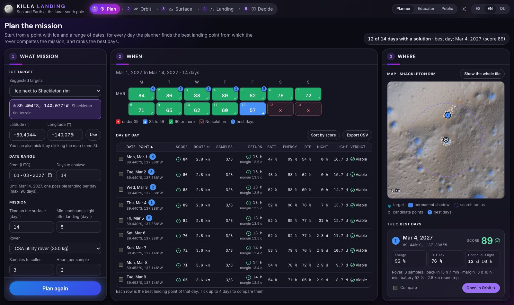

_The Plan step after a run for the utility rover: the inputs on the left, the calendar and the day-by-day table in the middle, the map and the best days on the right._

### 7.1 What mission: the inputs

**Ice target.** The point with ice the mission is after. Three ways to set it:

- **Suggested targets**: a list in two groups, **Ice next to a sunlit site** and **Permanently shadowed interior**, built from the catalogue sites that have 20 m terrain and an illumination map.
- **Latitude (°)** and **Longitude (°)**, then **Use**. A point outside the covered area is rejected with **Outside the area with 20 m terrain.**
- A click on the map of zone 3.

The planner snaps the target to the nearest permanently shadowed cell of the illumination map; that cell is where the rover routes end.

**Date range.** **From (UTC)** is the first candidate landing day and **Days to analyse** the number of consecutive days, from 1 to 90 (30 by default). One landing per day is evaluated, at 00:00 UTC. Dates must fall between 1 January 2026 and 31 December 2030.

**Mission.**

| Input                                          | Range                        | Default       | Meaning                                                                         |
| ---------------------------------------------- | ---------------------------- | ------------- | ------------------------------------------------------------------------------- |
| **Time on the surface (days)**                 | 1 to 365                     | 14            | Mission duration. The rover must be back at the lander before it ends           |
| **Min. continuous light after landing (days)** | 0 to 365                     | 15            | Uninterrupted sunlight required from touchdown                                  |
| **Rover**                                      | micro-rover or utility rover | utility rover | The vehicle that drives to the ice (see [section 13](#13-the-rover-round-trip)) |
| **Samples to collect**                         | 1 to 10                      | 3             | Samples the rover must take at the ice                                          |
| **Hours per sample**                           | 0.5 to 6, in steps of 0.5    | 2             | Working time per sample (drilling and analysing)                                |
| **Min. rover battery (%)**                     | 0 to 90                      | 20            | The rover battery must never drop below this value during the trip              |
| **Search radius**                              | 1 km, 2 km or 3 km           | 2 km          | Landing points are searched within this distance of the target                  |

A line under the sample inputs states the total work at the ice and the power the instrument of the selected rover draws.

**Constraints.** A summary of the limits shared with the rest of the app. **Change limits** opens them for editing:

| Limit                               | Default | Compared with                                                  |
| ----------------------------------- | ------- | -------------------------------------------------------------- |
| **Max slope (°, p90 within 500 m)** | 15      | 90th percentile of the slope within 500 m of the landing point |
| **Max continuous night (h)**        | 120     | Longest night of the mission                                   |
| **Min DTE link (%)**                | 30      | Share of the mission with a direct link to Earth               |
| **Rover max slope (°)**             | 20      | Steepest ground the rover route may cross                      |
| **Min. link elev. (°)**             | 3       | Elevation the Earth must clear above the terrain for a link    |
| **Science weight (%)**              | 0       | Share of the ice-access score in the ranking score             |
| **Require a DSN station**           | off     | The link counts only while a DSN complex has the Moon in view  |

### 7.2 Running and cancelling

Press **Plan**. A progress bar shows **Preparing the landing points…** and then **Day {n} of {total}**; the calendar, the table and the cards fill in as the days come in. **Cancel** stops the run and keeps the days already analysed. After a run the button reads **Plan again**.

If an input changes after a run, the results are marked **Computed with other inputs** until the plan is run again. The inputs are remembered between visits; the results are recomputed.

The button is disabled until there is a valid target, with the reason shown below it: **Choose an ice target first.** or **The target is outside the area with 20 m terrain.**

### 7.3 When: calendar and day-by-day table

**Calendar.** The range laid out in weeks, Monday first. Each cell prints the score of the best landing point of that day and takes the colour of its band: **under 35**, **35 to 59** or **60 or more**. A day with no solution carries a ✕, a day not computed yet a dot, and the best days carry their rank. Hover or focus a cell for the key figures (score, energy, link, continuous light, longest night, rover summary) or the reason it has no solution. Click a cell to select that day in the table and on the map; the arrow keys move between days.

**Day by day.** One row per day: the best landing point of that day.

| Column           | Meaning                                                                                         |
| ---------------- | ----------------------------------------------------------------------------------------------- |
| Tick box         | Marks the day for comparison (up to four)                                                       |
| **Date · point** | Landing date, the rank when the day is among the best, and the coordinates of the landing point |
| **Score**        | Ranking score of the point, 0 to 100                                                            |
| **Route ↔**      | Round-trip route: the metres the rover drives in total, out and back                            |
| **Samples**      | Samples collected out of those requested                                                        |
| **Return**       | Length of the whole trip, and the margin left until the end of the mission                      |
| **Batt.**        | Lowest rover battery over the whole trip                                                        |
| **Energy**       | Mean visible fraction of the solar disc over the mission                                        |
| **DTE**          | Share of the mission with a direct link to Earth                                                |
| **Night**        | Longest night of the mission                                                                    |
| **Light**        | Continuous light from touchdown                                                                 |
| **Verdict**      | **Viable** or **Marginal**, with the limits that are within 20 % of failing                     |

A day without a solution shows **No solution** and the constraint that rejects most points. Click a column header to sort by it (click again to reverse); **Sort by score** toggles between score order and date order. **Export CSV** downloads the plan: a header with every input, then one row per day with the landing point, the scores, the energy, link and night figures, the rover figures (reaches, samples done, returns, total hours, margin, lowest and final battery), the verdict, the rank and, for days without a solution, the rejection reason.

### 7.4 Where: map and the five best days

**Map.** The 20 m terrain around the target, shaded by yearly illumination. The key reads: **target**, **permanent shadow**, **search radius**, **candidate points** and **best days**. Hovering shows the coordinates and either **Permanent shadow** or the share of the year the point is lit. Click the terrain to put the target there; click a best-day marker to select that day. **Show the whole tile** zooms out to the full tile.

**The 5 best days.** One card per day, best first, with the rank, date, landing coordinates, score, **Energy**, **DTE link**, **Continuous light**, and a rover line such as "Rover: 3 samples · back in 13 h · margin 13 d · min. battery 47 % · 2.8 km round trip". A card whose verdict is marginal adds **Close to the limit** with the limits concerned. Clicking the date highlights the day in the calendar and on the map.

- **Open in Orbit** loads that landing point, date, mission duration, rover and ice target as the active scenario and moves to the Orbit step. The rover route, the ice card and the traverse go to that ice target until the site is changed by hand.
- Tick **Compare** on two to four days (here or in the table) and press **Send to Compare (2)** (the number is the count of ticked days) to open them side by side in Decide.

When fewer than five days qualify, a note says how many do and offers fix buttons.

### 7.5 How the planner decides

1. Around the target, the planner looks for safe ground on a 40 m grid inside the search radius: slope under 10° with no neighbouring cell at 15° or more, and never in permanent shadow.
2. It keeps up to 60 candidate points, at least 80 m apart: a third chosen for the most yearly light, a third for height, a third for closeness to the ice. Points with no drivable route to the ice are dropped.
3. For each day, each candidate is checked in this order: Sun at touchdown, continuous light, landing slope, longest night, Earth link.
4. The survivors are ranked by score (ties go to the shorter route) and the rover trip is simulated for the best of them, up to three attempts per day, until one completes the whole trip.
5. Days with a solution are ranked by score, then by the larger time margin at the return, then by the higher minimum battery.

The rover trip is mandatory and it is a round trip: the rover has to reach the ice, collect every sample requested and be back at the lander before the mission ends, without ever dropping below the minimum battery.

### 7.6 Why a day has no solution, and the fix buttons

| Reason shown                                                                                   | What it means                                       | Suggested change                                                            |
| ---------------------------------------------------------------------------------------------- | --------------------------------------------------- | --------------------------------------------------------------------------- |
| no drivable route to the ice                                                                   | No path under the rover slope limit                 | Raise the rover's maximum slope or widen the search radius                  |
| touchdown in the dark                                                                          | The Sun is hidden at landing                        | Widen the date range                                                        |
| not enough continuous light after landing                                                      | The first night comes too early                     | Reduce the minimum continuous light or widen the date range                 |
| night longer than the limit                                                                    | The longest night exceeds what the lander tolerates | Raise the night limit or shorten the mission                                |
| not enough Earth link                                                                          | The link share is under the minimum                 | Lower the minimum DTE link or the minimum link elevation                    |
| landing slope too steep                                                                        | The slope around the point exceeds the limit        | Raise the maximum landing slope or widen the search radius                  |
| the rover runs out of battery before it reaches the ice                                        | It cannot recharge enough on the way                | Narrow the search radius to land closer, or use the utility rover           |
| the rover reaches the ice, but the battery does not last for every sample                      | There is no Sun at the ice to recharge              | Use the utility rover, collect fewer samples or shorten the time per sample |
| the rover collects the samples, but has no battery left to drive back                          | The work at the ice drains it                       | Use the utility rover, collect fewer samples or narrow the radius           |
| the rover gets back after the end of the mission                                               | Long recharge stops delay it                        | Make the mission longer or collect fewer samples                            |
| the rover is back in time with the samples, but its battery drops below the minimum on the way | The trip succeeds with too little reserve           | Use the utility rover, lower the minimum battery or collect fewer samples   |

When no day meets every constraint, the notice **No day meets every constraint** names the constraint that rejects most points, shows a bar per constraint, and offers up to three one-click fixes chosen from this list:

- **Widen the range to {n} days** (30 more, up to 90)
- **Lower the minimum light to {n} days** (5 fewer)
- **Lower the rover’s minimum battery to {n} %** (10 points lower)
- **Widen the radius to {r}** or **Narrow the radius to {r}**
- **Collect {n} samples** or **Collect just 1 sample**
- **Shorten the time per sample to {h}**
- **Switch to the utility rover**
- **Extend the mission to {n} days** (7 more)

Each button changes one input and launches nothing: press **Plan** afterwards.

Two errors stop a plan before any day is evaluated: no permanently shadowed ground near the target (move it closer to a blue area of the map), and no safe ground outside permanent shadow within the search radius (widen the radius or pick a target nearer the edge of the shadow). **Retry** runs the plan again.

With the default workload (3 samples of 2 hours) the micro-rover does not complete the trip, which is why the default rover is the utility rover. The micro-rover suits lighter missions: one or two short samples from a point close to the ice.

## 8. Orbit view

The whole Moon lit by the Sun of the current mission time, with the LRO WAC mosaics from Moon Trek over the globe and over the LOLA relief of the south polar cap, the Earth with its day side, night side and clouds, and the sites as dots. A tag and the 85°S circle mark the south pole. The relief of the cap is exaggerated so it reads from orbit.

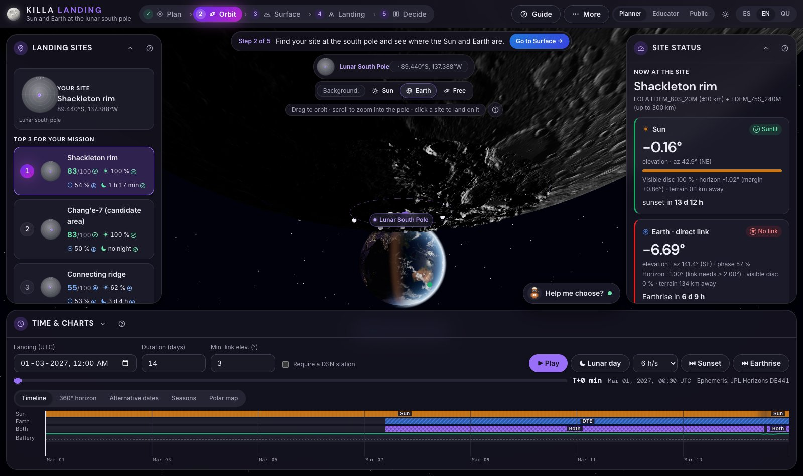

_The Orbit view with the Earth as background: the south polar cap with the site dots, and the three panels open._

- Drag to orbit, scroll to zoom into the pole.
- Click a site dot to select it and fly down to its surface. The active site is highlighted and labelled; south-pole sites are brighter than reference sites.
- **Background:** **Sun**, **Earth** or **Free** frames the view with that body behind the Moon, or leaves the camera free.
- The badge at the top of the HUD shows where the active site is on the Moon, with its coordinates.

The Sun and the Earth are not at their true distance (the Earth label says **Earth (not to scale)**); their directions are the true ones. The three DSN stations are marked on the Earth globe: a station that sees the Moon glows and the others are dimmed.

## 9. Surface view

The camera stands on the site, 2 m above the ground. Sites with 20 m terrain show a 20 × 20 km tile with a regolith texture; beyond it a horizon ring draws the distant relief of the horizon mask. The Sun and the Earth appear at their true angular size (the Sun is 0.5° wide), and sunlight dims with the fraction of the solar disc that clears the horizon.

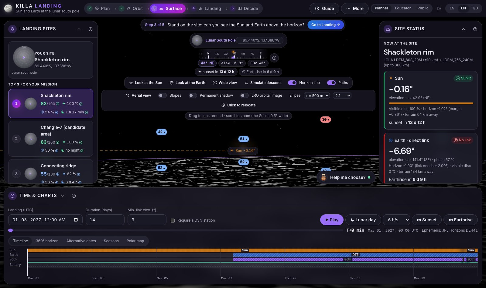

_The Surface view at Shackleton rim: the Sun grazing the ridge, the HUD controls, the site status on the right and the timeline at the bottom._

**Camera.** Drag to look around; scroll or pinch to zoom, from a 75° field of view down to 2°; the arrow keys turn the camera too.

**Heading tape.** At the top: ticks every 5°, cardinal points, and the symbols ☀ and ⊕ when the Sun or the Earth are within the tape. Below it, the exact heading, the elevation and the field of view (FOV).

**Countdown chips.** Under the tape, two chips count down to the next change: ☀ to sunset or sunrise, ⊕ to Earthset or Earthrise. When nothing changes inside the mission window they say so.

**Controls.**

| Control                           | What it does                                                                                                                                                                                                           |
| --------------------------------- | ---------------------------------------------------------------------------------------------------------------------------------------------------------------------------------------------------------------------- |
| **Look at the Sun**               | Points the camera at the Sun with zoom; when the Sun is hidden it aims at the ridge that hides it                                                                                                                      |
| **Look at the Earth**             | The same for the Earth                                                                                                                                                                                                 |
| **Wide view**                     | Back to a 75° field of view                                                                                                                                                                                            |
| **Simulate descent**              | Opens the Landing view                                                                                                                                                                                                 |
| **Horizon line**                  | Draws the horizon mask as a line over the relief                                                                                                                                                                       |
| **Paths**                         | Draws the paths of the Sun and the Earth over the mission window (also in the 360° horizon chart)                                                                                                                      |
| **Aerial view** / **Lander view** | A top-down camera 3 km up to see the surroundings, and back to the lander's eye                                                                                                                                        |
| **Slopes**                        | Colours the terrain by slope: under 10° safe, 10–15° marginal, over 15° hazardous, with a legend                                                                                                                       |
| **Permanent shadow**              | Colours the terrain by mean yearly illumination: striped for permanent shadow (PSR, possible ice), then from little light to almost always lit; also draws the rover route to the ice                                  |
| **LRO orbital image**             | Drapes a real LRO photograph over the relief (via LROC QuickMap: the south pole NAC mosaic at 10 m/px and, north of 85.5°S, the WAC mosaic at 100 m/px). Its shadows are those of the photo, not of the simulated date |
| **Ellipse**                       | Landing ellipse: **no ellipse**, or a semi-major axis of 500 m, 1 km or 2 km, and its shape (**circle**, 2:1 or 3:1)                                                                                                   |
| **Click to relocate**             | Arms the pick mode: the next click on the terrain moves the site there                                                                                                                                                 |

The three terrain layers (slopes, permanent shadow, orbital image) are exclusive: turning one on turns the others off. On small screens the control rows fold behind **Controls** / **Hide controls**.

**Landing ellipse.** The ellipse is the 3σ footprint of the landing error. Its major axis follows the approach azimuth, because the error along the approach track is larger than the cross-track one. The mission is evaluated at 17 points (the centre and two rings of eight), each weighted by the probability of landing there. Each point appears on the terrain as a marker with its score; hover for the figures and click to move the site there. The results feed the landing ellipse card of the right panel.

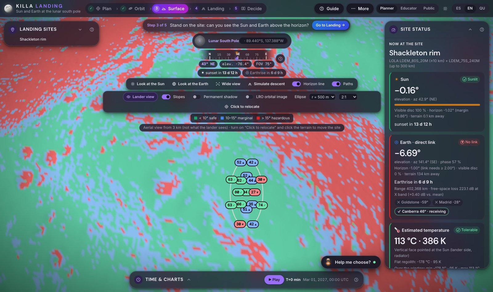

_The aerial view with **Slopes** on: safe, marginal and hazardous ground, the landing ellipse and its score points._

**Availability.** The aerial view, the slopes, the ellipse and the relocation need terrain data: a site with its own tile, or any point south of 75.5°S. The permanent shadow layer needs the illumination map of the site, and the orbital image layer needs the imagery of its tile; a control that cannot work at a site is not shown.

## 10. Site status panel

The right panel, **Site status**, reads the active scenario. Under the site name a line states the source of its horizon.

### At the current mission time

**Sun.** Badge **Sunlit** or **In shadow**; the elevation and azimuth; a bar with the visible fraction of the disc; the elevation of the horizon in that direction with the margin over it; the distance to the terrain that forms the horizon there; and a countdown to the next sunset or sunrise.

**Earth · direct link.** Badge **DTE active** or **No link**; the elevation, azimuth and phase of the Earth; the horizon in its direction and the elevation the link needs (horizon plus the link margin); the visible fraction of the disc; and a countdown to the next Earthset or Earthrise.

**DSN** (Planner mode). The Earth–Moon range, the free-space loss at X band and its difference from the loss at the mean distance, and the three Deep Space Network complexes: **Goldstone**, **Madrid** and **Canberra**. A station is marked ✓ when it sees the Moon at 10° or more, and the one with the Moon highest is tagged **receiving**. If the Earth is visible from the site but no station sees the Moon, a warning says so.

**Estimated temperature.** Badge **Tolerable**, **Cold nights** or **Critical freeze**. The large figure is a vertical face pointed at the Sun (a lander side or radiator); below it, flat regolith, the minimum and maximum over the window, and the time below −100 °C for unheated equipment, in total and in a row. A site with no light in the whole window is treated as a permanently shadowed floor at about −233 °C.

### Over the mission window

**Score.** A number from 0 to 100:

```
score = 0.50 × energy % + 0.35 × link % + 15 × survival
survival = 1 − min(longest night in hours ÷ 120, 1)
```

- _Energy %_ is the mean visible fraction of the solar disc over the window (what a Sun-tracking panel collects relative to continuous full sunlight).
- _Link %_ is the share of the window with a direct link to Earth: at least half of the Earth's disc above the terrain horizon plus the link margin and, when **Require a DSN station** is on, a DSN complex with the Moon in view.
- _Survival_ is 1 with no night and falls to 0 for a night of 120 hours (5 days) or longer.

**Verdict.** **Viable**, **Marginal** or **Ruled out** against the hardware limits (slope, longest night, minimum link), naming the limits that fail or are within 20 % of failing. The limits are edited in **More** → **Hardware**.

**Date shift.** A strip labelled "If the date moves" with the range of scores, then the score of the same mission landing 1, 3 or 7 days earlier or later. Click a value to adopt that date.

**Engineering** ↔ **Science**. A slider from 0 to 100 % science, 0 by default. Above zero, the panel shows the combined score:

```
combined = (1 − w) × engineering score + w × science score
```

The Top 3, the hardware filter, **Suggest a better point** and the planner rank by the combined score.

**Window figures.** **Energy (vs. continuous Sun)**, **Time in sunlight**, **Time with DTE link**, **Sun + Earth at once**, **Longest night**, **Longest link outage** and **Mean / max Sun elevation**.

**Ice access (PSR).** Badge **Inside a PSR**, **Reachable** or **Out of reach**. The large figure is the science score:

```
science = 100 × distance factor × (1 − 0.5 × steepness)
distance factor = 1 up to 500 m of driving, falling linearly to 0 at 2 km
steepness = steepest slope of the route ÷ rover slope limit
```

The card gives the straight distance to the nearest permanent shadow within 2 km and the rover route to it, found on the 20 m terrain without crossing slopes above the rover limit. If the walls around the shadow are too steep, the card says so. For a reachable site a line states whether the selected rover completes its round trip, and **See the traverse** opens the rover view directly.

**Power · battery.** Choose a power profile; the card says **Survives** or **Out of power**, the minimum charge, the charge at the current mission time, the share of time operating and the energy generated. When the battery empties, the card gives the date and how long the craft stays without power.

| Profile                                                | Arrays                  | Power per panel | Battery | Operating load | Survival load | Hibernates below |
| ------------------------------------------------------ | ----------------------- | --------------- | ------- | -------------- | ------------- | ---------------- |
| **CLPS-class lander (box, 4 vertical faces)**          | Box: 4 vertical faces   | 150 W           | 1500 Wh | 150 W          | 45 W          | 25 %             |
| **Small rover (sun-tracking panel)**                   | Sun-tracking            | 120 W           | 600 Wh  | 70 W           | 18 W          | 20 %             |
| **Canadian utility rover (CSA concept, illustrative)** | Sun-tracking            | 400 W           | 5000 Wh | 200 W          | 10 W          | 30 %             |
| **Fixed vertical panel (one face)**                    | One fixed vertical face | 300 W           | 1000 Wh | 120 W          | 30 W          | 20 %             |

**Edit profile** opens every field (**Arrays**, **Power per panel (W)**, **Battery (Wh)**, **Operating load (W)**, **Survival load (W)**, **Hibernate below (%)**, **Initial charge (%)** and, for vertical arrays, **Facing (° from N)**); an edited profile is labelled **Custom**. All values are illustrative.

**Terrain · landing.** Badge **Safe slope**, **Marginal slope** or **Too steep**, judged on the 90th-percentile slope around the site. The card gives the local slope, and within the radius the p90, the maximum and the share of area under 10°. On terrain coarser than 20 m a warning explains that slopes are smoothed.

**Landing ellipse** (Planner mode, when an ellipse is selected in the Surface view). The spread of the mission over the 17 points: minimum, median and maximum of the score, time in sunlight, link, longest night and slope, plus the **Expected score**, the probability of a score of 60 or more and the probability of a slope under 10°.

**Suggest a better point.** Searches the ellipse for safe ground (slope under 10°, with no neighbouring cell at 15° or more), evaluates the mission at the 40 highest points and lists the three best with their score, the difference from the target, the distance and bearing, and their slope, light, link and night. **Go to this point** moves the site there.

## 11. Time controls and charts

The bottom panel, **Time & charts**, holds the clock of the mission and five chart tabs.

### Time controls

| Control                          | What it does                                                                                                                                   |
| -------------------------------- | ---------------------------------------------------------------------------------------------------------------------------------------------- |
| **Landing (UTC)**                | Landing date and time of the active scenario                                                                                                   |
| **Duration (days)**              | Mission duration, 1 to 365 days (14 by default)                                                                                                |
| **Min. link elev. (°)**          | Planner mode. Elevation the Earth must clear above the terrain for a usable link, 0 to 10° (3° by default)                                     |
| **Require a DSN station**        | Planner mode. The link counts only while Goldstone, Madrid or Canberra see the Moon at 10° or more                                             |
| **▶ Play** / **❚❚ Pause**        | Runs or stops mission time                                                                                                                     |
| **☾ Lunar day**                  | Rewinds to the landing and plays one full lunar day (29.5 Earth days) at one day per second, extending the mission to 30 days if it is shorter |
| Speed                            | 1, 6, 24 or 72 hours per second, or 7 or 30 days per second                                                                                    |
| **⏭ Sunset** / **⏭ Sunrise**     | Jumps to the next change of the Sun                                                                                                            |
| **⏭ Earthset** / **⏭ Earthrise** | Jumps to the next change of the Earth                                                                                                          |
| Time slider                      | Time since landing, in quarter-hour steps, with T+ and the UTC date beside it                                                                  |

The whole app follows this clock: the 3D lighting, the cards of the right panel, the countdowns and the cursors of the charts.

### Timeline

Lanes over the mission window, with patterns and labels as well as colour: **Sun** (intensity follows the visible fraction of the disc), **Earth** (direct link), **Both**, and **Battery** with its hibernation threshold and an **Out of power** mark where it empties. Under the lanes, a chart of the height of the Sun and the Earth above the local horizon; a body is hidden wherever its line dips below the horizon line. Click or drag to move mission time to that moment.

### 360° horizon

The terrain profile all around the site, as a panorama, with the paths of the Sun and the Earth over the mission window (filled dots where the body is visible, hollow where it is hidden) and a dashed line for the link threshold above the terrain. The vertical scale is exaggerated and the factor is printed on the chart. **If this were Earth** adds what an atmosphere would do: the Sun lifted by refraction and a sky still bright during twilight. On the Moon it is dark the moment the disc drops behind a ridge.

### Alternative dates

The score of the mission for each landing day over the next 12 months at the active site. Faint bars mark days when the Sun does not light the site at touchdown; a blue strip marks days with the Earth visible at landing. Beside the chart, the five best sunlit days are listed with their score, energy, link and longest night. Click a bar or a listed date to adopt it.

### Seasons

Month by month from 2026 to 2030: bars for the mean energy of a mission landing in that month (fainter when few days have the Sun up at touchdown), a blue line for the Earth link, and a lower strip for the maximum Sun elevation. The chart names the best and the worst month and explains why: the Moon's axis is tilted only 1.54°, so the polar Sun swings between +1.54° and −1.54° over the year, and that small difference decides how much of it clears the mountains. Click a month to land on its first sunlit day.

### Polar map

The polar cap from 80°S to 90°S seen from above, in stereographic projection, with the pole at the centre, the Earth direction (0° longitude) up and rings every 2°. It shows the LOLA relief as a hillshade, the yearly illumination of the catalogue sites (blue for permanent shadow, then a ramp from 0 % to 100 % mean yearly Sun) and the sites as markers. The active site is highlighted; with several scenarios their sites carry the letters A, B, C and D. Hover to read coordinates; click a marker to select that site.

## 12. Landing view: the descent

The Landing step simulates the final approach to the site. Mission time is frozen during the descent.

### Models

**Model** chooses between two:

- **with physics** (default). The lander is a point mass with an engine. Thrust, lunar gravity (1.62 m/s²) and propellant consumption (the rocket equation) are integrated, and a guidance law flies the craft to a gate 30 m above the target and then straight down. The approach starts 3.5 km above the site and 7.5 km up-range, at about 170 m/s horizontally and 50 m/s of descent. If relief under the approach track blocks it, the simulation retries from 5 km and then 7 km.
- **quick**. A 45-second illustrative fly-down without physics. It is also shown, with a notice, whenever the guidance cannot close the descent.

**Lander** chooses the vehicle of the physics model. The values are illustrative.

| Lander                  | Dry mass | Descent propellant | Thrust | Specific impulse |
| ----------------------- | -------- | ------------------ | ------ | ---------------- |
| **CLPS class (700 kg)** | 700 kg   | 1200 kg            | 4 kN   | 320 s            |
| **small (200 kg)**      | 200 kg   | 520 kg             | 2 kN   | 320 s            |
| **heavy (6 t)**         | 6000 kg  | 8500 kg            | 45 kN  | 311 s            |

**Approach** sets the direction the craft comes from: **Sun behind (auto)**, **Sun ahead** (the worst case for the cameras), or one of eight compass bearings.

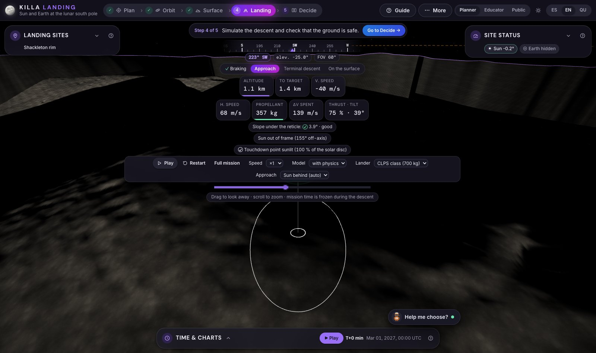

_Mid-descent with physics: the phases, the telemetry cards, the slope under the reticle and the landing ellipse on the terrain._

### Read-outs

- _Phases_: **Braking** → **Approach** → **Terminal descent** → **On the surface**.
- _Telemetry_: **Altitude** above the terrain (with a bar on a logarithmic scale), **To target** and **V. speed**. With physics, also **H. speed**, **Propellant** (kilograms and a bar), **Δv spent** and **Thrust · tilt**.
- **Slope under the reticle**: the reticle marks where the camera points on the ground. Its colour and its shape give the slope there: a circle for safe, a diamond for marginal, a cross for hazardous.
- **Sun in the field of view**: a warning when the Sun enters the camera, with its angle off the axis.
- "Touchdown point sunlit" (with the share of the solar disc) or **Touchdown point in shadow**: whether the site has Sun at the landing time.
- _Unsafe target_: if the target is not safe ground, a notice gives how far the guidance would divert (within 300 m) and the extra Δv; **Land there** moves the site to that point. If no safe ground is within reach, the notice says so.

In the last 30 m or so the engine plume raises dust, which leaves in low arcs (with no air it forms no cloud).

### Playback

**Pause** / **Play**, **Restart**, **Speed** (×1, ×2, ×4) and a progress slider. Drag to look away from the flight direction (the view returns by itself) and scroll to zoom.

### The result

After a physics touchdown a line sums up the descent: the touchdown speed, the duration, the Δv of the simulated approach, the estimated total including the braking burn from orbit (about 1700 m/s, which is not simulated) and the propellant left, in kilograms and as a share of the load. The line carries ✓ when the margin is 10 % or more and ▲ below that.

When the guidance fails, the notice gives the reason and the illustrative fly-down plays instead:

- The lander runs out of propellant before touchdown.
- Terrain under the approach cuts the guided trajectory.
- Touchdown exceeds the allowed speed (2.5 m/s vertical, 1 m/s horizontal).
- The guidance does not close the descent.

### After touchdown

- **View from the craft** or **Orbit around**: the lander's eye, or a camera circling the craft.
- A line gives the direct sunlight on the panels: the top deck and the side facing the Sun.
- **Go to the surface view** returns to the Surface step.
- **Deploy rover** starts the rover round trip (next section). It appears when the site has a drivable route to the ice.
- **Full mission**, available from the start of the descent under the same condition, plays the descent and then the rover traverse in one go.

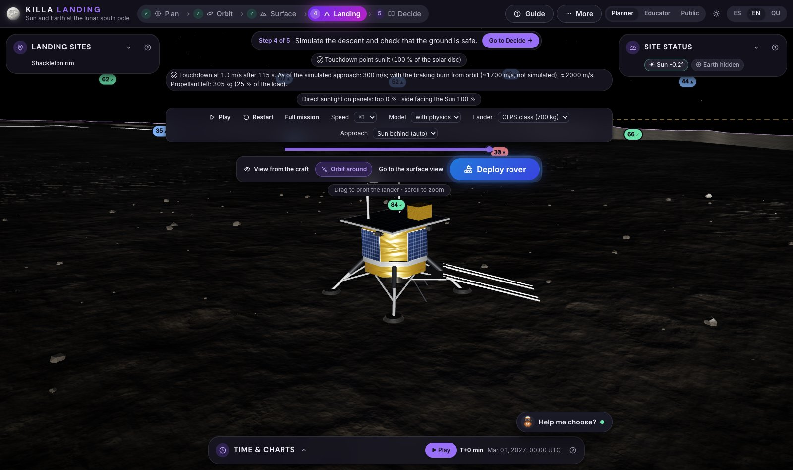

_After touchdown with **Orbit around**: the lander with its ramps down, the touchdown summary and the **Deploy rover** button._

The lander is a CLPS-class craft about 4 m tall: an octagonal body in gold insulation, four legs, side solar panels and a deck array, thruster pods, tanks, a camera mast and a high-gain antenna. It sits on the local slope of the terrain and its first face points to the azimuth of the power profile, so the light on its panels and the shadow it casts are those of the chosen date.

## 13. The rover round trip

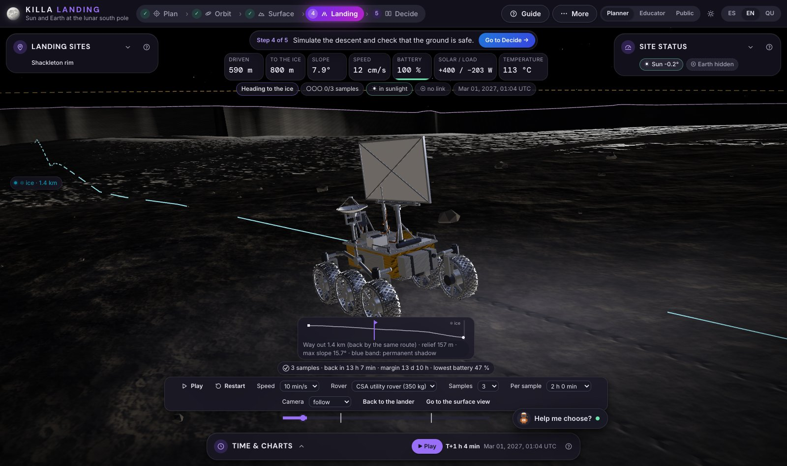

_The utility rover on its way out (**Heading to the ice**): the telemetry cards and state chips at the top, the dotted route ahead, and the elevation profile and controls at the bottom._

When the site has a drivable route to permanently shadowed ground, the rover makes the whole trip in the scene: out to the ice, sampling, and back to the lander by the same route. Open it with **Deploy rover** after a descent, with **Full mission**, or with **See the traverse** on the ice access card.

### What you see

- **Outbound.** The rover rolls down the ramps and follows the dotted route, leaving wheel tracks and throwing dust. In shadow it turns its headlights on.
- **Sampling.** It stops at the ice and the drill works for the whole time of each sample. After the last one it turns around on the spot.
- **Return.** It drives back along the same route, leaving a second set of tracks beside the first, and parks in front of the ramps.

Mission time advances with the rover, so the Sun, the shadows and the panels show the hour of each moment of the trip. The solar array tracks the Sun and the dish points at the Earth when there is a link.

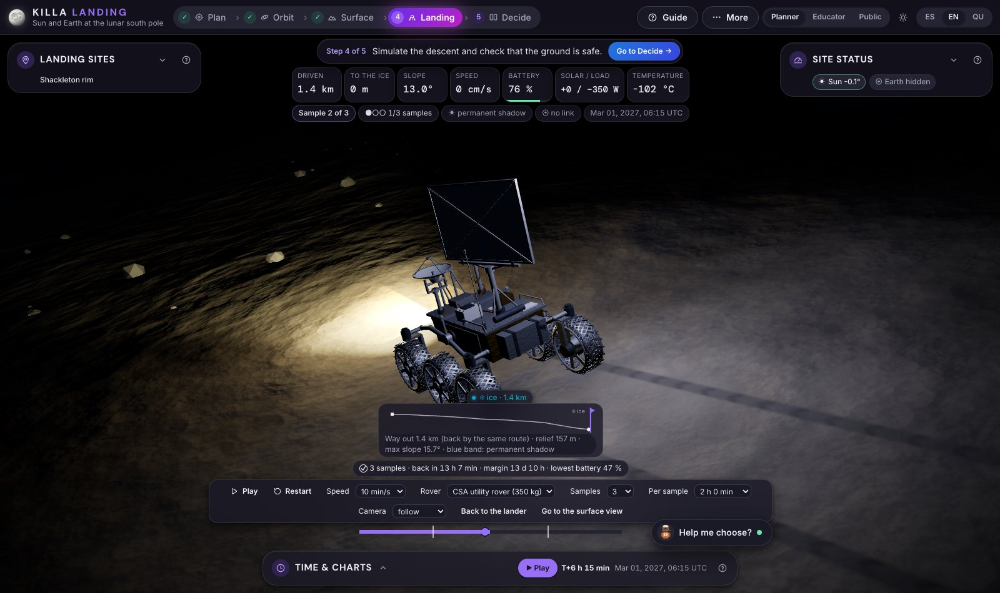

_Sampling at the ice (**Sample 2 of 3**): the rover works in permanent shadow with its headlights on, running on the battery._

### HUD

**State chip.**

| State                            | Meaning                                            |
| -------------------------------- | -------------------------------------------------- |
| **Heading to the ice**           | Driving out                                        |
| **Recharging**                   | Stopped in hibernation until the battery recovers  |
| **Sample {n} of {total}**        | Working on a sample                                |
| **Heading back**                 | Driving back to the lander                         |
| ✓ **Back at the lander**         | Trip completed                                     |
| ▼ **Out of battery**             | The trip ended on the way out or on the way back   |
| ▼ **Did not finish the samples** | The battery did not last for the work at the ice   |
| ▼ **Back late**                  | It reached the lander after the end of the mission |

**Sample counter.** One dot per sample requested, filled as they are completed, such as ●●○ with "2/3 samples".

**Telemetry.** **Driven** (the odometer), the distance left of the leg under way (**To the ice** on the way out, **To the lander** on the way back), **Slope**, **Speed**, **Battery** with a bar and, in Educator and Planner mode, **Solar / load** and **Temperature**. Chips say whether the rover is **in sunlight**, **in shadow** or in **permanent shadow**, and whether it has a **link to Earth** or **no link**, with the date and time.

**Elevation profile.** The height of the outbound route with the lander at the left and the ice at the right. A blue band marks the stretch inside permanent shadow. The cursor travels to the ice and comes back, with an arrowhead pointing the way the rover is driving. The caption gives the one-way distance, the relief and the maximum slope.

**Progress slider.** It covers the whole trip, in one-minute steps. Two ticks mark **Arrives at the ice** and **Leaves the ice**.

**Summary line.** When the trip succeeds: the samples collected, the duration of the whole trip, the margin left until the end of the mission and the lowest battery, for example "3 samples · back in 13 h 8 min · margin 13 d 10 h · lowest battery 47 %". Its tooltip adds the time in shadow and the share of the trip with a link to Earth.

### Controls

| Control                           | Options                                                                        |
| --------------------------------- | ------------------------------------------------------------------------------ |
| **Play** / **Pause**, **Restart** | Playback                                                                       |
| **Speed**                         | 2, 10 or 30 minutes of mission time per second, or 1 hour per second           |
| **Rover**                         | **micro-rover (40 kg)** or **CSA utility rover (350 kg)**                      |
| **Samples**                       | 1 to 10                                                                        |
| **Per sample**                    | 0.5 to 6 hours                                                                 |
| **Camera**                        | **follow** (drag to orbit the rover, scroll to zoom), **mast** or **top-down** |
| **Back to the lander**            | Returns to the lander's view                                                   |
| **Go to the surface view**        | Returns to the Surface step                                                    |

The rover, the number of samples and the hours per sample are the same inputs as in the Plan step, and the workload is remembered between visits. Changing any of them starts the trip over. A shared link that carries `rover=1` opens directly on the traverse.

### Rover types

| Parameter            | micro-rover                                     | utility rover                                                                                        |
| -------------------- | ----------------------------------------------- | ---------------------------------------------------------------------------------------------------- |
| Mass                 | 40 kg                                           | 350 kg                                                                                               |
| Speed on flat ground | 10 cm/s                                         | 20 cm/s                                                                                              |
| Solar array          | 120 W, Sun-tracking                             | 400 W, Sun-tracking                                                                                  |
| Battery              | 600 Wh                                          | 5000 Wh                                                                                              |
| Operating load       | 70 W                                            | 200 W                                                                                                |
| Survival load        | 18 W                                            | 10 W                                                                                                 |
| Hibernates below     | 20 %                                            | 30 %                                                                                                 |
| Sampling instrument  | 30 W                                            | 150 W                                                                                                |
| Model in the scene   | Four wheels, flat solar deck, short camera mast | Six wheels on a rocker-bogie, vertical tracking array, stereo mast, gimballed dish, drill at the bow |

Both use a rolling-resistance coefficient of 0.15 and a drivetrain efficiency of 60 %. These are orders of magnitude for the two vehicle classes, not the specifications of a real rover.

### Why a trip fails, and the fix buttons

The trip counts as done only if the rover reaches the ice, collects every sample and is back before the end of the mission. When it fails, a notice explains where and offers fix buttons.

| Notice                                                                           | What happened                                                                                   | Fix buttons                                                                                        |
| -------------------------------------------------------------------------------- | ----------------------------------------------------------------------------------------------- | -------------------------------------------------------------------------------------------------- |
| There is no drivable route to the ice from this point.                           | Every path crosses slopes above the rover limit                                                 | None: choose another site or raise the rover slope limit                                           |
| Out of battery: it stops before reaching the ice and cannot recharge.            | The charge ran out on the way out                                                               | **Use the utility rover**                                                                          |
| It did not finish the samples.                                                   | In permanent shadow it cannot recharge and the battery runs out                                 | **Collect fewer samples** (or **Shorten each sample** when one is left), **Use the utility rover** |
| Out of battery: it collects the samples, but runs out of charge on the way back. | Nothing was left for the return                                                                 | Same as above                                                                                      |
| Back late: it reaches the lander after the mission ends.                         | Long recharge stops                                                                             | Same as above; a longer mission or another landing date also helps                                 |
| It is back in time with the samples, but the battery drops below the minimum.    | The trip succeeds with less reserve than the minimum battery of the Plan step (20 % by default) | Same as above                                                                                      |

**Use the utility rover** is offered only while the micro-rover is selected.

### The assumptions

- **Speed.** The commanded speed is reduced linearly with the slope, down to 20 % of it at the rover slope limit.
- **Energy.** The load while driving is the operating load plus the traction power from weight, grade and rolling resistance. Solar input is the array power times the visible fraction of the solar disc times the incidence factor. The return leg is recomputed: climbs on the way out are descents on the way back, and the Sun is where it is at that hour.
- **Recharge stops.** When the battery falls below the hibernation threshold, the rover stops, drops to its survival load and waits until it is 10 points above the threshold. It gives up after 14 days of waiting.
- **No recharge in permanent shadow.** Inside a permanently shadowed cell the Sun counts as absent, so the sampling runs on the battery alone. If the charge falls below the threshold there, the trip fails.
- **Instrument.** While sampling, the rover draws its operating load plus the instrument power. The instrument power and the time per sample are reasonable assumptions, not data of a specific instrument.
- **Deadline.** The rover leaves at touchdown and must be back before the end of the mission (landing date plus duration).
- **Temperature.** The cold of the shadow is shown as a figure; what limits the trip is the battery.
- **Close-up ground.** Rocks, metre-size craters and fine relief below the resolution of the terrain data are illustrative. They do not enter the slopes, the route or the energy.

## 14. Decide: compare, edit, export

The **Decide** step opens the comparison (**Decide: compare and choose**): up to four scenarios, labelled A to D, side by side at the same mission time.

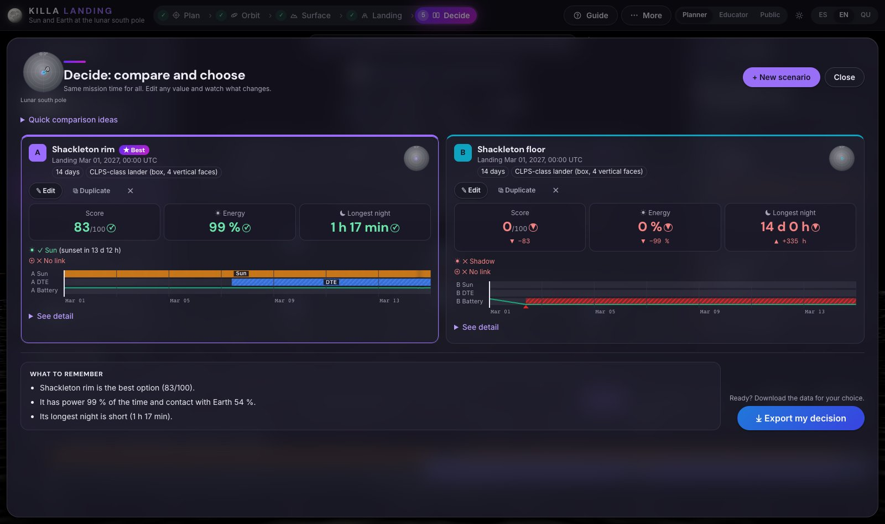

_The Decide step with two scenarios: Shackleton rim against Shackleton floor on the same landing date._

### A scenario column

- The letter badge (click it to make the scenario the active one), the site name, the landing date and tags for the duration, the power profile and the science weight. The winning column carries ★ **Best**.
- **Edit**, **Duplicate** and a ✕ button to remove the scenario.
- Three large figures with their level: **Score**, **Energy** and **Longest night**. Columns B to D add the difference from scenario A, such as "▲ +12" or "▼ −5"; "= A" means no difference.
- The state at the current mission time: Sun (with the countdown to the next change) and Earth link.
- A compact timeline with the Sun, link and battery lanes. Click it to move the shared mission time.
- **See detail** unfolds the 360° horizon and more rows: **Time in sunlight**, **DTE link**, **Sun + Earth**, **Longest DTE outage**, **Max Sun elev.**, **Min battery**, **Estimated min. temp.**, **Ice access** (science score and route) and, with a science weight above zero, the combined score.

A locator map in the header shows the sites of all scenarios with their letters. Under the columns, **What to remember** sums up the best scenario in three lines: its score, its power and Earth contact, and its longest night.

### Creating and editing scenarios

**+ New scenario** opens the editor on a copy of the active scenario; **Edit** opens it on an existing one, where changes apply instantly.

1. **Where?** The Top 3, the full list with **See more sites (22)**, and custom coordinates.
2. **When, and with what hardware?** **Landing date (UTC)**, **Duration (days)**, the **Power · battery** profile, **Min. link elev. (°)**, **Require a DSN station**, **Science weight (ice)** and, under **Lander and rover limits**, the four hardware limits.

Finish with **Create scenario** or **Cancel**.

### Quick comparison ideas

**Quick comparison ideas** unfolds five one-click comparisons, built from the active site and date:

| Idea                                           | What it compares                                                                               |
| ---------------------------------------------- | ---------------------------------------------------------------------------------------------- |
| **What if Artemis III slips 14 days?**         | The active site on the active date and 14 days later                                           |
| **Near-eternal-light peak vs. crater floor**   | Connecting ridge against the permanently shadowed floor of Shackleton                          |
| **Light vs. ice**                              | Connecting ridge, Shackleton rim, Nobile rim and de Gerlache rim, with 30 % science weight     |
| **Artemis III candidates**                     | Connecting ridge, de Gerlache rim, Malapert massif and Mons Mouton on the same date            |
| **Canadian rover: does it survive the night?** | Connecting ridge, Malapert massif and Cabeus over 30 days with the utility rover power profile |

The same ideas appear as cards in the **Why?** overlay.

### Export and share

In Planner mode, **Export my decision** downloads:

| Option                    | File                                                                                                                                                                                                                                                                                  |
| ------------------------- | ------------------------------------------------------------------------------------------------------------------------------------------------------------------------------------------------------------------------------------------------------------------------------------- |
| **Time series (CSV)**     | The active scenario, one row per sample: UTC time; azimuth, elevation, horizon elevation and visible fraction of the Sun and of the Earth; sunlit, link and both flags; array power, battery charge and operating flag. A header lists the site, the horizon source and every setting |
| **Full scenario (JSON)**  | The same series in columns, plus the metrics and the Sun and link windows                                                                                                                                                                                                             |
| **Horizon profile (CSV)** | Horizon elevation by azimuth and, for catalogue sites, the distance to the terrain that forms it                                                                                                                                                                                      |
| **All scenarios (JSON)**  | Every scenario of the comparison in one file (offered with two or more)                                                                                                                                                                                                               |

The sampling step is 10 minutes for missions up to 60 days, 30 minutes up to 180 days and 60 minutes beyond.

**Sharing.** The address bar always holds the full state of the 3D steps (see [section 21](#21-url-parameters)). Copy it to share exactly what is on screen, including the comparison.

## 15. Hardware filter

**More** → **Hardware** (Planner mode) opens the viability filter. Set what the lander tolerates and every catalogue site is judged at once, for the active landing date, mission duration and link settings.

| Limit                               | Range    | Default | Compared with                                       |
| ----------------------------------- | -------- | ------- | --------------------------------------------------- |
| **Max slope (°, p90 within 500 m)** | 1 to 30  | 15      | 90th-percentile slope within 500 m of the site      |
| **Max continuous night (h)**        | 1 to 720 | 120     | Longest night of the mission window                 |
| **Min DTE link (%)**                | 0 to 100 | 30      | Share of the window with a direct link              |
| **Rover max slope (°)**             | 5 to 35  | 20      | The route to the ice (ice access and science score) |

Each row of the table gives the **Status**, the **Site**, the **Score**, the **Slope p90**, the **Longest night**, the **DTE** share and the **Constraint** that fails or is tight. The status is **Viable**, **Marginal** (a limit is met with less than 20 % of headroom) or **Ruled out**. Viable sites are listed first, then by score. **Send {n} viable to Compare** opens Decide with the best of them, up to four.

The limits are part of the scenario: they also drive the verdict of the right panel, the Top 3 and the planner.

## 16. The assistant

The **Help me choose?** button, with the mascot Killa (the name means "Moon" in Quechua), floats over the stage in the 3D steps. It opens a card with three recommended scenarios for the active date and mission, drawn from the south-pole sites:

| Recommendation              | Chosen by                                                               |
| --------------------------- | ----------------------------------------------------------------------- |
| **Best overall**            | Highest score                                                           |
| **Best contact with Earth** | Highest share of time with a direct link                                |
| **Light + ice**             | Best balance of the score and ice access; it sets a 30 % science weight |

The three are always different sites, and sites that pass the hardware limits come first. **Apply** puts that recommendation in the active scenario; **Compare the 3 options** loads the three into Decide.

The text box answers short questions about light, the Earth link, slope, ice, night and which site is best. The answers are computed on your device, as the note **Demo mode: answers computed on your device.** states. The mascot's face follows what the assistant is doing: thinking, a recommendation ready, or a problem.

## 17. Why?, glossary, guided tour and help

**Why?** (**More** → **Why?**) opens **Why is the lunar south pole so hard?**: eight cards for a general audience, each with a button that takes you to the site that illustrates it.

| Card                                          | Button                                                   |
| --------------------------------------------- | -------------------------------------------------------- |
| **Why does the Sun never climb at the pole?** | **See the Shackleton rim**                               |
| **A few metres change everything**            | **Go down into Shackleton**                              |
| **No atmosphere: the horizon is the terrain** | **Climb the Malapert massif**                            |
| **The Earth barely moves… but it wobbles**    | **See the connecting ridge**                             |
| **Far side: never any Earth**                 | **Go to Chang'e-4**                                      |
| **Two-week days and nights**                  | **Compare with Apollo 11**                               |
| **No air: no twilight, no blanket**           | **See inside Shackleton**                                |
| **Canada on the Moon**                        | **Try the Canadian rover** (opens that quick comparison) |

The overlay also holds a button to the challenges, the quick scenarios as cards, the **Glossary** and a list of the NASA and CSA resources the app draws on (JPL Horizons, LROC QuickMap, Moon Trek and the Canadian Space Agency's Moon exploration pages), each with a link. In Educator and Public mode it opens by itself on entering the 3D steps, once per browser session.

**Glossary.**

| Term                 | Meaning                                                                                                                                                 |
| -------------------- | ------------------------------------------------------------------------------------------------------------------------------------------------------- |
| **Horizon mask**     | Elevation of the terrain in every direction seen from the site (0.5° resolution, out to 300 km). It decides when the Sun or the Earth are blocked       |
| **Visible fraction** | Share of the disc of the Sun (or the Earth) above the horizon; a body counts as visible from 50 %                                                       |
| **DTE**              | Direct-to-Earth: communication straight to Earth, with no relay satellite                                                                               |
| **Link margin**      | Degrees the Earth must clear above the terrain for a usable link; it keeps the signal from bouncing off the ground (multipath)                          |
| **DSN**              | Deep Space Network: NASA's antennas at Goldstone, Madrid and Canberra. To talk to the Moon at least one must have it in view                            |
| **Landing ellipse**  | Area where the lander may end up because of guidance error (3σ). It is elongated: the error along the approach track is larger than the cross-track one |
| **PSR**              | Permanently shadowed region: crater floors the Sun never reaches, where ice can survive                                                                 |
| **Slope**            | Tilt of the ground computed on the 20 m terrain (60 m at the reference sites). Under 10° is safe to land on; over 15° is hazardous                      |
| **LOLA**             | Lunar Orbiter Laser Altimeter: the laser altimeter on the LRO orbiter, the source of all the topography                                                 |
| **T+**               | Time elapsed since touchdown; shared by every scenario                                                                                                  |

**Guided tour.** **Guide** in the top bar (or **Take the guided tour** on the welcome card) starts a 12-step tour: the welcome, the steps, the 3D scene, the sites, the site status, the time controls, the charts, the view controls, Decide, the assistant, the **More** menu and a closing step with a link to this guide. It opens the panel each step talks about and restores your layout when it ends. Move with **Next** and **Back** or the arrow keys; **Skip**, **Finish** or Esc close it.

**Contextual help.** The **?** buttons on the panels and the HUD open a short explanation; **Show me in the tour** jumps to the matching tour step. Esc or a click outside closes it.

## 18. Challenges

**Challenges** (**More** → **Challenges**, **Play the challenges** on the welcome card, or the button in the **Why?** overlay) is a game mode: five short missions that each drop you into a tricky situation. You solve them with the usual controls (site, date, views, lander, rover).

**How it plays.** Press **Start** on a challenge, read the brief and press **Go to the simulator**. The challenge stays active in a bar at the bottom left, with the number of goals met, and ticks itself off when you make it. **View challenge** reopens the brief and the checklist, where each goal shows its current value, such as "(now: 57 %)". **Restart** puts the starting state back, and **All challenges** returns to the list.

**Scoring.** A solved challenge is worth 100 points. Each goal has a hint; revealing one costs 15 points, and a score never drops below 40. The best score of each challenge is kept, and the list shows the total out of 500. On success the overlay shows the score, **What you learned** and **Next challenge**.

| #   | Challenge                | Starting state                                                                                     | Goals                                                                                                                                                                                                      |
| --- | ------------------------ | -------------------------------------------------------------------------------------------------- | ---------------------------------------------------------------------------------------------------------------------------------------------------------------------------------------------------------- |
| 1   | **Find the light**       | Shackleton floor, 1 March 2027, 14 days: permanent shadow                                          | A site south of 80°S with Sun at least 80 % of the time over 14 days                                                                                                                                       |
| 2   | **Don’t lose the Earth** | Shackleton rim, 19 March 2027, 14 days: no direct link for the whole mission                       | A direct link at least 50 % of the time over 14 days, at the south pole                                                                                                                                    |
| 3   | **Survive the night**    | Malapert massif, 1 March 2027, 30 days: a night of more than 300 hours                             | The longest night lasts 120 hours or less in a 30-day mission at the south pole; the verdict of the site is not **Ruled out**                                                                              |
| 4   | **Land with margin**     | Nobile rim with the heavy lander: steep ground and little propellant                               | A site with a p90 slope under 15°; in Landing, a physics descent with a propellant margin of 20 % or more; the descent completed down to the surface                                                       |
| 5   | **Bring ice back**       | Chang'e-7 area, 15 March 2027, 14 days, micro-rover with 3 samples of 2 hours: no route to the ice | A site outside permanent shadow with a drivable route to the ice; the rover collects every sample; it is back at the lander before the mission ends; its battery stays at 30 % or more over the whole trip |

**Hints, in short.**

1. The rim of the same crater is a few kilometres away and much higher.
2. The Earth rises and sets on a cycle of about 27 days: move the landing date by about 10 days.
3. The highest ridges next to the pole are almost never in the dark (Connecting ridge, Shackleton rim); the verdict also looks at the slope and the link.
4. Mons Mouton and the Malapert massif are much flatter than the Nobile rim; a lighter lander keeps more propellant margin; let the physics descent run to the end.
5. The rims and ridges next to the pole have permanent shadow within 2 km; the utility rover, fewer samples, shorter samples or a shorter route keep the battery up.

## 19. Themes and languages

**Themes.** The interface is dark by default. The sun or moon icon in the top bar switches to the light theme and back, and the choice is remembered. The 3D scene and everything floating on it stay dark in both themes.

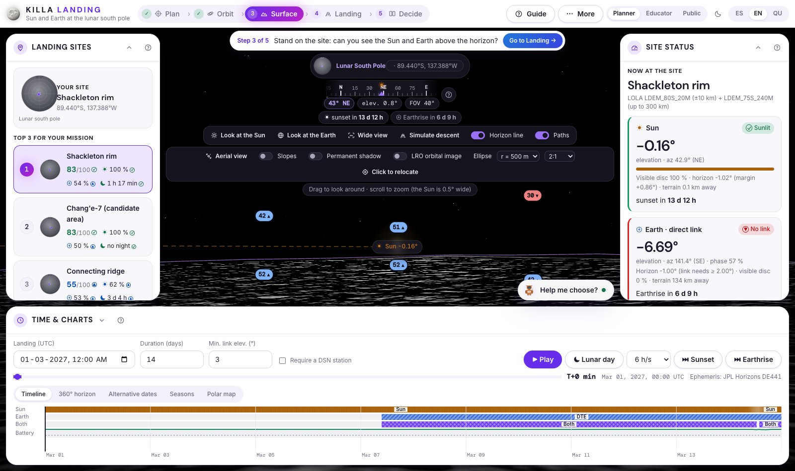

_The Surface view in the light theme: the panels and the top bar turn light, the 3D scene stays dark._

**Languages.** The ES / EN / QU switch changes the interface between Spanish, English and Quechua (Runasimi, Southern Quechua). On a first visit the app follows the browser language: Spanish browsers get Spanish, Quechua browsers get Quechua, and every other language gets English. The choice is remembered and can be forced with `lang=` in the address.

Quechua is a partial translation that covers the main interface. Any text it does not cover appears in Spanish.

## 20. Keyboard and accessibility

| Key or action       | Effect                                                                                  |
| ------------------- | --------------------------------------------------------------------------------------- |
| `1` · `2` · `3`     | Expand or minimise the left, right and bottom panels                                    |
| Enter · Space · Esc | Skip the splash                                                                         |
| `←` `→`             | Guided tour: previous and next step                                                     |
| Esc                 | Close the guided tour or a help popover                                                 |
| Arrow keys          | Surface view: turn the camera. Plan calendar: move between days                         |
| Scroll or pinch     | Zoom in every 3D view                                                                   |
| Drag                | Orbit (Orbit view, lander orbit, rover follow camera) or look around (Surface, descent) |

The panel keys are ignored while typing in a field and during the guided tour.

Accessibility features:

- A level is never given by colour alone: it always carries a glyph and a text (see [section 22](#22-states-levels-and-glyphs)). Chart lanes use patterns and labels.
- Controls, charts and maps have text labels for screen readers, and status changes (progress of a plan, results, warnings) are announced.
- The table of the Plan step sorts from the keyboard, and the calendar is navigable with the arrow keys.
- The splash and the mascot reduce their motion when the system asks for reduced motion.
- The dark and the light theme are both complete.

## 21. URL parameters

While you are in the 3D steps the address bar is kept in step with the state, so the address is the share link. A link that names a site, coordinates or a scenario list opens directly on it, skipping the welcome card.

| Parameter    | Example                                                                     | Meaning                                                                                                                                                                                                            |
| ------------ | --------------------------------------------------------------------------- | ------------------------------------------------------------------------------------------------------------------------------------------------------------------------------------------------------------------ |
| `site`       | `site=shackleton-rim`                                                       | Active catalogue site, by its identifier                                                                                                                                                                           |
| `lat`, `lon` | `lat=-89.1&lon=-60`                                                         | Custom coordinates instead of `site` (degrees; negative is south or west)                                                                                                                                          |
| `date`       | `date=2027-03-01T00:00Z`                                                    | Landing date and time, UTC                                                                                                                                                                                         |
| `days`       | `days=14`                                                                   | Mission duration, 1 to 365 days                                                                                                                                                                                    |
| `view`       | `view=micro`                                                                | 3D view: `macro` (Orbit), `micro` (Surface) or `landing` (Landing)                                                                                                                                                 |
| `ap`         | `ap=90`                                                                     | Approach azimuth of the descent, in degrees; omitted means Sun behind                                                                                                                                              |
| `rover`      | `rover=1`                                                                   | With `view=landing`: opens straight on the rover traverse, skipping the descent                                                                                                                                    |
| `ice`        | `ice=-89.4044,-140.0766`                                                    | Ice target of a planner pick (latitude, longitude): the ice the rover goes to. With a scenario list it travels inside `s`                                                                                          |
| `link`       | `link=3`                                                                    | Link margin: minimum Earth elevation above the terrain, 0 to 10°                                                                                                                                                   |
| `dsn`        | `dsn=1`                                                                     | The link also needs a DSN station with the Moon in view                                                                                                                                                            |
| `hw`         | `hw=15,120,30,20`                                                           | Hardware limits: landing slope (°), longest night (h), minimum link (%), rover slope (°). Written only when they differ from the defaults                                                                          |
| `sci`        | `sci=0.3`                                                                   | Science weight, 0 to 1. Written only when above zero                                                                                                                                                               |
| `en`         | `en=lander`                                                                 | Power profile: `lander`, `rover`, `csa-rover`, `fixed`, or `custom:` followed by eight values (array type, facing, power per panel, battery, operating load, survival load, hibernation threshold, initial charge) |
| `s`          | `s=shackleton-rim@2027-03-01T00:00Z,shackleton-floor@2027-03-01T00:00Z~d30` | Scenario list for Decide: `site@date` items separated by commas. Custom sites use `custom:lat:lon`                                                                                                                 |
| `a`          | `a=0`                                                                       | Index of the active scenario in `s` (0 is A)                                                                                                                                                                       |
| `cmp`        | `cmp=1`                                                                     | Opens the Decide comparison                                                                                                                                                                                        |
| `lang`       | `lang=en`                                                                   | Interface language: `es`, `en` or `qu`                                                                                                                                                                             |
| `mode`       | `mode=public`                                                               | Audience mode: `planner`, `educator` or `public`                                                                                                                                                                   |

Inside `s`, a scenario whose settings differ from the active one adds them after `~`:

| Token  | Example              | Meaning                                      |
| ------ | -------------------- | -------------------------------------------- |
| `~d`   | `~d30`               | Mission duration in days                     |
| `~l`   | `~l5`                | Link margin in degrees                       |
| `~gs`  | `~gs1`               | Require a DSN station (1 or 0)               |
| `~sci` | `~sci0.3`            | Science weight                               |
| `~en`  | `~enrover`           | Power profile (lists use `_` instead of `,`) |
| `~hw`  | `~hw15_120_30_20`    | Hardware limits                              |
| `~i`   | `~i-89.1234_45.6789` | Ice target of that scenario                  |

Values out of range are clamped and unknown values are ignored.

## 22. States, levels and glyphs

Every level is shown with a glyph and a word as well as a colour.

| Glyph | Level   | Word in the app | Typical labels                                                             |
| ----- | ------- | --------------- | -------------------------------------------------------------------------- |
| ✓     | Good    | good            | **Viable**, **Sunlit**, **DTE active**, **Survives**, **Safe slope**       |
| ▲     | Warning | caution         | **Marginal**, **Cold nights**, **Marginal slope**                          |
| ▼     | Bad     | critical        | **Ruled out**, **In shadow**, **No link**, **Out of power**, **Too steep** |

Other marks:

- ✕ marks a day with no solution in the planner calendar and table, a DSN station that does not see the Moon, and a body that is hidden in the comparison.
- ▲ and ▼ next to a number in the comparison are differences from scenario A (up and down). Beside a column header of the planner table they give the sort direction.
- In the descent read-out the slope under the reticle uses ✓, ! and ✕, and the reticle itself uses a circle, a diamond and a cross.
- Notices carry ▲ for a warning, ▼ for an error, ✓ for a success and ℹ for a note.

Thresholds behind the levels:

| Figure                               | Good                                  | Warning                        | Bad                                        |
| ------------------------------------ | ------------------------------------- | ------------------------------ | ------------------------------------------ |
| Score                                | 60 or more                            | 35 to 59                       | under 35                                   |
| Energy                               | 70 % or more                          | 40 to 69 %                     | under 40 %                                 |
| DTE link                             | 70 % or more                          | 30 to 69 %                     | under 30 %                                 |
| Longest night                        | up to 48 h                            | over 48 h                      | over 120 h                                 |
| Slope                                | under 10°                             | 10° to under 15°               | 15° or more                                |
| Science score (ice access)           | 60 or more                            | 20 to 59                       | under 20                                   |
| Battery                              | minimum 40 % or more                  | minimum under 40 %             | empties at any point                       |
| Time below −100 °C in a row          | up to 24 h                            | over 24 h                      | over 120 h, or a permanently shadowed site |
| Verdict against hardware limits      | every limit met with 20 % of headroom | a limit within 20 % of failing | a limit exceeded                           |
| Return margin of the rover (planner) | 24 h or more                          | under 24 h                     | (the day has no solution)                  |
| Propellant margin at touchdown       | 10 % or more                          | under 10 %                     | (the descent fails)                        |

## 23. Model assumptions and limits

Killa Landing is a planning and teaching tool. Its models are first-order and are stated here so the results are read for what they are.

**Sun, Earth and horizon**

- The horizon mask has a 0.5° azimuth resolution and reaches 300 km. The observer stands 2 m above the ground.
- There is no atmosphere in the model: visibility is pure geometry. A body is visible from half of its disc.
- The link is geometric: Earth above the terrain plus the link margin and, optionally, a DSN complex with the Moon at 10° or more. Antenna gain, noise, data rates and network scheduling are not modelled. Relay satellites are not modelled.

**Score**

- The score is a synthetic index with fixed weights (50 % energy, 35 % link, 15 % survival). It ranks options; it is not a probability of mission success.

**Power**

- Array power = panel power × visible fraction of the disc × incidence cosine. The craft operates with Sun and battery above its threshold and hibernates otherwise. There are no thermal effects, ageing or conversion losses. All profiles are illustrative.

**Temperature**

- Simplified radiative equilibrium (albedo 0.12, emissivity 0.95) while lit, and exponential cooling with a 4-hour time constant in shadow, towards a night floor of 95 K, or 40 K in permanent shadow. No conduction and no heaters. It gives an order of magnitude.

**Terrain and ice**

- Slopes come from the 20 m terrain (60 m at the reference sites); anything smaller than a pixel is invisible to the model.
- Permanent shadow comes from a one-year illumination map with cells of about 100 m. It marks where ice can survive; it does not say that ice is there.
- The rover route is the least-cost path on the 20 m terrain within 2 km, never over slopes above the rover limit.
- The landing ellipse and **Suggest a better point** use a quicker analysis (1° horizons and a 30-minute step), so their figures may shift slightly after relocating.

**Descent**

- Only the final approach is simulated, as a point mass over a flat Moon with constant gravity, an ideal engine and perfect navigation. The braking burn from orbit is accounted for with a fixed 1700 m/s, not simulated. The guidance does not steer around relief under its track: that is reported as a failure.
- The hazard divert is reported, not flown, so the view always ends at the site being evaluated.

**Rover**

- Constant commanded speed reduced by slope, rigid wheels with rolling resistance, no slip or sinkage, no obstacle avoidance below the terrain resolution, no regenerative braking.
- The handover of the samples to the lander and any ascent or return to Earth are outside the model: the trip counts as done when the rover is back at the lander in time.

**Planner**

- It optimises the surface phase only, not the Earth–Moon transfer.
- The target must lie where 20 m terrain and an illumination map are published, and dates must fall in 2026 to 2030.
- Landings are evaluated once per day, at 00:00 UTC, among at most 60 candidate points.

**Assistant**

- Its recommendations and answers are rule-based and computed on the device.

## 24. Troubleshooting and FAQ

| Symptom or question                                         | Cause and solution                                                                                                                                                             |
| ----------------------------------------------------------- | ------------------------------------------------------------------------------------------------------------------------------------------------------------------------------ |
| The Surface view is black                                   | It is night at the site. Move mission time (**⏭ Sunrise**), or turn on **Slopes**, which is visible at any hour                                                                |
| The aerial view, slopes, ellipse or relocation are missing  | The point has no terrain data: custom coordinates north of 75.5°S and away from a reference site                                                                               |
| **Permanent shadow** or **LRO orbital image** are missing   | The site has no illumination map or no imagery for its tile                                                                                                                    |
| The ice access card is missing                              | The site has no illumination map, or the mode is Public                                                                                                                        |
| **Deploy rover** and **Full mission** are missing           | The site has no drivable route to permanent shadow. Check the ice access card, pick another site, or raise the rover slope limit                                               |
| The rover "did not finish the samples"                      | It cannot recharge at the ice. Use the utility rover, or ask for fewer samples or less time per sample                                                                         |
| The **Plan** step is missing                                | It belongs to Planner mode. Switch the mode in the top bar                                                                                                                     |
| **Plan** is disabled                                        | No ice target yet, or the target is outside the area with 20 m terrain                                                                                                         |
| The plan finds no day                                       | Read the notice: it names the constraint that rejects most points and offers fix buttons. Requiring 15 days of continuous light leaves few valid days outside the polar summer |
| Planner results show **Computed with other inputs**         | An input changed after the run. Press **Plan again**                                                                                                                           |
| The landing ellipse card is missing                         | Select an ellipse size in the Surface view; the card belongs to Planner mode                                                                                                   |
| The export, the hardware filter or the DSN row are missing  | They belong to Planner mode                                                                                                                                                    |
| The assistant button is missing                             | It hides while the Decide comparison is open                                                                                                                                   |
| The descent shows "Showing the illustrative fly-down"       | The guidance did not close (the notice gives the reason). Try another approach direction, a lighter lander or a flatter site                                                   |
| A date outside 2026–2030 gives slightly different positions | Outside that span the analytic IAU model replaces the JPL Horizons table; the label under the time slider says which applies                                                   |
| Some texts appear in Spanish with QU selected               | Quechua covers the main interface only; the rest falls back to Spanish                                                                                                         |
| The scene is slow                                           | Minimise the panels you are not reading (their charts stop computing) or make the window smaller                                                                               |
| How do I start over?                                        | **More** → **Change site** returns to the Plan step (Planner mode) or to the Top 3 card, where **Back** leads to the welcome card                                              |
| How do I share what I see?                                  | Copy the address of the browser while in the 3D steps                                                                                                                          |
